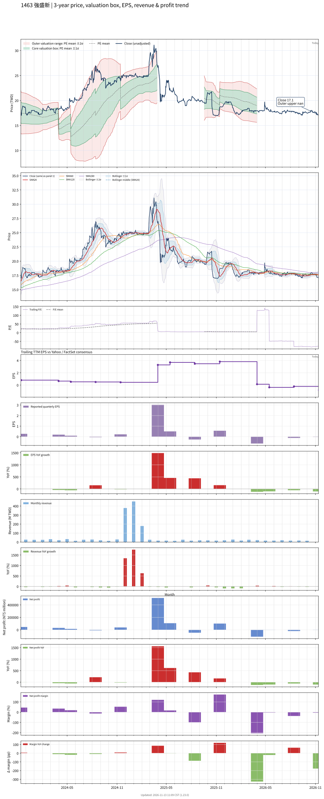

# 1463 - 強盛新

## 業務簡介
**板塊:** Consumer Cyclical
**產業:** Textile Manufacturing
**市值:** 2,943 百萬台幣
**企業價值:** 1,764 百萬台幣

強盛新 (Chyang Sheng Texing，原強盛染整) 為台灣專業委託加工染整業者。紡織部門提供天然纖維與人造纖維之專業染整加工服務，具備先進染整設備，能處理高附加價值之機能性布料；營建部門透過轉投資子公司「[[保強建設]]」跨足不動產開發，近年營建收入成為公司獲利重要支柱 (如台北市都更案)。公司於2024年更名，反映其多元化經營策略。

## 供應鏈位置
**紡織事業:**
- 位於中游染整環節
- 接受織布廠或貿易商委託進行布料染整

**營建事業 (子公司[[保強建設]]):**
- 住宅大樓開發與銷售 (台北市都更案)

## 主要客戶及供應商
### 主要客戶
- **紡織:** 國內外織布廠如 、、布料貿易商
- **營建:** 購屋大眾

### 主要供應商
- **紡織:** 染料化學助劑廠如[[永光化學]]、[[大連化工]]
- **營建:** 營造廠、 等建材供應商

## 財務概況 (單位: 百萬台幣, 只有 Margin 為 %)
### 估值指標 (股價 $17.15 as of 2026-11-12 | TTM 截至 2026-06-30 | Forward 預估至 2026-12-31)
| P/E (TTM) | Forward P/E | P/S (TTM) |  P/B | EV/EBITDA |
|-----------|-------------|-----------|------|-----------|
|       N/A |         N/A |     12.97 | 1.13 |    -12.63 |

### 年度關鍵財務數據 (近 3 年)
|                         |   2025-12-31 |   2024-12-31 |   2023-12-31 |
|:------------------------|-------------:|-------------:|-------------:|
| Revenue                 |       796.49 |       643.16 |       347.51 |
| Gross Profit            |        87.35 |       110.82 |        15.76 |
| Gross Margin (%)        |        10.97 |        17.23 |         4.53 |
| Selling & Marketing Exp |         6.84 |         9.57 |        10.41 |
| R&D Exp                 |         5.40 |         9.42 |         9.08 |
| General & Admin Exp     |        79.49 |        77.77 |        51.99 |
| Operating Income        |        -4.39 |        14.06 |       -55.73 |
| Operating Margin (%)    |        -0.55 |         2.19 |       -16.04 |
| Net Income              |        22.88 |       539.14 |       107.28 |
| Net Margin (%)          |         2.87 |        83.83 |        30.87 |
| Op Cash Flow            |       180.60 |        44.93 |        55.29 |
| Investing Cash Flow     |        15.45 |       620.97 |       -18.01 |
| Financing Cash Flow     |      -162.28 |       -90.12 |       -67.55 |
| CAPEX                   |        -8.41 |       -30.90 |       -25.94 |

### 季度關鍵財務數據 (近 4 季)
|                         |   2026-09-30 |   2026-06-30 |   2026-03-31 |   2025-12-31 |
|:------------------------|-------------:|-------------:|-------------:|-------------:|
| Revenue                 |        52.29 |        52.36 |        62.81 |        53.47 |
| Gross Profit            |         3.72 |        -0.86 |        10.72 |       -79.32 |
| Gross Margin (%)        |         7.12 |        -1.65 |        17.06 |      -148.35 |
| Selling & Marketing Exp |         0.63 |         0.79 |         0.86 |         0.86 |
| R&D Exp                 |         0.37 |         0.44 |         0.67 |         1.14 |
| General & Admin Exp     |        16.58 |        18.01 |        14.85 |        32.28 |
| Operating Income        |       -13.86 |       -20.10 |        -5.67 |      -113.59 |
| Operating Margin (%)    |       -26.50 |       -38.39 |        -9.03 |      -212.45 |
| Net Income              |        -5.96 |       -20.23 |        -1.59 |      -109.47 |
| Net Margin (%)          |       -11.40 |       -38.62 |        -2.52 |      -204.74 |
| Op Cash Flow            |       -10.18 |         1.03 |       -16.25 |       413.02 |
| Investing Cash Flow     |       145.26 |        -8.50 |        20.48 |        -9.45 |
| Financing Cash Flow     |      -129.08 |        -0.84 |        -0.84 |      -376.09 |
| CAPEX                   |        -1.32 |        -0.89 |        -3.81 |        -4.77 |
## Chart

