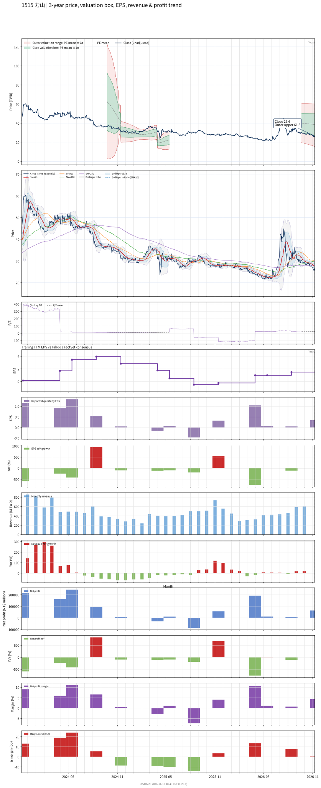

# 1515 - 力山

## 業務簡介
**板塊:** Consumer Cyclical
**產業:** Leisure
**市值:** 4,918 百萬台幣
**企業價值:** 4,623 百萬台幣

力山工業股份有限公司 (1515，Rexon Industrial) 成立於 1972 年，主要業務分為三大類：健身器材、電動工具及園藝工具。力山初期以電動工具起家，後轉型為國際健身器材大廠之主要[[ODM]]代工夥伴。健身器材為最大營收來源，主要客戶包括[[Peloton]] (跑步機/飛輪車)、[[Life Fitness]]、[[Precor]]、[[Technogym]]等全球知名品牌。電動工具代工客戶涵蓋[[Bosch]]、[[Makita]]等國際大廠。園藝工具則服務[[EGO]]、[[Toro]]等品牌。

## 供應鏈位置
**上游 (原物料與零組件):**
- **金屬材料:** 鋼材、鋁材
- **關鍵零件:** 馬達、控制器、皮帶、塑膠件
- **電子元件:** 面板模組、電子控制元件

**中游 ([[ODM]]/[[OEM]]製造):**
- **力山** — 健身器材、電動工具及園藝工具設計、模具開發、加工、組裝與測試

**下游 (國際品牌商):**
- **健身器材:** [[Peloton]]、[[Life Fitness]]、[[Precor]]、[[Technogym]]
- **電動工具:** [[Bosch]]、[[Makita]]
- **園藝工具:** [[EGO]]、[[Toro]]

## 主要客戶及供應商
### 主要客戶
- **健身器材:** [[Peloton]] (最大客戶，跑步機/飛輪車)、[[Life Fitness]]、[[Precor]]、[[Technogym]]
- **電動工具:** [[Bosch]]、[[Makita]]
- **園藝工具:** [[EGO]]、[[Toro]]

### 主要供應商
- **馬達:** 國內外馬達供應商
- **金屬原料:** 鋼材與鋁材供應商
- **電子元件:** 控制器與面板模組供應商

## 財務概況 (單位: 百萬台幣, 只有 Margin 為 %)
### 估值指標 (股價 $27.10 as of 2026-11-12 | TTM 截至 2026-06-30 | Forward 預估至 2026-12-31)
| P/E (TTM) | Forward P/E | P/S (TTM) |  P/B | EV/EBITDA |
|-----------|-------------|-----------|------|-----------|
|     17.83 |        8.74 |      0.90 | 1.24 |     22.11 |

### 年度關鍵財務數據 (近 3 年)
|                         |   2025-12-31 |   2024-12-31 |   2023-12-31 |
|:------------------------|-------------:|-------------:|-------------:|
| Revenue                 |      5419.29 |      6099.29 |      6708.46 |
| Gross Profit            |       689.95 |       939.38 |      1116.22 |
| Gross Margin (%)        |        12.73 |        15.40 |        16.64 |
| Selling & Marketing Exp |       252.86 |       303.17 |       262.26 |
| R&D Exp                 |       186.44 |       179.47 |       173.69 |
| General & Admin Exp     |       271.13 |       234.87 |       200.42 |
| Operating Income        |       -20.48 |       221.87 |       479.85 |
| Operating Margin (%)    |        -0.38 |         3.64 |         7.15 |
| Net Income              |       176.31 |       318.83 |       308.77 |
| Net Margin (%)          |         3.25 |         5.23 |         4.60 |
| Op Cash Flow            |       119.78 |      -212.02 |      2069.56 |
| Investing Cash Flow     |      -718.27 |       -66.25 |      -167.17 |
| Financing Cash Flow     |       239.22 |      -651.51 |      -588.93 |
| CAPEX                   |      -705.42 |       -68.06 |      -189.69 |

### 季度關鍵財務數據 (近 4 季)
|                         |   2026-09-30 |   2026-06-30 |   2026-03-31 |   2025-12-31 |
|:------------------------|-------------:|-------------:|-------------:|-------------:|
| Revenue                 |      1482.55 |      1172.19 |      1050.35 |      1801.13 |
| Gross Profit            |       186.08 |       152.78 |       154.82 |       238.17 |
| Gross Margin (%)        |        12.55 |        13.03 |        14.74 |        13.22 |
| Selling & Marketing Exp |        60.80 |        51.48 |        46.55 |        77.91 |
| R&D Exp                 |        48.92 |        55.65 |        48.32 |        63.79 |
| General & Admin Exp     |        87.10 |        69.08 |        64.44 |        81.88 |
| Operating Income        |       -10.74 |       -23.43 |        -4.49 |        14.60 |
| Operating Margin (%)    |        -0.72 |        -2.00 |        -0.43 |         0.81 |
| Net Income              |        63.87 |         8.63 |        12.90 |       191.68 |
| Net Margin (%)          |         4.31 |         0.74 |         1.23 |        10.64 |
| Op Cash Flow            |       -52.54 |      -316.20 |       138.90 |       334.24 |
| Investing Cash Flow     |       -95.47 |      -361.33 |      -155.63 |      -126.84 |
| Financing Cash Flow     |       180.10 |       440.64 |       -41.19 |       -36.88 |
| CAPEX                   |      -118.86 |      -165.07 |      -156.13 |      -190.50 |
## Chart

