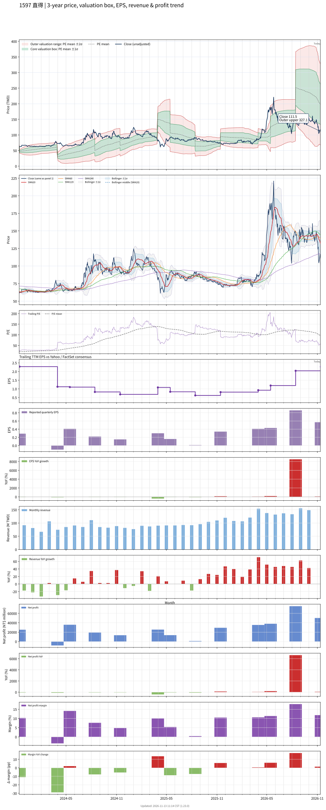

# 1597 - 直得

## 業務簡介
**板塊:** Industrials
**產業:** Electrical Equipment & Parts
**市值:** 10,210 百萬台幣
**企業價值:** 10,664 百萬台幣

直得科技 (1597，Chieftek Precision) 為全球微型[[線性滑軌]]領導廠商，自有品牌「cpc」。產品涵蓋微型至大型[[線性滑軌]]、[[滾珠螺桿]]、線性模組、[[線性馬達]]及驅動器。主要應用於[[半導體]]製程設備 (最大領域)、醫療精密儀器及自動化設備。半導體設備客戶涵蓋 、、[[KLA]]、[[Tokyo Electron]]。醫療客戶含[[Siemens Healthineers]]、[[GE Healthcare]]。上游特殊鋼材來自[[日本製鐵]]及歐洲鋼廠。

## 供應鏈位置
**上游 (原料):**
- **特殊鋼:** [[日本製鐵]]及歐洲特殊鋼廠 — 軸承鋼

**中游 (製造):**
- **直得** (cpc 品牌微型[[線性滑軌]]/[[滾珠螺桿]]/[[線性馬達]])

**下游 (終端):**
- **半導體設備:** 、、[[KLA]]、[[Tokyo Electron]] — 微型滑軌
- **醫療:** [[Siemens Healthineers]]、[[GE Healthcare]] — 精密儀器
- **自動化:** 工具機/電子組裝設備

## 主要客戶及供應商
### 主要客戶
- **半導體設備:** 、、[[KLA]]、[[Tokyo Electron]]
- **醫療:** [[Siemens Healthineers]]、[[GE Healthcare]]
- **自動化:** 工具機/組裝設備

### 主要供應商
- **特殊鋼:** [[日本製鐵]]及歐洲鋼廠

## 財務概況 (單位: 百萬台幣, 只有 Margin 為 %)
### 估值指標 (股價 $117.00 as of 2026-11-12 | TTM 截至 2026-09-30 | Forward 預估至 2026-12-31)
| P/E (TTM) | Forward P/E | P/S (TTM) |  P/B | EV/EBITDA |
|-----------|-------------|-----------|------|-----------|
|     49.79 |       46.99 |      6.73 | 4.08 |     33.73 |

### 年度關鍵財務數據 (近 3 年)
|                         |   2025-12-31 |   2024-12-31 |   2023-12-31 |
|:------------------------|-------------:|-------------:|-------------:|
| Revenue                 |      1138.32 |      1036.58 |      1074.75 |
| Gross Profit            |       466.55 |       424.16 |       468.65 |
| Gross Margin (%)        |        40.99 |        40.92 |        43.61 |
| Selling & Marketing Exp |       117.74 |       105.06 |       121.82 |
| R&D Exp                 |        84.84 |        75.83 |        72.49 |
| General & Admin Exp     |       156.68 |       147.94 |       152.67 |
| Operating Income        |       107.29 |        95.33 |       121.66 |
| Operating Margin (%)    |         9.43 |         9.20 |        11.32 |
| Net Income              |        79.42 |        93.81 |        98.04 |
| Net Margin (%)          |         6.98 |         9.05 |         9.12 |
| Op Cash Flow            |       123.75 |       205.80 |       -21.06 |
| Investing Cash Flow     |      -125.72 |      -247.15 |      -174.32 |
| Financing Cash Flow     |      -163.59 |        52.71 |       105.92 |
| CAPEX                   |       -60.25 |      -109.14 |      -156.68 |

### 季度關鍵財務數據 (近 4 季)
|                         |   2026-09-30 |   2026-06-30 |   2026-03-31 |   2025-12-31 |
|:------------------------|-------------:|-------------:|-------------:|-------------:|
| Revenue                 |       424.94 |       423.26 |       334.40 |       333.59 |
| Gross Profit            |       170.44 |       178.64 |       139.66 |       129.54 |
| Gross Margin (%)        |        40.11 |        42.21 |        41.76 |        38.83 |
| Selling & Marketing Exp |        31.49 |        32.48 |        27.18 |        35.28 |
| R&D Exp                 |        23.82 |        25.94 |        21.51 |        20.42 |
| General & Admin Exp     |        44.82 |        49.48 |        41.73 |        42.13 |
| Operating Income        |        70.31 |        70.75 |        49.24 |        31.72 |
| Operating Margin (%)    |        16.55 |        16.71 |        14.72 |         9.51 |
| Net Income              |        50.16 |        75.35 |        37.91 |        35.36 |
| Net Margin (%)          |        11.80 |        17.80 |        11.34 |        10.60 |
| Op Cash Flow            |        91.98 |       151.51 |        49.16 |        21.67 |
| Investing Cash Flow     |       -55.62 |        94.16 |       -14.72 |       -65.13 |
| Financing Cash Flow     |      -131.14 |        45.78 |       -90.49 |      -154.74 |
| CAPEX                   |       -56.35 |       -15.79 |        -8.78 |       -28.46 |
## Chart

