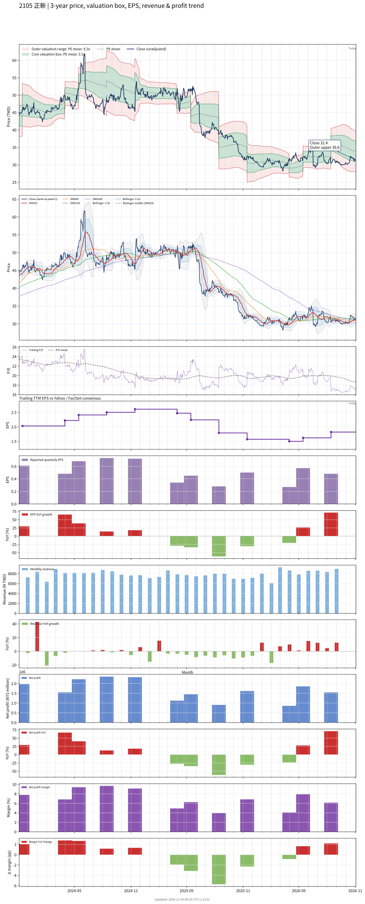

# 2105 - 正新

## 業務簡介
**板塊:** Consumer Cyclical
**產業:** Auto Parts
**市值:** 94,973 百萬台幣
**企業價值:** 86,469 百萬台幣

正新橡膠 (2105，Cheng Shin Rubber) 為台灣最大輪胎集團，全球前十大輪胎廠。旗艦品牌[[Maxxis]] (瑪吉斯) 為全球知名運動輪胎品牌，另有 CHENG SHIN、CST 及 PRESA 等品牌。OEM 客戶涵蓋[[BMW]] (1/2/5/7 系列、MINI、X1/X3/X4 原廠配胎)、[[Ford]]、[[Toyota]]、、[[Honda]]、[[Volkswagen]]及[[GM]]。全球 11 座工廠分布於台灣、中國 (昆山/廈門/重慶)、泰國、越南、印尼及印度。賽事方面，[[Maxxis]] RAZR RAID+ 參與[[達卡拉力賽]] (Dakar Rally)。上游原料採購自  (合成橡膠) 及[[中橡]] (碳煙)。

## 供應鏈位置
**上游 (原料):**
- **合成橡膠:**  (TSRC) — SBR/SSBR
- **碳煙:** [[中橡]] ( Carbon) — 碳黑
- **天然橡膠/簾布/鋼絲:** 國際原料供應商

**中游 (製造):**
- **正新** ([[Maxxis]] 品牌輪胎製造，全球 11 座工廠)

**下游 (終端):**
- **OEM 客戶:** [[BMW]]、[[Ford]]、[[Toyota]]、、[[Honda]]、[[Volkswagen]]、[[GM]] — 原廠配胎
- **全球 AM:** [[Maxxis]]/CST 品牌全球經銷
- **賽事:** [[達卡拉力賽]] — Maxxis RAZR RAID+

## 主要客戶及供應商
### 主要客戶
- **OEM:** [[BMW]] — 1/2/5/7/MINI/X 系列原廠配胎；[[Ford]]；[[Toyota]]；；[[Honda]]；[[Volkswagen]]；[[GM]]
- **全球 AM:** [[Maxxis]]/CST/PRESA 品牌全球經銷
- **賽事:** [[達卡拉力賽]] — Maxxis 官方輪胎

### 主要供應商
- **合成橡膠:**  — SBR/SSBR
- **碳煙:** [[中橡]] — 碳黑

## 財務概況 (單位: 百萬台幣, 只有 Margin 為 %)
### 估值指標 (股價 $29.30 as of 2026-11-12 | TTM 截至 2026-06-30 | Forward 預估至 2026-12-31)
| P/E (TTM) | Forward P/E | P/S (TTM) |  P/B | EV/EBITDA |
|-----------|-------------|-----------|------|-----------|
|     17.54 |       20.14 |      1.02 | 1.09 |      5.24 |

### 年度關鍵財務數據 (近 3 年)
|                         |   2025-12-31 |   2024-12-31 |   2023-12-31 |
|:------------------------|-------------:|-------------:|-------------:|
| Revenue                 |     90780.87 |     96247.06 |     96201.31 |
| Gross Profit            |     20632.04 |     23243.92 |     23388.69 |
| Gross Margin (%)        |        22.73 |        24.15 |        24.31 |
| Selling & Marketing Exp |      6321.67 |      5936.69 |      5735.57 |
| R&D Exp                 |      3705.26 |      3705.00 |      3783.39 |
| General & Admin Exp     |      3444.84 |      3602.31 |      3478.09 |
| Operating Income        |      7160.28 |      9999.92 |     10391.63 |
| Operating Margin (%)    |         7.89 |        10.39 |        10.80 |
| Net Income              |      4854.33 |      8017.12 |      7182.38 |
| Net Margin (%)          |         5.35 |         8.33 |         7.47 |
| Op Cash Flow            |     13554.22 |     17694.56 |     21210.30 |
| Investing Cash Flow     |    -10783.47 |     -9291.24 |    -10519.30 |
| Financing Cash Flow     |     -6917.42 |     -6243.03 |    -10330.67 |
| CAPEX                   |     -2999.63 |     -2736.34 |     -3215.43 |

### 季度關鍵財務數據 (近 4 季)
|                         |   2026-09-30 |   2026-06-30 |   2026-03-31 |   2025-12-31 |
|:------------------------|-------------:|-------------:|-------------:|-------------:|
| Revenue                 |     25895.83 |     25190.42 |     23428.39 |     20955.15 |
| Gross Profit            |      5354.79 |      6254.95 |      5819.82 |      4786.97 |
| Gross Margin (%)        |        20.68 |        24.83 |        24.84 |        22.84 |
| Selling & Marketing Exp |      1914.68 |      1829.33 |      1696.20 |      1615.21 |
| R&D Exp                 |       967.59 |       950.43 |       870.20 |       922.96 |
| General & Admin Exp     |       928.62 |       885.13 |       925.14 |       828.12 |
| Operating Income        |      1543.89 |      2590.07 |      2328.29 |      1420.69 |
| Operating Margin (%)    |         5.96 |        10.28 |         9.94 |         6.78 |
| Net Income              |      1143.88 |      1553.40 |      1861.69 |       860.92 |
| Net Margin (%)          |         4.42 |         6.17 |         7.95 |         4.11 |
| Op Cash Flow            |      1851.52 |      4503.40 |      3847.16 |      3639.84 |
| Investing Cash Flow     |     -1288.12 |      -442.32 |      1475.34 |     -7728.57 |
| Financing Cash Flow     |     -4066.43 |     -2636.00 |      -318.15 |      -732.13 |
| CAPEX                   |      -686.06 |      -578.98 |      -910.15 |      -808.67 |
## Chart

