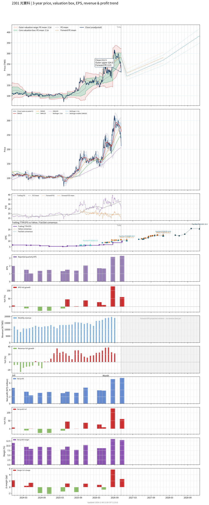

# 2301 - 光寶科

## 業務簡介
**板塊:** Technology
**產業:** Computer Hardware
**市值:** 517,356 百萬台幣
**企業價值:** 482,859 百萬台幣

光寶科技 (2301，Lite-On Technology) 成立於 1975 年，總部位於台北，為全球領先之光電半導體暨電源管理解決方案提供商。公司深耕三大核心事業：雲端與物聯網、光電半導體、汽車電子暨智慧照明。

在雲端領域，光寶科為全球主要  電源供應商，已導入支援  GB200/GB300 世代之兆瓦級 800V 直流電源櫃 (Power Rack)、備援電池系統 ([[BBU]]) 及電容機架，預計 2026 年 AI 伺服器營收占比突破 25%。在低軌衛星領域，公司為全球最大  電源供應商，市佔率逾六成。光寶科同時是全球唯一橫跨三大遊戲機品牌 ([[Nintendo]]、、) 之電源供應商。汽車電子方面，積極開發 [[ADAS]] 解決方案及交直流充電模組。全球產能布局涵蓋台灣、越南、泰國及北美。

## 供應鏈位置
**上游 (半導體元件與關鍵材料):**
- **功率元件:** [[MOSFET]]、[[IGBT]]、 (SiC) 功率元件
- **光電晶片:** LED/紅外線磊晶片及封裝材料
- **被動元件:** [[MLCC]]、電感、變壓器磁性元件

**中游 (電源管理與光電模組):**
- **雲端電源:** **光寶科** (AI 伺服器兆瓦級電源櫃、BBU、電容機架)
- **光電半導體:** **光寶科** (車用 LED、紅外線感測、光耦合器)
- **汽車電子:** **光寶科** ([[ADAS]] 模組、AC/DC 充電模組)

**下游 (雲端服務商與品牌廠):**
- **CSP 雲端:** 、、、 — AI 資料中心電源
- **遊戲機:** [[Nintendo]]、、 — 電源供應器
- **低軌衛星:** [[SpaceX]] ([[Starlink]]) — 衛星電源模組
- **汽車品牌:** 全球車廠 — ADAS 及 EV 充電模組

## 主要客戶及供應商
### 主要客戶
- **CSP 雲端:** 、、、 — AI 伺服器電源櫃及 BBU
- **遊戲機品牌:** [[Nintendo]]、、 — 全球唯一橫跨三大品牌之電源供應商
- **低軌衛星:** [[SpaceX]] ([[Starlink]]) — 全球最大低軌衛星電源供應商 (市佔逾六成)
- **伺服器 OEM:** 、、[[Supermicro]] — 伺服器電源模組

### 主要供應商
- **功率元件:** [[Infineon]]、[[ON Semiconductor]] (onsemi) — SiC/[[MOSFET]] 功率元件
- **被動元件:** [[MLCC]]、電感及磁性元件供應商
- **PCB:** 高頻多層 PCB 及銅箔基板廠

## 財務概況 (單位: 百萬台幣, 只有 Margin 為 %)
### 估值指標 (股價 $228.00 as of 2026-11-12 | TTM 截至 2026-09-30 | Forward 預估至 2026-12-31)
| P/E (TTM) | Forward P/E | P/S (TTM) |  P/B | EV/EBITDA |
|-----------|-------------|-----------|------|-----------|
|     23.46 |       14.84 |      2.61 | 5.22 |     16.47 |

### 年度關鍵財務數據 (近 3 年)
|                         |   2025-12-31 |   2024-12-31 |   2023-12-31 |
|:------------------------|-------------:|-------------:|-------------:|
| Revenue                 |    166084.86 |    137133.89 |    148333.45 |
| Gross Profit            |     38039.26 |     29629.73 |     32668.08 |
| Gross Margin (%)        |        22.90 |        21.61 |        22.02 |
| Selling & Marketing Exp |      7628.85 |      5184.03 |      5760.54 |
| R&D Exp                 |      8721.05 |      7476.43 |      8125.55 |
| General & Admin Exp     |      4965.17 |      3990.42 |      4508.60 |
| Operating Income        |     16724.19 |     12978.85 |     14273.40 |
| Operating Margin (%)    |        10.07 |         9.46 |         9.62 |
| Net Income              |     15115.93 |     11941.95 |     14570.62 |
| Net Margin (%)          |         9.10 |         8.71 |         9.82 |
| Op Cash Flow            |     14532.85 |     12411.12 |     27265.56 |
| Investing Cash Flow     |     -7394.76 |     -4843.20 |     -3339.90 |
| Financing Cash Flow     |    -23098.92 |     -3362.83 |    -22045.22 |
| CAPEX                   |     -6947.81 |     -3978.67 |     -3808.59 |

### 季度關鍵財務數據 (近 4 季)
|                         |   2026-09-30 |   2026-06-30 |   2026-03-31 |   2025-12-31 |
|:------------------------|-------------:|-------------:|-------------:|-------------:|
| Revenue                 |     57403.02 |     52703.45 |     43407.29 |     44356.42 |
| Gross Profit            |     14866.70 |     14348.46 |      9402.93 |      9632.83 |
| Gross Margin (%)        |        25.90 |        27.22 |        21.66 |        21.72 |
| Selling & Marketing Exp |      1560.03 |      1622.59 |      1500.19 |      1511.52 |
| R&D Exp                 |      2949.95 |      2787.01 |      2341.06 |      2344.53 |
| General & Admin Exp     |      1692.12 |      1782.78 |      1456.88 |      1127.04 |
| Operating Income        |      8664.59 |      8156.08 |      4104.81 |      4649.75 |
| Operating Margin (%)    |        15.09 |        15.48 |         9.46 |        10.48 |
| Net Income              |      7429.35 |      7115.83 |      3775.41 |      3859.89 |
| Net Margin (%)          |        12.94 |        13.50 |         8.70 |         8.70 |
| Op Cash Flow            |      5433.88 |     -2998.05 |     -1240.04 |      6106.82 |
| Investing Cash Flow     |    -12626.40 |     -4160.91 |     -3772.09 |     -2126.60 |
| Financing Cash Flow     |      6608.11 |     10686.69 |     -6762.82 |    -12209.29 |
| CAPEX                   |     -6194.00 |     -4278.81 |     -2687.22 |     -2000.66 |
## Chart

