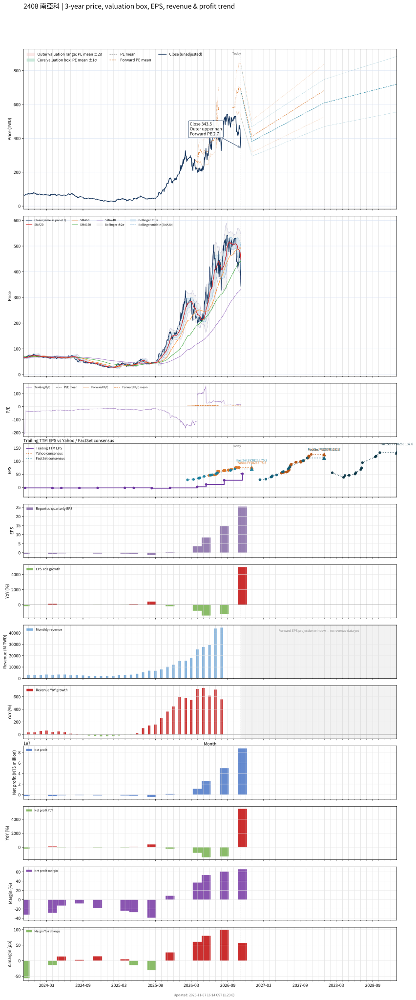

# 2408 - 南亞科

## 業務簡介
**板塊:** Technology
**產業:** Semiconductors
**市值:** 1,359,381 百萬台幣
**企業價值:** 1,092,166 百萬台幣

南亞科技 (Nanya Technology) 成立於 1995 年，隸屬於** 集團**，總部位於台灣[[新北]]。公司是台灣最大的 **DRAM (動態隨機存取記憶體)** 製造商，也是全球第四大  廠。南亞科專注於利基型  (Consumer ) 及標準型  (Standard ) 的研發、設計與製造。公司已自主開發 10 奈米級製程技術 (1A, 1B, 1C)，不再依賴國外技術授權，具備獨立研發能力。

## 供應鏈位置
**上游 (設備/原料):**
- **設備:** , , [[Lam Research]].
- **:** 台勝科 ( 集團關係企業).

**下游應用:**
- **主要平台:** DRAM Chips (約100%).
- **消費電子 (Consumer):** 電視、機上盒、智慧音箱 - 南亞科的傳統強項。
- **網通/工控:** Wi-Fi 路由器、。
- **車用:** 車載資訊娛樂系統。
- **PC/Server:** DDR4/DDR5 模組 (佔比較低，主要由三大原廠主導)。

## 主要客戶及供應商
### 主要客戶
- **消費/網通:** 國際知名品牌及模組廠 (如 Kingston, Adata)。
- **PC:** ,  等 (透過模組廠或直接供貨)。

### 主要供應商
- **:** 台勝科 (主要供應商)。

## 核心競爭力
- 南亞科技 (Nanya Technology) 成立於 1995 年，隸屬於** 集團**，總部位於台灣[[新北]]。公司是台灣最大的 **DRAM (動態隨機存取記憶體)** 製造商，也是全球第四大  廠。南亞科專注於利基型  (Consumer ) 及標準型  (Standard ) 的研發、設計與製造。公司已自主開發 10 奈米級製程技術 (1A, 1B, 1C)，不再依賴國外技術授權，具備獨立研發能力。

## 財務概況 (單位: 百萬台幣, 只有 Margin 為 %)
### 估值指標 (股價 $394.00 as of 2026-11-12 | TTM 截至 2026-09-30 | Forward 預估至 2026-12-31)
| P/E (TTM) | Forward P/E | P/S (TTM) |  P/B | EV/EBITDA |
|-----------|-------------|-----------|------|-----------|
|     14.44 |        3.13 |      4.60 | 3.31 |      4.94 |

### 年度關鍵財務數據 (近 3 年)
|                         |   2025-12-31 |   2024-12-31 |   2023-12-31 |
|:------------------------|-------------:|-------------:|-------------:|
| Revenue                 |     66586.52 |     34131.67 |     29892.31 |
| Gross Profit            |     14986.20 |      -420.58 |     -4482.84 |
| Gross Margin (%)        |        22.51 |        -1.23 |       -15.00 |
| Selling & Marketing Exp |       832.07 |       664.75 |       589.34 |
| R&D Exp                 |      7040.82 |      7685.03 |      7576.01 |
| General & Admin Exp     |      1868.28 |      1784.26 |      1812.00 |
| Operating Income        |      5245.03 |    -10554.63 |    -14460.19 |
| Operating Margin (%)    |         7.88 |       -30.92 |       -48.37 |
| Net Income              |      6613.77 |     -5083.35 |     -7439.63 |
| Net Margin (%)          |         9.93 |       -14.89 |       -24.89 |
| Op Cash Flow            |     18568.39 |      1951.88 |     -6095.02 |
| Investing Cash Flow     |    -14109.53 |    -16187.85 |    -12785.53 |
| Financing Cash Flow     |     -6317.20 |     13707.33 |      4195.55 |
| CAPEX                   |    -13683.61 |    -16307.82 |    -13555.41 |

### 季度關鍵財務數據 (近 4 季)
|                         |   2026-09-30 |   2026-06-30 |   2026-03-31 |   2025-12-31 |
|:------------------------|-------------:|-------------:|-------------:|-------------:|
| Revenue                 |    133648.97 |     82549.07 |     49086.93 |     30093.62 |
| Gross Profit            |    114493.43 |     65617.46 |     33325.48 |     14760.84 |
| Gross Margin (%)        |        85.67 |        79.49 |        67.89 |        49.05 |
| Selling & Marketing Exp |       789.65 |       503.36 |       347.32 |       291.16 |
| R&D Exp                 |      5145.21 |      3229.78 |      2109.03 |      2127.05 |
| General & Admin Exp     |      1653.24 |      1059.79 |       748.50 |       560.41 |
| Operating Income        |    106905.33 |     60824.53 |     30120.64 |     11782.23 |
| Operating Margin (%)    |        79.99 |        73.68 |        61.36 |        39.15 |
| Net Income              |     87627.17 |     50192.04 |     26059.49 |     11093.19 |
| Net Margin (%)          |        65.57 |        60.80 |        53.09 |        36.86 |
| Op Cash Flow            |     97425.25 |     55858.89 |     31548.82 |     15504.73 |
| Investing Cash Flow     |    -20057.66 |     -4242.48 |     -2814.11 |     -2292.74 |
| Financing Cash Flow     |     -4919.91 |     79414.83 |     -1546.56 |     -8989.32 |
| CAPEX                   |    -20783.02 |     -4047.73 |     -2810.10 |     -2292.52 |
## Chart

