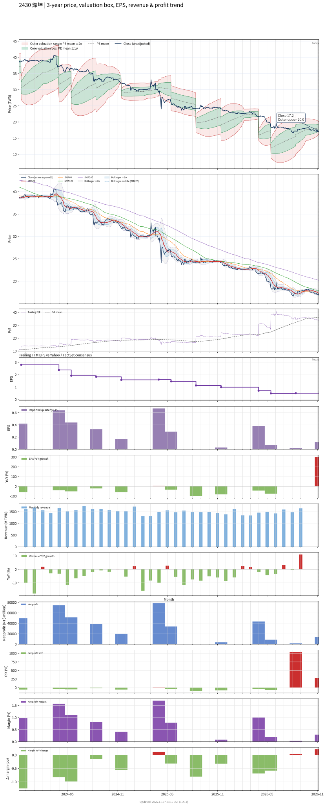

# 2430 - 燦坤

## 業務簡介
**板塊:** Consumer Cyclical
**產業:** Specialty Retail
**市值:** 1,986 百萬台幣
**企業價值:** 5,645 百萬台幣

燦坤實業股份有限公司成立於 1978 年，總部位於台灣台北。公司為台灣主要 3C 家電零售連鎖通路，經營「燦坤 3C」門市品牌，全台門市約 200 家，並營運電商平台「燦坤快3」。主要銷售產品涵蓋手機、電腦、家電、影音及周邊配件等 3C 商品，同時提供維修售後服務。燦坤曾為台灣最大 3C 零售通路，近年面臨電商競爭及門市轉型挑戰。

## 供應鏈位置
**上游 (品牌供應):**
- **消費電子:** 、、、[[LG]]、[[Panasonic]]、[[Dyson]] 等國際品牌及其台灣代理商
- **電腦資訊:** 、、、 等電腦品牌

**中游 (零售通路):**
- **燦坤 (2430):** 實體門市約 200 家、電商平台「燦坤快3」、維修售後服務

**下游 (終端消費):**
- **個人消費者:** 台灣一般消費者（3C、家電、手機）
- **中小企業:** IT 設備採購

## 主要客戶及供應商
### 主要客戶
- **個人消費者:** 台灣一般消費者，為 B2C 零售模式
- **中小型商用:** IT 設備及辦公家電採購

### 主要供應商
- **國際品牌:** 、、、[[Dyson]]、[[LG]]、[[Panasonic]]
- **電腦品牌:** 、
**各品牌台灣代理商**

## 財務概況 (單位: 百萬台幣, 只有 Margin 為 %)
### 估值指標 (股價 $17.00 as of 2026-11-12 | TTM 截至 2026-06-30 | Forward 預估至 2026-12-31)
| P/E (TTM) | Forward P/E | P/S (TTM) |  P/B | EV/EBITDA |
|-----------|-------------|-----------|------|-----------|
|     34.69 |         N/A |      0.11 | 0.45 |     22.79 |

### 年度關鍵財務數據 (近 3 年)
|                         |   2025-12-31 |   2024-12-31 |   2023-12-31 |
|:------------------------|-------------:|-------------:|-------------:|
| Revenue                 |     17676.94 |     18985.72 |     19984.88 |
| Gross Profit            |      2660.05 |      2859.60 |      2980.48 |
| Gross Margin (%)        |        15.05 |        15.06 |        14.91 |
| Selling & Marketing Exp |      2149.04 |      2197.13 |      2238.71 |
| R&D Exp                 |       -    |       -    |       -    |
| General & Admin Exp     |       370.20 |       378.45 |       387.60 |
| Operating Income        |       140.81 |       284.02 |       354.18 |
| Operating Margin (%)    |         0.80 |         1.50 |         1.77 |
| Net Income              |        81.18 |       188.44 |       278.74 |
| Net Margin (%)          |         0.46 |         0.99 |         1.39 |
| Op Cash Flow            |       866.62 |      1440.33 |      1056.41 |
| Investing Cash Flow     |       -65.21 |      -107.06 |       -56.92 |
| Financing Cash Flow     |     -1192.76 |     -1265.31 |     -1467.34 |
| CAPEX                   |       -92.03 |       -79.30 |      -103.45 |

### 季度關鍵財務數據 (近 4 季)
|                         |   2026-09-30 |   2026-06-30 |   2026-03-31 |   2025-12-31 |
|:------------------------|-------------:|-------------:|-------------:|-------------:|
| Revenue                 |      4715.52 |      4373.92 |      4297.21 |      4307.09 |
| Gross Profit            |       671.95 |       629.57 |       635.93 |       677.98 |
| Gross Margin (%)        |        14.25 |        14.39 |        14.80 |        15.74 |
| Selling & Marketing Exp |       551.84 |       527.86 |       518.34 |       537.98 |
| R&D Exp                 |       -    |       -    |       -    |       -    |
| General & Admin Exp     |        92.12 |        91.55 |        93.83 |        89.92 |
| Operating Income        |        27.98 |        10.17 |        23.76 |        50.08 |
| Operating Margin (%)    |         0.59 |         0.23 |         0.55 |         1.16 |
| Net Income              |        13.68 |         1.72 |         8.56 |        43.42 |
| Net Margin (%)          |         0.29 |         0.04 |         0.20 |         1.01 |
| Op Cash Flow            |       596.79 |       -21.45 |       853.34 |      -166.48 |
| Investing Cash Flow     |        -6.35 |        10.85 |       -56.83 |       -19.44 |
| Financing Cash Flow     |      -257.21 |      -342.87 |      -261.48 |      -249.72 |
| CAPEX                   |        -5.99 |        -4.65 |       -13.74 |       -22.63 |
## Chart

