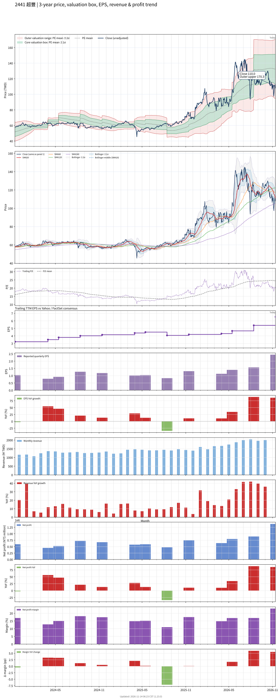

# 2441 - 超豐

## 業務簡介
**板塊:** Technology
**產業:** Semiconductor Equipment & Materials
**市值:** 60,787 百萬台幣
**企業價值:** 55,613 百萬台幣

超豐電子 (2441) 是台灣專業的半導體[[封裝測試]]服務廠商，為[[力成科技]]子公司 (持股約 43%)。公司主力業務為 IC 封裝 (占 2024 年營收 83%) 及測試 (17%)，技術涵蓋 DIP、SOP、QFP、LQFP、TSSOP 等傳統封裝型態。客戶以台灣 IC 設計公司為主 (約 62%)，前十大客戶占營收 40-45%。終端應用以消費性電子 (57%)、電腦 (25%) 及通訊 (9%) 為主。

## 供應鏈位置
**上游 (封裝材料):**
- **[[導線架]]:** 台灣 (30%)、中國、新加坡、日本、韓國、菲律賓
- **金線/鋁線:** 鍵合線材供應

**中游 (封裝測試):**
- **IC 封測:** **超豐** (傳統封裝及測試服務，苗栗竹南/頭份廠)
- **母公司:** [[力成科技]] (持股 43%)

**下游 (IC 設計客戶):**
- **MCU/控制 IC:** 、、
- **車用 LED:**  LED 車燈及電源 IC 客戶
- **消費電子:** 消費性 IC 設計公司

## 主要客戶及供應商
### 主要客戶
- **MCU/控制 IC:** 、、
- **車用電子:**  LED 車燈及電源 IC 客戶
- **消費電子:** 台灣 IC 設計公司 (前十大占營收 40-45%)

### 主要供應商
- **[[導線架]]:** 台灣、中國、日韓供應商
- **鍵合線材:** 金線/鋁線供應
- **母公司:** [[力成科技]] (集團資源支持)

## 財務概況 (單位: 百萬台幣, 只有 Margin 為 %)
### 估值指標 (股價 $108.00 as of 2026-11-12 | TTM 截至 2026-09-30 | Forward 預估至 2026-12-31)
| P/E (TTM) | Forward P/E | P/S (TTM) |  P/B | EV/EBITDA |
|-----------|-------------|-----------|------|-----------|
|     16.67 |       18.69 |      2.99 | 2.26 |      7.69 |

### 年度關鍵財務數據 (近 3 年)
|                         |   2025-12-31 |   2024-12-31 |   2023-12-31 |
|:------------------------|-------------:|-------------:|-------------:|
| Revenue                 |     16764.21 |     15213.24 |     13570.08 |
| Gross Profit            |      3385.65 |      3357.43 |      2829.97 |
| Gross Margin (%)        |        20.20 |        22.07 |        20.85 |
| Selling & Marketing Exp |        66.14 |        64.72 |        53.07 |
| R&D Exp                 |       320.69 |       289.19 |       247.56 |
| General & Admin Exp     |       287.24 |       273.07 |       245.52 |
| Operating Income        |      2711.57 |      2730.45 |      2283.82 |
| Operating Margin (%)    |        16.17 |        17.95 |        16.83 |
| Net Income              |      2449.02 |      2496.27 |      1997.12 |
| Net Margin (%)          |        14.61 |        16.41 |        14.72 |
| Op Cash Flow            |      4888.39 |      5729.11 |      4521.00 |
| Investing Cash Flow     |     -3850.70 |     -2440.89 |     -1462.09 |
| Financing Cash Flow     |     -1718.61 |     -1445.10 |     -2179.82 |
| CAPEX                   |     -2846.24 |     -2127.00 |     -1595.14 |

### 季度關鍵財務數據 (近 4 季)
|                         |   2026-09-30 |   2026-06-30 |   2026-03-31 |   2025-12-31 |
|:------------------------|-------------:|-------------:|-------------:|-------------:|
| Revenue                 |      5998.02 |      5283.60 |      4722.34 |      4295.96 |
| Gross Profit            |      1804.58 |      1281.02 |      1115.83 |       855.43 |
| Gross Margin (%)        |        30.09 |        24.25 |        23.63 |        19.91 |
| Selling & Marketing Exp |        21.12 |        17.89 |        16.71 |        20.58 |
| R&D Exp                 |       101.37 |        96.77 |        87.62 |        87.26 |
| General & Admin Exp     |        97.24 |        83.12 |        87.89 |        72.35 |
| Operating Income        |      1584.85 |      1083.24 |       923.62 |       675.25 |
| Operating Margin (%)    |        26.42 |        20.50 |        19.56 |        15.72 |
| Net Income              |      1381.58 |       894.59 |       797.95 |       637.32 |
| Net Margin (%)          |        23.03 |        16.93 |        16.90 |        14.84 |
| Op Cash Flow            |      1818.15 |      1501.36 |      1291.72 |      1216.06 |
| Investing Cash Flow     |      -620.18 |      -771.23 |      -865.59 |      -840.29 |
| Financing Cash Flow     |     -2406.31 |        -3.16 |        -3.14 |        -3.00 |
| CAPEX                   |      -698.85 |      -761.24 |      -866.03 |      -841.05 |
## Chart

