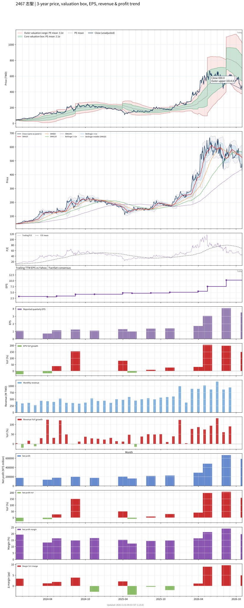

# 2467 - 志聖

## 業務簡介
**板塊:** Industrials
**產業:** Specialty Industrial Machinery
**市值:** 48,599 百萬台幣
**企業價值:** 49,470 百萬台幣

志聖工業 (2467) 為半導體及PCB產業烘烤/固化設備專業廠，以UV固化爐及熱風循環烘箱為核心。主要客戶涵蓋 、、[[矽品]]、、[[南亞電路板]]、、。產品應用於晶圓製程光阻烘烤、封裝後固化及PCB防焊/綠漆烘乾。

## 供應鏈位置
**上游:** 加熱元件、溫控儀表、風機、PLC
**中游:** **志聖** (UV固化爐/熱風烘箱)
**下游:**
- **半導體:** 、、[[矽品]] — 光阻烘烤/封裝固化
- **PCB/載板:** 、[[南亞電路板]] — 防焊烘乾
- **面板:** 、

## 主要客戶及供應商
### 主要客戶
- **半導體:** 、、[[矽品]]
- **PCB:** 、[[南亞電路板]]
- **面板:** 、

### 主要供應商
- 加熱元件/溫控/PLC

## 財務概況 (單位: 百萬台幣, 只有 Margin 為 %)
### 估值指標 (股價 $307.00 as of 2026-11-13 | TTM 截至 2026-09-30 | Forward 預估至 2026-12-31)
| P/E (TTM) | Forward P/E | P/S (TTM) |  P/B | EV/EBITDA |
|-----------|-------------|-----------|------|-----------|
|     59.96 |       15.78 |      4.97 | 3.20 |     21.80 |

### 年度關鍵財務數據 (近 3 年)
|                         |   2024-12-31 |   2023-12-31 |   2022-12-31 |
|:------------------------|-------------:|-------------:|-------------:|
| Revenue                 |      4818.21 |      3625.80 |      5366.98 |
| Gross Profit            |      1983.10 |      1506.16 |      1908.01 |
| Gross Margin (%)        |        41.16 |        41.54 |        35.55 |
| Selling & Marketing Exp |       527.87 |       423.67 |       484.73 |
| R&D Exp                 |       362.18 |       337.89 |       323.51 |
| General & Admin Exp     |       454.01 |       338.12 |       356.43 |
| Operating Income        |       639.03 |       406.48 |       743.34 |
| Operating Margin (%)    |        13.26 |        11.21 |        13.85 |
| Net Income              |       719.16 |       486.32 |       718.97 |
| Net Margin (%)          |        14.93 |        13.41 |        13.40 |
| Op Cash Flow            |       873.95 |       988.09 |       611.97 |
| Investing Cash Flow     |      -313.37 |      -293.17 |      -143.77 |
| Financing Cash Flow     |      -135.81 |      -608.55 |      -175.21 |
| CAPEX                   |      -333.63 |       -29.37 |       -95.53 |

### 季度關鍵財務數據 (近 4 季)
|                         |   2026-09-30 |   2026-06-30 |   2026-03-31 |   2025-09-30 |
|:------------------------|-------------:|-------------:|-------------:|-------------:|
| Revenue                 |      2978.46 |      2782.56 |      2261.51 |      1536.11 |
| Gross Profit            |      1291.11 |      1356.99 |      1118.84 |       679.46 |
| Gross Margin (%)        |        43.35 |        48.77 |        49.47 |        44.23 |
| Selling & Marketing Exp |       212.96 |       222.62 |       189.42 |       176.78 |
| R&D Exp                 |       269.06 |       182.65 |       164.85 |       163.96 |
| General & Admin Exp     |       219.63 |       204.68 |       210.98 |       168.39 |
| Operating Income        |       589.46 |       747.04 |       553.59 |       170.33 |
| Operating Margin (%)    |        19.79 |        26.85 |        24.48 |        11.09 |
| Net Income              |       554.57 |       640.18 |       466.17 |       211.57 |
| Net Margin (%)          |        18.62 |        23.01 |        20.61 |        13.77 |
| Op Cash Flow            |       766.26 |       869.28 |       908.87 |        51.85 |
| Investing Cash Flow     |      -175.00 |     -1148.89 |     -2132.58 |       -71.63 |
| Financing Cash Flow     |      -150.09 |       333.89 |      1883.22 |      -126.55 |
| CAPEX                   |      -194.30 |     -1131.89 |     -1072.65 |      -206.30 |
## Chart

