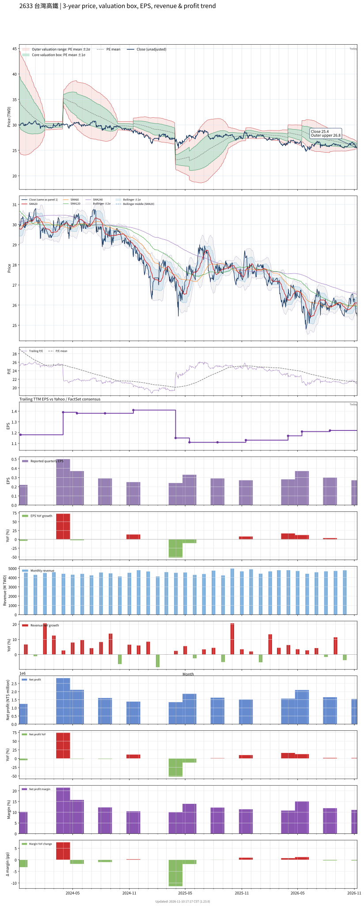

# 2633 - 台灣高鐵

## 業務簡介
**板塊:** Industrials
**產業:** Railroads
**市值:** 142,396 百萬台幣
**企業價值:** 345,135 百萬台幣

台灣高鐵 (2633，Taiwan High Speed Rail Corp.) 成立於 1998 年，以 BOT 模式興建營運全長 350 公里之高速鐵路系統，連結南港至左營共 12 站。核心業務涵蓋：(1) 高速鐵路客運 — 年運量逾 7,000 萬人次，採用[[新幹線]]技術之 700T 型列車 34 組；(2) 新世代列車 — 2023 年與[[日立製作所]]及[[東芝]]聯盟簽約採購 12 組 [[N700S]] 列車 (命名 [[N700ST]])，總金額約 289 億台幣；(3) 附屬事業 — 站內商業空間租賃 ([[統一超商]]、[[星巴克]]、[[摩斯漢堡]]等)、車站廣告、停車場經營；(4) 票證整合 — 支援  聯名信用卡感應乘車。

## 供應鏈位置
**上游 (列車與系統):**
- **既有列車:** [[川崎重工]]、[[日立製作所]] — 700T 型列車
- **新世代列車:** [[日立製作所]]與[[東芝]]聯盟 — [[N700ST]] 列車 12 組
- **機電維修:** [[三菱重工]]、[[東芝]] — 機電與軌道系統維修
- **在地化零件:** 國內逾 130 家精密機械廠商

**中游 (鐵路營運):**
- **台灣高鐵** (高速鐵路客運服務、場站經營、維修保養)

**下游 (旅客與商業):**
- **旅客:** 一般大眾、商務旅客、觀光客
- **站內商業:** [[統一超商]]、[[星巴克]]、[[摩斯漢堡]]
- **票證合作:** 

## 主要客戶及供應商
### 主要客戶
- **一般旅客:** 台灣西部走廊通勤/商務/觀光旅客
- **企業會員:** 逾 3,000 家企業簽約戶
- **站內承租商:** [[統一超商]]、[[星巴克]]、[[摩斯漢堡]]

### 主要供應商
- **新世代列車:** [[日立製作所]]與[[東芝]]聯盟 — [[N700ST]] 12 組 (289 億台幣)
- **既有列車:** [[川崎重工]] — 700T 技轉與維修
- **機電維修:** [[三菱重工]]、[[東芝]]
- **票證:**  公司

## 財務概況 (單位: 百萬台幣, 只有 Margin 為 %)
### 估值指標 (股價 $25.30 as of 2026-11-12 | TTM 截至 2026-06-30 | Forward 預估至 2026-12-31)
| P/E (TTM) | Forward P/E | P/S (TTM) |  P/B | EV/EBITDA |
|-----------|-------------|-----------|------|-----------|
|     20.91 |       18.47 |      2.56 | 1.96 |      9.72 |

### 年度關鍵財務數據 (近 3 年)
|                         |   2025-12-31 |   2024-12-31 |   2023-12-31 |
|:------------------------|-------------:|-------------:|-------------:|
| Revenue                 |     54648.46 |     53185.66 |     49812.02 |
| Gross Profit            |     23641.28 |     23356.96 |     22193.21 |
| Gross Margin (%)        |        43.26 |        43.92 |        44.55 |
| Selling & Marketing Exp |       -    |       -    |       -    |
| R&D Exp                 |       -    |       -    |       -    |
| General & Admin Exp     |       -    |       -    |       -    |
| Operating Income        |     21500.30 |     21495.63 |     20532.02 |
| Operating Margin (%)    |        39.34 |        40.42 |        41.22 |
| Net Income              |      6580.19 |      6451.43 |      7824.28 |
| Net Margin (%)          |        12.04 |        12.13 |        15.71 |
| Op Cash Flow            |     20691.03 |     16695.33 |     27751.44 |
| Investing Cash Flow     |     -9558.09 |     -7458.13 |    -12875.34 |
| Financing Cash Flow     |    -10634.04 |    -22518.31 |    -13871.98 |
| CAPEX                   |     -9947.62 |     -8219.23 |     -6134.88 |

### 季度關鍵財務數據 (近 4 季)
|                         |   2026-09-30 |   2026-06-30 |   2026-03-31 |   2025-12-31 |
|:------------------------|-------------:|-------------:|-------------:|-------------:|
| Revenue                 |     13968.65 |     13921.53 |     13890.56 |     14540.35 |
| Gross Profit            |      5539.43 |      5761.90 |      6507.59 |      6284.64 |
| Gross Margin (%)        |        39.66 |        41.39 |        46.85 |        43.22 |
| Selling & Marketing Exp |       -    |       -    |       -    |       -    |
| R&D Exp                 |       -    |       -    |       -    |       -    |
| General & Admin Exp     |       -    |       -    |       -    |       -    |
| Operating Income        |      4962.86 |      5166.85 |      6005.31 |      5645.02 |
| Operating Margin (%)    |        35.53 |        37.11 |        43.23 |        38.82 |
| Net Income              |      1547.58 |      1656.43 |      2097.81 |      1568.27 |
| Net Margin (%)          |        11.08 |        11.90 |        15.10 |        10.79 |
| Op Cash Flow            |      -374.24 |      5756.69 |      7800.14 |      8210.64 |
| Investing Cash Flow     |       277.76 |      8069.00 |     -6135.24 |     -9354.50 |
| Financing Cash Flow     |    -11526.44 |     -1365.66 |       -53.63 |       -23.23 |
| CAPEX                   |     -3236.33 |     -2113.14 |     -2629.19 |     -3046.58 |
## Chart

