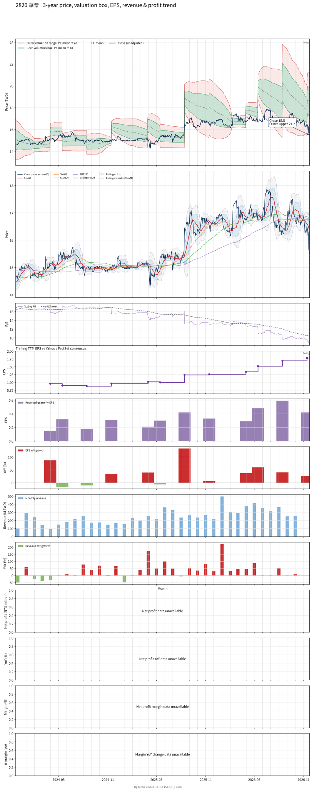

# 2820 - 華票

## 業務簡介
**板塊:** Financial Services
**產業:** Capital Markets
**市值:** 21,353 百萬台幣
**企業價值:** 11,848 百萬台幣

中華票券金融公司 (2820，China Bills Finance) 成立於 1978 年，為台灣第二大票券金融公司，市場份額約 25%。最大股東為  (持股約 28%)，第二大股東為[[寶佳集團]] (持股約 17%)。核心業務涵蓋短期票券 (商業本票、銀行承兌匯票) 及債券 (政府公債、公司債、金融債券) 之簽證、承銷、經紀與自營。公司在固定收益市場具領先地位，獲利與市場利率走勢高度連動，養券利差為主要收入來源。業務版圖亦延伸至企業財務諮詢、金融機構同業拆款經紀、外幣債券投資及相關股權商品投資。股票自 1994 年起於[[台灣證券交易所]]掛牌交易。

## 供應鏈位置
**上游 (資金供給與市場基建):**
- **市場基礎設施:** [[台灣證券交易所]]、[[證券櫃檯買賣中心]] — 債券交易平台
- **資金供給方:** 銀行同業拆款、企業法人及自然人購買票債券

**中游 (貨幣市場中介):**
- **中華票券 (2820)** — 短期票券簽證承銷、債券經紀自營、企業財務諮詢、同業拆款經紀

**下游 (資金需求方):**
- **發行端:** 發行商業本票 (CP) 籌措短期營運資金之上市櫃企業
- **投資端:** 金融同業及法人機構 — 短期資金停泊與債券配置

## 主要客戶及供應商
### 主要客戶
- **票券發行端:** 國內中大型上市櫃企業 — 發行商業本票 (CP) 籌措短期營運資金
- **債券投資端:** 金融同業、壽險公司、法人機構 — 購買政府公債及公司債進行資金配置
- **同業拆款:** 商業銀行 — 隔夜拆款與短期資金調度

### 主要供應商
- **資金來源:** 銀行同業拆款市場、附買回交易 (RP)
- **市場基建:** [[台灣證券交易所]]、[[證券櫃檯買賣中心]]、[[台灣集中保管結算所]]

### 其他關係
-  (持股約 28%) — 最大股東
- [[寶佳集團]] (持股約 17%) — 第二大策略性股東

## 財務概況 (單位: 百萬台幣, 只有 Margin 為 %)
### 估值指標 (股價 $15.90 as of 2026-11-26 | TTM 截至 2026-09-30 | Forward 預估至 2026-12-31)
| P/E (TTM) | Forward P/E | P/S (TTM) |  P/B | EV/EBITDA |
|-----------|-------------|-----------|------|-----------|
|      8.59 |         N/A |      5.88 | 0.79 |       N/A |

### 年度關鍵財務數據 (近 3 年)
|                         |   2025-12-31 |   2024-12-31 |   2023-12-31 |
|:------------------------|-------------:|-------------:|-------------:|
| Revenue                 |      2975.15 |      2244.56 |      2017.71 |
| Gross Profit            |       -    |       -    |       -    |
| Gross Margin (%)        |       -    |       -    |       -    |
| Selling & Marketing Exp |       -    |       -    |       -    |
| R&D Exp                 |       -    |       -    |       -    |
| General & Admin Exp     |       170.44 |       150.39 |       137.43 |
| Operating Income        |       -    |       -    |       -    |
| Operating Margin (%)    |       -    |       -    |       -    |
| Net Income              |      1796.08 |      1374.34 |      1288.52 |
| Net Margin (%)          |        60.37 |        61.23 |        63.86 |
| Op Cash Flow            |     -8294.51 |     -1576.04 |     -5985.60 |
| Investing Cash Flow     |       -10.20 |       -19.77 |       -12.49 |
| Financing Cash Flow     |      7795.74 |      2205.67 |      5708.28 |
| CAPEX                   |        -8.14 |       -19.78 |        -5.83 |

### 季度關鍵財務數據 (近 4 季)
|                         |   2026-09-30 |   2026-06-30 |   2026-03-31 |   2025-12-31 |
|:------------------------|-------------:|-------------:|-------------:|-------------:|
| Revenue                 |       929.45 |      1145.98 |      1093.68 |       724.38 |
| Gross Profit            |       -    |       -    |       -    |       -    |
| Gross Margin (%)        |       -    |       -    |       -    |       -    |
| Selling & Marketing Exp |       -    |       -    |       -    |       -    |
| R&D Exp                 |       -    |       -    |       -    |       -    |
| General & Admin Exp     |        45.35 |        44.60 |        42.78 |        42.59 |
| Operating Income        |       -    |       -    |       -    |       -    |
| Operating Margin (%)    |       -    |       -    |       -    |       -    |
| Net Income              |       566.31 |       796.30 |       639.89 |       384.32 |
| Net Margin (%)          |        60.93 |        69.49 |        58.51 |        53.05 |
| Op Cash Flow            |     -3453.79 |     -5219.01 |       470.85 |      5526.46 |
| Investing Cash Flow     |        -8.28 |        -5.43 |        -5.96 |        17.20 |
| Financing Cash Flow     |      3615.51 |      5244.52 |      -506.62 |     -5481.00 |
| CAPEX                   |        -4.22 |        -3.75 |        -1.52 |        -2.34 |
## Chart

