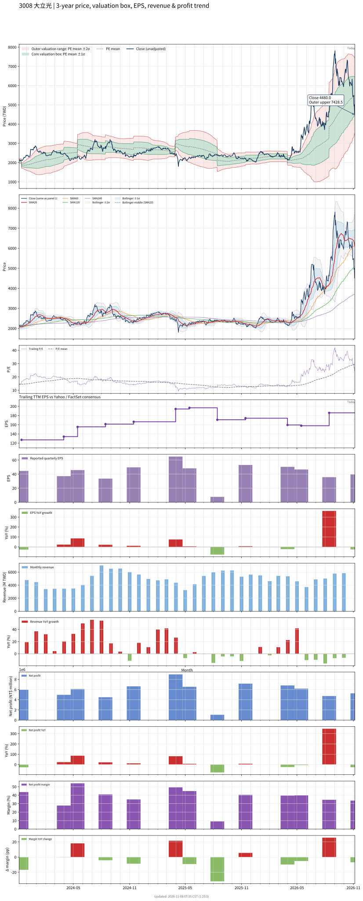

# 3008 - 大立光

## 業務簡介
**板塊:** Technology
**產業:** Electronic Components
**市值:** 696,500 百萬台幣
**企業價值:** 573,388 百萬台幣

大立光電 ([[Largan Precision]]) 為全球手機鏡頭龍頭廠，技術與產能遙遙領先同業。公司專注於高階塑膠非球面鏡片之設計與模具製造，擁有極高良率與專利護城河。

主要產品線涵蓋：(1) 高階手機鏡頭 — 7P/8P/9P 規格鏡組，為  iPhone 系列核心供應商；(2) 潛望式鏡頭 (Periscope Lens) — 受惠高倍光學變焦趨勢，打入  及  旗艦機種；(3) 車用鏡頭 — 切入 [[ADAS]] 車載光學，規格持續升級。

## 供應鏈位置
**上游 (光學材料與模具):**
- **光學塑膠粒:** 日系特殊光學樹脂供應商 — 鏡片核心材料
- **模具鋼材:** 高精密模具鋼
- **設備:** 自製精密模具與自動化設備 — 核心競爭力

**中游 (鏡頭設計與製造):**
- **手機鏡頭:** **大立光** (7P/8P/9P 高階手機鏡組)
- **潛望式鏡頭:** **大立光** (Periscope 長焦鏡頭)
- **車用鏡頭:** **大立光** ([[ADAS]] 車載光學鏡頭)

**下游 (鏡頭模組廠與終端品牌):**
- **鏡頭模組:** [[LG Innotek]]、、[[立訊]] — 模組組裝
- **手機品牌:** 、、[[小米]]、[[OPPO]]、[[vivo]]
- **車用:** 、歐系車廠 — 透過模組廠間接供貨

## 主要客戶及供應商
### 主要客戶
- **手機品牌:**  (最大客戶)、、[[小米]]、[[OPPO]]、[[vivo]]
- **鏡頭模組廠:** [[LG Innotek]]、、[[立訊]]
- **車用:**  — 透過模組廠供貨車載鏡頭

### 主要供應商
- **光學材料:** 日系光學塑膠粒供應商

## 核心競爭力
- 大立光電 ([[Largan Precision]]) 為全球手機鏡頭龍頭廠，技術與產能遙遙領先同業。公司專注於高階塑膠非球面鏡片之設計與模具製造，擁有極高良率與專利護城河。
- **設備:** 自製精密模具與自動化設備 — 核心競爭力
- **設備:** 自製精密模具與自動化設備為核心競爭力

## 競爭定位補充
- **設備:** 自製精密模具與自動化設備 — 核心競爭力
- **設備:** 自製精密模具與自動化設備為核心競爭力

## 財務概況 (單位: 百萬台幣, 只有 Margin 為 %)
### 估值指標 (股價 $5,325.00 as of 2026-11-12 | TTM 截至 2026-09-30 | Forward 預估至 2026-12-31)
| P/E (TTM) | Forward P/E | P/S (TTM) |  P/B | EV/EBITDA |
|-----------|-------------|-----------|------|-----------|
|     27.56 |       28.50 |     11.22 | 3.64 |     18.92 |

### 年度關鍵財務數據 (近 3 年)
|                         |   2025-12-31 |   2024-12-31 |   2023-12-31 |
|:------------------------|-------------:|-------------:|-------------:|
| Revenue                 |     61147.89 |     59457.55 |     48842.25 |
| Gross Profit            |     30837.05 |     31209.31 |     23805.55 |
| Gross Margin (%)        |        50.43 |        52.49 |        48.74 |
| Selling & Marketing Exp |       376.08 |       398.79 |       290.63 |
| R&D Exp                 |      5293.32 |      5246.70 |      4191.17 |
| General & Admin Exp     |      1609.39 |      1531.29 |      1504.48 |
| Operating Income        |     23558.26 |     24032.53 |     17819.28 |
| Operating Margin (%)    |        38.53 |        40.42 |        36.48 |
| Net Income              |     21275.41 |     25915.41 |     17902.32 |
| Net Margin (%)          |        34.79 |        43.59 |        36.65 |
| Op Cash Flow            |     26080.23 |     31578.53 |     18198.56 |
| Investing Cash Flow     |     -9235.73 |    -16066.03 |    -11151.03 |
| Financing Cash Flow     |    -13457.66 |    -10763.55 |     -9750.25 |
| CAPEX                   |    -12514.88 |    -11446.93 |     -8449.14 |

### 季度關鍵財務數據 (近 4 季)
|                         |   2026-09-30 |   2026-06-30 |   2026-03-31 |   2025-12-31 |
|:------------------------|-------------:|-------------:|-------------:|-------------:|
| Revenue                 |     15650.82 |     13664.76 |     15544.08 |     17218.64 |
| Gross Profit            |      6606.85 |      6752.93 |      7679.57 |      8260.18 |
| Gross Margin (%)        |        42.21 |        49.42 |        49.41 |        47.97 |
| Selling & Marketing Exp |       100.92 |        97.79 |        97.07 |       102.47 |
| R&D Exp                 |      1408.01 |      1169.20 |      1401.14 |      1419.56 |
| General & Admin Exp     |       362.94 |       337.94 |       369.13 |       409.56 |
| Operating Income        |      4734.98 |      5148.01 |      5812.22 |      6328.59 |
| Operating Margin (%)    |        30.25 |        37.67 |        37.39 |        36.75 |
| Net Income              |      5182.45 |      4669.98 |      6123.20 |      6719.70 |
| Net Margin (%)          |        33.11 |        34.18 |        39.39 |        39.03 |
| Op Cash Flow            |      1951.77 |      8968.48 |      9316.79 |     10519.68 |
| Investing Cash Flow     |     -8491.66 |     -2399.28 |     -2411.60 |     -1092.31 |
| Financing Cash Flow     |     -5608.24 |     -6816.02 |     -4868.40 |     -1746.32 |
| CAPEX                   |     -3242.95 |     -2531.64 |     -2393.22 |     -2669.65 |
## Chart

