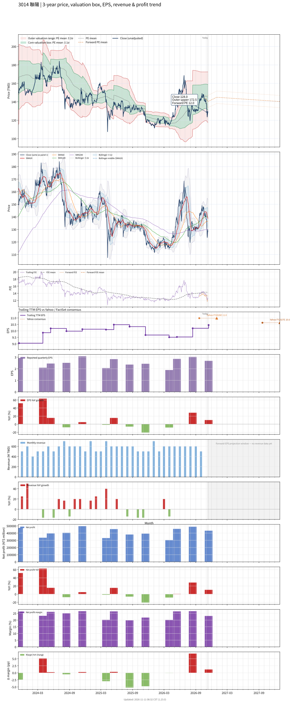

# 3014 - 聯陽

## 業務簡介
**板塊:** Technology
**產業:** Semiconductors
**市值:** 22,902 百萬台幣
**企業價值:** 18,170 百萬台幣

聯陽半導體 (3014) 是[[聯華電子]]集團轉投資的專業 [[IC 設計]]公司，為全球 [[Super I/O]] 控制晶片 (市占 45-50%) 及筆電 [[EC 晶片]] (Embedded Controller，市占 35-40%) 領導廠商。產品線涵蓋高速影像介面 IC ([[HDMI]]、[[DisplayPort]]、[[USB Type-C]])、數位電視 IC、[[電子紙]]驅動 IC、[[感測器中樞]] MCU 及多媒體 [[SoC]]。

## 供應鏈位置
**上游 (晶圓代工與封測):**
- **晶圓代工:** [[聯華電子]] (UMC)、[[蘇州和艦]] (合資廠)
- **封裝:** [[Amkor]]、[[矽品]]、[[華通電腦]]
- **測試:** 、[[宏觀微電子]]

**中游 (IC 設計):**
- **PC I/O 控制:** **聯陽** (Super I/O、EC 晶片，全球市占率領先)
- **高速介面:** HDMI、DisplayPort、USB-C 控制 IC
- **多媒體 SoC:** 智慧家電及機上盒用

**下游 (系統組裝):**
- **筆電 ODM:** 、、
- **主機板:** PC 主機板廠
- **智慧家電:** 中國大陸家電品牌 (多媒體 SoC 客戶占 80-90%)

## 主要客戶及供應商
### 主要客戶
- **筆電 ODM:** 、、
- **多媒體 SoC:** 中國大陸智慧家電品牌 (占 80-90%)
- **主機板/PC:** 台灣及全球 PC 主機板廠商

### 主要供應商
- **晶圓代工:** [[聯華電子]] (UMC)、[[蘇州和艦]]
- **封裝:** [[Amkor]]、[[矽品]]、[[華通電腦]]
- **測試:** 、[[宏觀微電子]]

## 財務概況 (單位: 百萬台幣, 只有 Margin 為 %)
### 估值指標 (股價 $138.00 as of 2026-11-12 | TTM 截至 2026-09-30 | Forward 預估至 2026-12-31)
| P/E (TTM) | Forward P/E | P/S (TTM) |  P/B | EV/EBITDA |
|-----------|-------------|-----------|------|-----------|
|     13.91 |       12.98 |      3.29 | 2.87 |      9.34 |

### 年度關鍵財務數據 (近 3 年)
|                         |   2025-12-31 |   2024-12-31 |   2023-12-31 |
|:------------------------|-------------:|-------------:|-------------:|
| Revenue                 |      6946.96 |      6632.58 |      6276.44 |
| Gross Profit            |      3830.88 |      3689.07 |      3424.00 |
| Gross Margin (%)        |        55.14 |        55.62 |        54.55 |
| Selling & Marketing Exp |       463.54 |       412.88 |       390.13 |
| R&D Exp                 |      1250.45 |      1067.69 |       977.68 |
| General & Admin Exp     |       310.48 |       373.97 |       293.54 |
| Operating Income        |      1806.40 |      1834.53 |      1762.65 |
| Operating Margin (%)    |        26.00 |        27.66 |        28.08 |
| Net Income              |      1531.30 |      1626.63 |      1587.81 |
| Net Margin (%)          |        22.04 |        24.52 |        25.30 |
| Op Cash Flow            |       902.04 |      1384.47 |      2441.43 |
| Investing Cash Flow     |       -29.13 |        77.91 |        44.22 |
| Financing Cash Flow     |     -1502.24 |     -1246.88 |      -974.10 |
| CAPEX                   |       -55.68 |       -61.42 |       -83.30 |

### 季度關鍵財務數據 (近 4 季)
|                         |   2026-09-30 |   2026-06-30 |   2026-03-31 |   2025-12-31 |
|:------------------------|-------------:|-------------:|-------------:|-------------:|
| Revenue                 |      1881.09 |      1835.43 |      1734.05 |      1506.96 |
| Gross Profit            |      1026.12 |      1050.09 |       992.10 |       853.85 |
| Gross Margin (%)        |        54.55 |        57.21 |        57.21 |        56.66 |
| Selling & Marketing Exp |       126.30 |       128.96 |       113.71 |       116.08 |
| R&D Exp                 |       328.88 |       320.41 |       300.00 |       300.92 |
| General & Admin Exp     |        88.53 |        82.34 |        80.07 |        71.09 |
| Operating Income        |       482.40 |       518.38 |       498.32 |       365.75 |
| Operating Margin (%)    |        25.64 |        28.24 |        28.74 |        24.27 |
| Net Income              |       433.40 |       488.28 |       458.70 |       303.52 |
| Net Margin (%)          |        23.04 |        26.60 |        26.45 |        20.14 |
| Op Cash Flow            |       744.54 |        81.03 |      -386.59 |      -390.31 |
| Investing Cash Flow     |       -46.76 |       -43.88 |       -30.15 |        -2.96 |
| Financing Cash Flow     |     -1413.02 |        -2.16 |        -1.81 |        -1.98 |
| CAPEX                   |        -5.61 |       -15.49 |        -4.39 |        -3.68 |
## Chart

