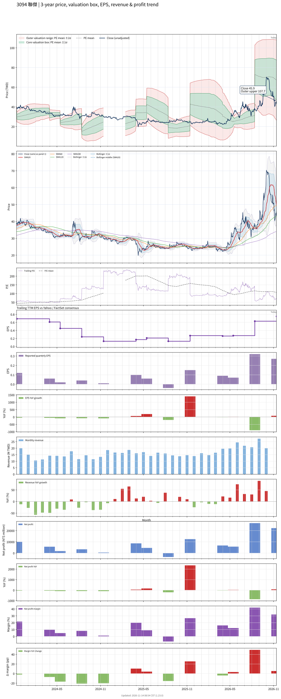

# 3094 - 聯傑

## 業務簡介
**板塊:** Technology
**產業:** Semiconductors
**市值:** 3,815 百萬台幣
**企業價值:** 2,724 百萬台幣

聯傑國際 (3094) 是[[聯華電子]]集團轉投資的專業 [[IC 設計]]公司，以 [[Ethernet]] 乙太網路控制晶片起家 (原名 DAVICOM)。公司核心產品為嵌入式乙太網路控制器 IC，廣泛應用於[[網路設備]]、[[工業控制]]、[[物聯網]]裝置及[[嵌入式系統]]。產品涵蓋 Fast Ethernet MAC/PHY 整合晶片、網路介面控制器及相關周邊 IC。國際競爭同業包括 [[Microchip]]、。

## 供應鏈位置
**上游 (晶圓代工):**
- **晶圓製造:** 台灣晶圓代工廠

**中游 (IC 設計):**
- **網路 IC:** **聯傑** (Ethernet 控制器、嵌入式網路 IC)

**下游 (網通與工控):**
- **網通設備:** 交換器、路由器、閘道器
- **工業控制:** 工業自動化設備
- **IoT:** 物聯網終端裝置

## 主要客戶及供應商
### 主要客戶
- **網通設備:** 交換器及路由器品牌廠
- **工業控制:** 工業自動化設備製造商
- **嵌入式系統:** IoT 及嵌入式裝置整合商

### 主要供應商
- **晶圓代工:** 台灣晶圓代工廠
- **封裝測試:** 半導體封測服務

### 競爭同業
- 聯傑國際 (3094) 是[[聯華電子]]集團轉投資的專業 [[IC 設計]]公司，以 [[Ethernet]] 乙太網路控制晶片起家 (原名 DAVICOM)。公司核心產品為嵌入式乙太網路控制器 IC，廣泛應用於[[網路設備]]、[[工業控制]]、[[物聯網]]裝置及[[嵌入式系統]]。產品涵蓋 Fast Ethernet MAC/PHY 整合晶片、網路介面控制器及相關周邊 IC。國際競爭同業包括 [[Microchip]]、。

### 同業參照
- 聯傑國際 (3094) 是[[聯華電子]]集團轉投資的專業 [[IC 設計]]公司，以 [[Ethernet]] 乙太網路控制晶片起家 (原名 DAVICOM)。公司核心產品為嵌入式乙太網路控制器 IC，廣泛應用於[[網路設備]]、[[工業控制]]、[[物聯網]]裝置及[[嵌入式系統]]。產品涵蓋 Fast Ethernet MAC/PHY 整合晶片、網路介面控制器及相關周邊 IC。國際競爭同業包括 [[Microchip]]、。

## 財務概況 (單位: 百萬台幣, 只有 Margin 為 %)
### 估值指標 (股價 $45.90 as of 2026-11-13 | TTM 截至 2026-06-30 | Forward 預估至 2026-12-31)
| P/E (TTM) | Forward P/E | P/S (TTM) |  P/B | EV/EBITDA |
|-----------|-------------|-----------|------|-----------|
|     58.85 |         N/A |     19.07 | 3.72 |    161.02 |

### 年度關鍵財務數據 (近 3 年)
|                         |   2025-12-31 |   2024-12-31 |   2023-12-31 |
|:------------------------|-------------:|-------------:|-------------:|
| Revenue                 |       187.76 |       165.86 |       242.57 |
| Gross Profit            |       142.04 |       111.19 |       163.63 |
| Gross Margin (%)        |        75.65 |        67.04 |        67.46 |
| Selling & Marketing Exp |        26.77 |        36.48 |        34.52 |
| R&D Exp                 |        67.36 |        55.79 |        66.02 |
| General & Admin Exp     |        47.95 |        45.18 |        48.64 |
| Operating Income        |        -0.04 |       -26.26 |        14.45 |
| Operating Margin (%)    |        -0.02 |       -15.83 |         5.96 |
| Net Income              |        20.36 |        14.36 |        50.74 |
| Net Margin (%)          |        10.84 |         8.66 |        20.92 |
| Op Cash Flow            |        27.51 |        18.77 |        52.12 |
| Investing Cash Flow     |        -0.56 |        -3.08 |        -0.52 |
| Financing Cash Flow     |        -8.77 |       -51.94 |       -84.12 |
| CAPEX                   |        -0.39 |        -0.78 |        -0.47 |

### 季度關鍵財務數據 (近 4 季)
|                         |   2026-09-30 |   2026-06-30 |   2026-03-31 |   2025-12-31 |
|:------------------------|-------------:|-------------:|-------------:|-------------:|
| Revenue                 |        69.79 |        63.69 |        47.21 |        42.29 |
| Gross Profit            |        49.69 |        47.38 |        35.40 |        31.22 |
| Gross Margin (%)        |        71.19 |        74.39 |        74.98 |        73.82 |
| Selling & Marketing Exp |         6.35 |         6.58 |         6.29 |         7.15 |
| R&D Exp                 |        14.98 |        15.86 |        15.55 |        16.72 |
| General & Admin Exp     |        13.18 |        13.38 |        11.21 |        10.43 |
| Operating Income        |        15.18 |        11.56 |         2.35 |        -3.08 |
| Operating Margin (%)    |        21.75 |        18.15 |         4.97 |        -7.29 |
| Net Income              |        22.27 |        26.72 |         5.76 |         6.78 |
| Net Margin (%)          |        31.91 |        41.95 |        12.20 |        16.03 |
| Op Cash Flow            |         5.71 |        -7.21 |        29.55 |        17.06 |
| Investing Cash Flow     |         0.00 |        -0.08 |        -0.46 |        -0.01 |
| Financing Cash Flow     |       -21.20 |        -0.46 |        -0.38 |        -1.85 |
| CAPEX                   |         0.00 |        -0.08 |        -0.32 |        -0.01 |
## Chart

