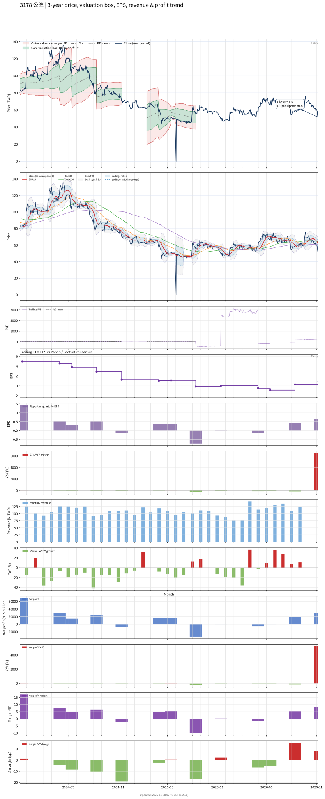

# 3178 - 公準

## 業務簡介
**板塊:** Technology
**產業:** Semiconductors
**市值:** 2,807 百萬台幣
**企業價值:** 3,221 百萬台幣

公準精密 (Gongin Precision) 是台灣領先的高階 **精密金屬加工** 與航太級零件供應商。
公司專長於高難度材料加工與潔淨室組裝，成功打入全球[[半導體]]設備與  供應鏈。
核心業務領域：
1.  **半導體設備**: 為全球微影設備龍頭 **** 與設備大廠 **** 提供真空腔體、精密零組件與模組組裝服務。
2.  **航太與低軌衛星**: 為 **SpaceX** (Starlink) 提供關鍵零件，並供應波音 (Boeing) 與空中巴士 (Airbus) 飛機起落架致動器零組件。
3.  **先進製程助力**: 隨  曝光機世代更迭，公準提供的精密零件規格持續升級，具備高度技術壁壘。

## 供應鏈位置
*   **精密加工 (本體)**: **公準 (3178)** - 特殊材料加工、表面處理、精密組裝。
*   **上游**: 特殊金屬 (鈦合金、鋁合金、不鏽鋼) 供應商。
*   **下游應用**:
    *   **半導體裝置**: ,  (AMAT).
    *   **航太領域**: [[SpaceX]], [[UTC Aerospace]].

## 主要客戶及供應商
### 主要客戶
**半導體設備商**:  — 主要供應  相關真空腔體與精密組件
**半導體設備商**:  — 精密零組件與模組組裝
**航太/衛星**: [[SpaceX]] (Starlink) — 低軌衛星關鍵零件
**航太**: Boeing、Airbus — 飛機起落架致動器零組件

### 主要供應商
**特殊金屬**: 鈦合金、鋁合金、不鏽鋼等特殊金屬供應商
**加工設備**: 五軸 CNC 精密加工機台

## 財務概況 (單位: 百萬台幣, 只有 Margin 為 %)
### 估值指標 (股價 $62.30 as of 2026-11-13 | TTM 截至 2026-06-30 | Forward 預估至 2026-12-31)
| P/E (TTM) | Forward P/E | P/S (TTM) |  P/B | EV/EBITDA |
|-----------|-------------|-----------|------|-----------|
|     62.93 |         N/A |      2.21 | 2.36 |     19.92 |

### 年度關鍵財務數據 (近 3 年)
|                         |   2025-12-31 |   2024-12-31 |   2023-12-31 |
|:------------------------|-------------:|-------------:|-------------:|
| Revenue                 |      1256.31 |      1314.13 |      1623.94 |
| Gross Profit            |       170.34 |       222.93 |       448.48 |
| Gross Margin (%)        |        13.56 |        16.96 |        27.62 |
| Selling & Marketing Exp |        19.93 |        19.95 |        22.14 |
| R&D Exp                 |        38.29 |        56.18 |        32.52 |
| General & Admin Exp     |       130.17 |       132.42 |       129.12 |
| Operating Income        |       -18.05 |        14.38 |       264.70 |
| Operating Margin (%)    |        -1.44 |         1.09 |        16.30 |
| Net Income              |       -20.64 |        47.62 |       203.85 |
| Net Margin (%)          |        -1.64 |         3.62 |        12.55 |
| Op Cash Flow            |       135.07 |       248.53 |       351.74 |
| Investing Cash Flow     |       -99.76 |      -247.73 |      -160.43 |
| Financing Cash Flow     |       -37.65 |      -116.87 |      -177.07 |
| CAPEX                   |      -118.91 |      -259.42 |      -198.21 |

### 季度關鍵財務數據 (近 4 季)
|                         |   2026-09-30 |   2026-06-30 |   2026-03-31 |   2025-12-31 |
|:------------------------|-------------:|-------------:|-------------:|-------------:|
| Revenue                 |       369.97 |       366.60 |       294.90 |       291.80 |
| Gross Profit            |       102.72 |        74.36 |        40.47 |        27.25 |
| Gross Margin (%)        |        27.77 |        20.28 |        13.72 |         9.34 |
| Selling & Marketing Exp |         4.87 |         4.58 |         4.88 |         5.08 |
| R&D Exp                 |        28.72 |        10.63 |         9.65 |         9.81 |
| General & Admin Exp     |        35.13 |        33.50 |        32.16 |        33.18 |
| Operating Income        |        34.01 |        25.65 |        -6.23 |       -20.83 |
| Operating Margin (%)    |         9.19 |         7.00 |        -2.11 |        -7.14 |
| Net Income              |        29.86 |        19.16 |         0.06 |        -5.37 |
| Net Margin (%)          |         8.07 |         5.23 |         0.02 |        -1.84 |
| Op Cash Flow            |        70.20 |        87.58 |        11.28 |        65.55 |
| Investing Cash Flow     |       -42.21 |       -12.51 |       -10.92 |       -27.20 |
| Financing Cash Flow     |        11.66 |        -5.05 |        -7.78 |       -81.36 |
| CAPEX                   |       -40.60 |       -10.89 |       -29.14 |       -27.22 |
## Chart

