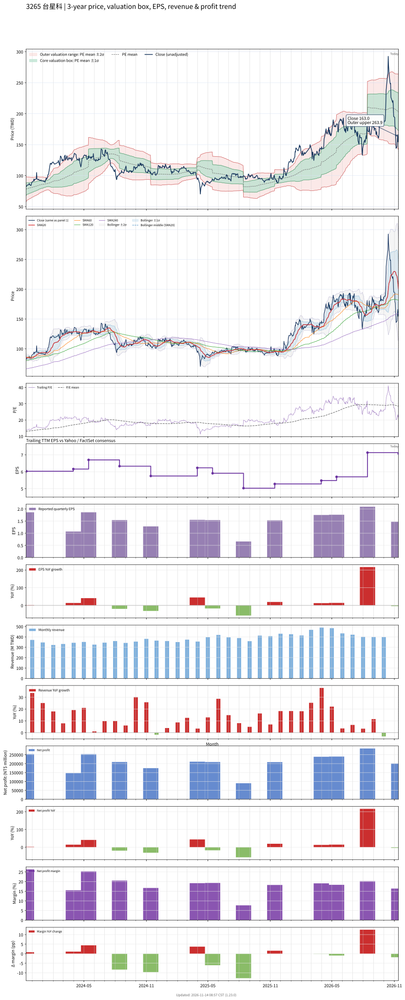

# 3265 - 台星科

## 業務簡介
**板塊:** Technology
**產業:** Semiconductor Equipment & Materials
**市值:** 22,211 百萬台幣
**企業價值:** 22,994 百萬台幣

台星科 (3265) 是一家專業的半導體[[封裝測試]]服務廠商，專注於功率半導體及分離式元件封測。公司與 、[[矽品]]、、 等大廠同為台灣半導體封測產業鏈成員。主要封裝型態涵蓋 [[QFN]]、[[SOP]]、[[DIP]] 等。公司主要服務包括 IC 封裝及測試，技術涵蓋多種封裝型態，產品應用於車用電子、工業控制及消費電子。

## 供應鏈位置
**上游 (封裝材料):**
- **[[導線架]]:** [[導線架]]供應
- **金線/樹脂:** 封裝原料

**中游 (封裝測試):**
- **IC 封測:** **台星科** (功率半導體及分離式元件封測)

**下游 (IC 設計客戶):**
- **功率元件:** 功率半導體 IC 設計公司
- **車用/工控:** 車用及工業電子應用客戶

## 主要客戶及供應商
### 主要客戶
- **功率半導體:** 功率元件 IC 設計公司
- **車用電子:** 車用電子模組廠
- **工業控制:** 工業電源應用客戶

### 主要供應商
- **[[導線架]]:** [[導線架]]供應商
- **封裝材料:** 金線、樹脂、銀膠
- **設備:** 封裝及測試設備

## 財務概況 (單位: 百萬台幣, 只有 Margin 為 %)
### 估值指標 (股價 $163.00 as of 2026-11-13 | TTM 截至 2026-09-30 | Forward 預估至 2026-12-31)
| P/E (TTM) | Forward P/E | P/S (TTM) |  P/B | EV/EBITDA |
|-----------|-------------|-----------|------|-----------|
|     23.12 |         N/A |      4.28 | 3.41 |     12.48 |

### 年度關鍵財務數據 (近 3 年)
|                         |   2025-12-31 |   2024-12-31 |   2023-12-31 |
|:------------------------|-------------:|-------------:|-------------:|
| Revenue                 |      4647.79 |      4166.57 |      3667.82 |
| Gross Profit            |      1221.38 |      1078.59 |      1103.53 |
| Gross Margin (%)        |        26.28 |        25.89 |        30.09 |
| Selling & Marketing Exp |        23.41 |        24.40 |        27.32 |
| R&D Exp                 |        16.82 |        20.56 |        17.39 |
| General & Admin Exp     |       264.17 |       228.76 |       199.96 |
| Operating Income        |       916.98 |       804.87 |       858.86 |
| Operating Margin (%)    |        19.73 |        19.32 |        23.42 |
| Net Income              |       746.54 |       848.54 |       839.84 |
| Net Margin (%)          |        16.06 |        20.37 |        22.90 |
| Op Cash Flow            |      1364.91 |      1330.86 |      1536.57 |
| Investing Cash Flow     |      -687.08 |      -532.41 |     -1231.42 |
| Financing Cash Flow     |       510.80 |      -993.60 |      -736.73 |
| CAPEX                   |     -1722.95 |     -1312.01 |      -343.41 |

### 季度關鍵財務數據 (近 4 季)
|                         |   2026-09-30 |   2026-06-30 |   2026-03-31 |   2025-12-31 |
|:------------------------|-------------:|-------------:|-------------:|-------------:|
| Revenue                 |      1223.11 |      1407.58 |      1307.80 |      1250.37 |
| Gross Profit            |       299.99 |       413.35 |       334.10 |       324.74 |
| Gross Margin (%)        |        24.53 |        29.37 |        25.55 |        25.97 |
| Selling & Marketing Exp |         7.92 |         6.16 |         8.49 |         7.80 |
| R&D Exp                 |        14.28 |         2.33 |         2.64 |         8.05 |
| General & Admin Exp     |        68.86 |        66.97 |        66.07 |        68.05 |
| Operating Income        |       208.93 |       337.90 |       256.90 |       240.83 |
| Operating Margin (%)    |        17.08 |        24.01 |        19.64 |        19.26 |
| Net Income              |       200.57 |       285.06 |       239.76 |       238.73 |
| Net Margin (%)          |        16.40 |        20.25 |        18.33 |        19.09 |
| Op Cash Flow            |       470.03 |       370.04 |       365.39 |       478.55 |
| Investing Cash Flow     |      -832.13 |      -654.47 |      -436.29 |       453.58 |
| Financing Cash Flow     |       -27.70 |       797.74 |       130.86 |        63.96 |
| CAPEX                   |      -703.37 |      -884.75 |      -526.22 |      -402.38 |
## Chart

