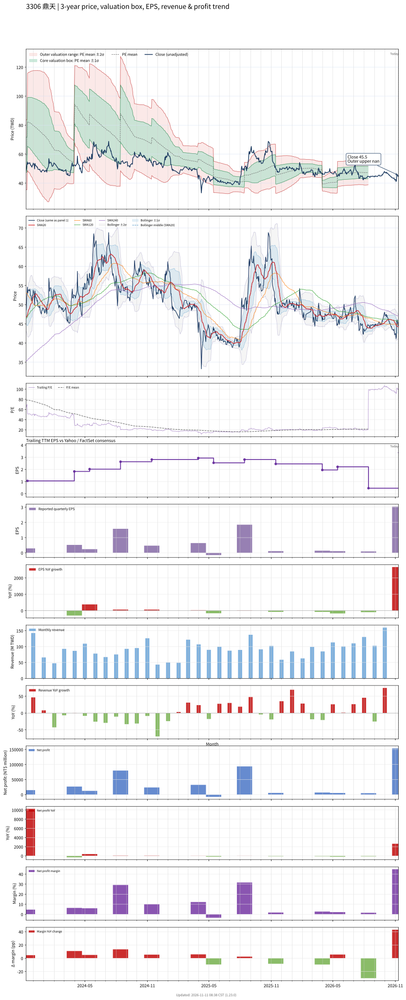

# 3306 - 鼎天

## 業務簡介
**板塊:** Technology
**產業:** Communication Equipment
**市值:** 2,424 百萬台幣
**企業價值:** 1,843 百萬台幣

鼎天國際股份有限公司 (3306，RoyalTek) 為[[廣達電腦]]集團旗下核心成員，專精於定位導航與車用電子技術。業務聚焦：(1) [[車載]]多媒體系統 (IVI) — 高整合度影音導航與資訊娛樂系統；(2) AI 視覺系統 — [[DMS]] 駕駛行為監控、行車記錄儀與車載 AI 攝影機；(3) 高精度定位 — 工業與車用級 GNSS 高精度定位模組，應用於無人機與精準農業。與母公司[[廣達電腦]]密切合作，共享研發資源並協同進攻全球  與自動駕駛供應鏈。

## 供應鏈位置
**上游 (晶片與元件):**
- **GPS/GNSS 晶片:** 定位晶片組供應商
- **螢幕面板:** 車用顯示面板
- **攝像感測器:** 車用鏡頭模組與[[PCB]]

**中游 (車用電子製造):**
- **鼎天** — GPS 模組、車載通訊系統、AI 攝影機研發製造

**下游 (終端應用):**
- **車廠供應鏈:** [[廣達電腦]] — 協同布局車電業務
- **OE 市場:** 全球 Tier 1 與車廠供應鏈
- **商用車隊:** 車務管理與遠端監控系統

## 主要客戶及供應商
### 主要客戶
- **母公司:** [[廣達電腦]] — 協同布局車電業務
- **車廠供應鏈:** 歐美與日系車廠 Tier 1 供應商
- **商用車隊:** 物流車隊 — 車務管理系統

### 主要供應商
- **GPS 晶片:** GNSS 定位晶片組供應商
- **車用面板:** 車用顯示面板供應商
- **[[PCB]]:** 印刷電路板製造商

## 財務概況 (單位: 百萬台幣, 只有 Margin 為 %)
### 估值指標 (股價 $47.90 as of 2026-11-12 | TTM 截至 2026-09-30 | Forward 預估至 2026-12-31)
| P/E (TTM) | Forward P/E | P/S (TTM) |  P/B | EV/EBITDA |
|-----------|-------------|-----------|------|-----------|
|     13.57 |         N/A |      2.13 | 0.61 |    106.35 |

### 年度關鍵財務數據 (近 3 年)
|                         |   2025-12-31 |   2024-12-31 |   2023-12-31 |
|:------------------------|-------------:|-------------:|-------------:|
| Revenue                 |      1082.88 |       980.06 |      1291.45 |
| Gross Profit            |       273.44 |       329.53 |       308.20 |
| Gross Margin (%)        |        25.25 |        33.62 |        23.86 |
| Selling & Marketing Exp |        36.48 |        19.48 |        21.55 |
| R&D Exp                 |       184.81 |       184.66 |       166.93 |
| General & Admin Exp     |        79.42 |        86.02 |        79.77 |
| Operating Income        |       -25.41 |        41.21 |        41.75 |
| Operating Margin (%)    |        -2.35 |         4.20 |         3.23 |
| Net Income              |        98.61 |       148.29 |        92.84 |
| Net Margin (%)          |         9.11 |        15.13 |         7.19 |
| Op Cash Flow            |      -255.33 |       237.25 |       194.24 |
| Investing Cash Flow     |        33.55 |       112.47 |      -446.20 |
| Financing Cash Flow     |      -116.45 |       -75.76 |       -35.01 |
| CAPEX                   |       -11.94 |        -8.88 |       -12.94 |

### 季度關鍵財務數據 (近 4 季)
|                         |   2026-09-30 |   2026-06-30 |   2026-03-31 |   2025-12-31 |
|:------------------------|-------------:|-------------:|-------------:|-------------:|
| Revenue                 |       342.89 |       298.55 |       246.64 |       252.04 |
| Gross Profit            |        91.92 |        67.99 |        67.93 |        65.02 |
| Gross Margin (%)        |        26.81 |        22.77 |        27.54 |        25.80 |
| Selling & Marketing Exp |         3.66 |         2.84 |        10.25 |         4.29 |
| R&D Exp                 |        57.00 |        46.72 |        42.91 |        40.68 |
| General & Admin Exp     |        28.26 |        19.52 |        15.59 |        16.93 |
| Operating Income        |         3.46 |        -0.63 |        -0.36 |         3.59 |
| Operating Margin (%)    |         1.01 |        -0.21 |        -0.15 |         1.42 |
| Net Income              |       153.62 |         4.67 |         5.35 |         6.87 |
| Net Margin (%)          |        44.80 |         1.56 |         2.17 |         2.73 |
| Op Cash Flow            |       180.04 |        57.66 |       -42.11 |        18.76 |
| Investing Cash Flow     |       -51.61 |        -5.17 |        99.88 |         0.32 |
| Financing Cash Flow     |       -86.98 |        -3.37 |        -2.57 |        -2.56 |
| CAPEX                   |        -1.35 |        -2.12 |        -0.12 |         0.32 |
## Chart

