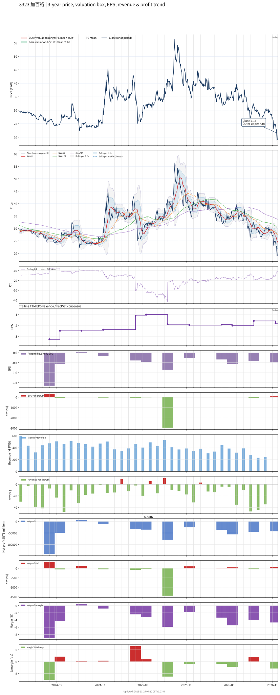

# 3323 - 加百裕

## 業務簡介
**板塊:** Technology
**產業:** Electronic Components
**市值:** 2,042 百萬台幣
**企業價值:** 1,854 百萬台幣

加百裕 (3323，Celxpert) 為鋰電池模組三雄之一 (與 、 並列)。核心成長為 [[BBU]]，獲系統電策略入股。IT 客戶含 、、。電芯來自[[Samsung SDI]]、[[LG Energy Solution]]。另供[[電動自行車]]及[[儲能]]。

## 供應鏈位置
**上游:** [[Samsung SDI]]、[[LG Energy Solution]]
**中游:** **加百裕** ([[BMS]]/[[BBU]]/電池模組)
**下游:** 、、；AI [[BBU]]

## 主要客戶及供應商
### 主要客戶
- 、、 — NB
- AI [[BBU]] — CSP

### 主要供應商
- [[Samsung SDI]]、[[LG Energy Solution]]

## 財務概況 (單位: 百萬台幣, 只有 Margin 為 %)
### 估值指標 (股價 $20.50 as of 2026-11-27 | TTM 截至 2026-09-30 | Forward 預估至 2026-12-31)
| P/E (TTM) | Forward P/E | P/S (TTM) |  P/B | EV/EBITDA |
|-----------|-------------|-----------|------|-----------|
|       N/A |         N/A |      0.49 | 0.87 |    -15.55 |

### 年度關鍵財務數據 (近 3 年)
|                         |   2025-12-31 |   2024-12-31 |   2023-12-31 |
|:------------------------|-------------:|-------------:|-------------:|
| Revenue                 |      4947.66 |      5447.78 |      7203.54 |
| Gross Profit            |       425.46 |       474.85 |       466.35 |
| Gross Margin (%)        |         8.60 |         8.72 |         6.47 |
| Selling & Marketing Exp |        94.81 |       104.01 |       146.41 |
| R&D Exp                 |       185.55 |       174.59 |       205.24 |
| General & Admin Exp     |       343.71 |       303.56 |       315.76 |
| Operating Income        |      -198.60 |      -107.32 |      -201.06 |
| Operating Margin (%)    |        -4.01 |        -1.97 |        -2.79 |
| Net Income              |      -182.62 |       -98.41 |      -270.65 |
| Net Margin (%)          |        -3.69 |        -1.81 |        -3.76 |
| Op Cash Flow            |        81.49 |       281.69 |      1321.79 |
| Investing Cash Flow     |      -209.49 |      -467.52 |      -529.65 |
| Financing Cash Flow     |      -192.57 |       128.05 |      -324.86 |
| CAPEX                   |       -43.44 |      -145.96 |       -54.08 |

### 季度關鍵財務數據 (近 4 季)
|                         |   2026-09-30 |   2026-06-30 |   2026-03-31 |   2025-12-31 |
|:------------------------|-------------:|-------------:|-------------:|-------------:|
| Revenue                 |       901.54 |      1149.58 |      1024.14 |      1104.72 |
| Gross Profit            |       105.99 |        98.98 |        86.85 |       123.35 |
| Gross Margin (%)        |        11.76 |         8.61 |         8.48 |        11.17 |
| Selling & Marketing Exp |        20.42 |        24.13 |        20.62 |        25.57 |
| R&D Exp                 |        49.50 |        49.05 |        45.99 |        53.69 |
| General & Admin Exp     |        80.62 |        82.59 |        81.60 |        91.82 |
| Operating Income        |       -44.55 |       -56.79 |       -61.37 |       -47.74 |
| Operating Margin (%)    |        -4.94 |        -4.94 |        -5.99 |        -4.32 |
| Net Income              |       -47.64 |       -41.38 |       -54.91 |       -33.61 |
| Net Margin (%)          |        -5.28 |        -3.60 |        -5.36 |        -3.04 |
| Op Cash Flow            |        62.44 |      -187.62 |        97.11 |        65.33 |
| Investing Cash Flow     |       -45.99 |        40.23 |        26.03 |      -109.26 |
| Financing Cash Flow     |       -59.61 |      -364.63 |       107.16 |       167.40 |
| CAPEX                   |       -23.78 |       -12.46 |       -11.64 |       -19.21 |
## Chart

