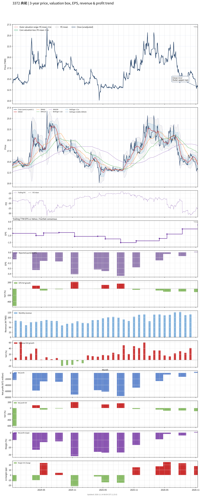

# 3372 - 典範

## 業務簡介
**板塊:** Technology
**產業:** Semiconductors
**市值:** 3,095 百萬台幣
**企業價值:** 3,039 百萬台幣

典範半導體 (3372) 是半導體 IC 封裝與測試公司，1998 年成立於高雄。產品包括 TSOP、SOP、SSOP/TSSOP、[[QFN]]/DFN、TQFP 等[[導線架]]封裝，以及 LGA、VLGA、microSD/SD 卡等基板型封裝。

## 供應鏈位置
**上游 (封裝材料):**
- **導線架:** 、[[長華科技]] 等導線架供應
- **封裝基板:** 基板供應

**中游 (封裝測試):**
- **IC 封測:** **典範** (導線架封裝/基板封裝/記憶卡封裝)

**下游 (IC 設計):**
- **IC 設計:** 記憶體及控制器 IC 設計公司
- **記憶卡:** 記憶卡品牌廠

## 主要客戶及供應商
### 主要客戶
- **IC 設計:** 記憶體及控制器 IC 設計公司
- **記憶卡:** 記憶卡品牌廠

### 主要供應商
- **導線架:** 、[[長華科技]]

### 競爭同業
- **競爭同業:** 、[[矽品]]

## 財務概況 (單位: 百萬台幣, 只有 Margin 為 %)
### 估值指標 (股價 $13.15 as of 2026-11-12 | TTM 截至 2026-09-30 | Forward 預估至 2026-12-31)
| P/E (TTM) | Forward P/E | P/S (TTM) |  P/B | EV/EBITDA |
|-----------|-------------|-----------|------|-----------|
|       N/A |         N/A |      2.36 | 1.61 |     30.07 |

### 年度關鍵財務數據 (近 3 年)
|                         |   2025-12-31 |   2024-12-31 |   2023-12-31 |
|:------------------------|-------------:|-------------:|-------------:|
| Revenue                 |      1099.07 |       904.16 |       861.69 |
| Gross Profit            |      -122.04 |      -146.61 |      -107.59 |
| Gross Margin (%)        |       -11.10 |       -16.22 |       -12.49 |
| Selling & Marketing Exp |        19.36 |        18.83 |        20.45 |
| R&D Exp                 |        26.98 |        28.05 |        24.13 |
| General & Admin Exp     |        46.76 |        48.75 |        44.71 |
| Operating Income        |      -215.14 |      -242.25 |      -196.88 |
| Operating Margin (%)    |       -19.57 |       -26.79 |       -22.85 |
| Net Income              |      -213.69 |      -185.38 |      -176.99 |
| Net Margin (%)          |       -19.44 |       -20.50 |       -20.54 |
| Op Cash Flow            |       -85.29 |        87.00 |        89.31 |
| Investing Cash Flow     |        59.90 |      -279.29 |       -92.49 |
| Financing Cash Flow     |        -2.01 |        -2.15 |       -90.16 |
| CAPEX                   |      -106.50 |      -172.18 |      -152.44 |

### 季度關鍵財務數據 (近 4 季)
|                         |   2026-09-30 |   2026-06-30 |   2026-03-31 |   2025-12-31 |
|:------------------------|-------------:|-------------:|-------------:|-------------:|
| Revenue                 |       365.23 |       338.32 |       309.68 |       298.43 |
| Gross Profit            |        21.09 |         6.83 |        12.72 |        -8.57 |
| Gross Margin (%)        |         5.77 |         2.02 |         4.11 |        -2.87 |
| Selling & Marketing Exp |         5.25 |         5.10 |         8.91 |         5.09 |
| R&D Exp                 |         2.95 |         3.84 |         1.97 |         6.75 |
| General & Admin Exp     |        13.35 |        13.11 |        12.55 |        11.88 |
| Operating Income        |        -0.47 |       -15.23 |       -10.70 |       -32.29 |
| Operating Margin (%)    |        -0.13 |        -4.50 |        -3.46 |       -10.82 |
| Net Income              |         3.06 |       -12.98 |        -5.42 |       -26.85 |
| Net Margin (%)          |         0.84 |        -3.84 |        -1.75 |        -9.00 |
| Op Cash Flow            |        -0.03 |        -7.72 |        -4.98 |        -9.94 |
| Investing Cash Flow     |      -380.20 |       -26.63 |       -22.59 |        25.54 |
| Financing Cash Flow     |      1003.92 |        -0.53 |        -0.52 |        -0.51 |
| CAPEX                   |      -180.20 |       -26.63 |       -22.49 |       -33.86 |
## Chart

