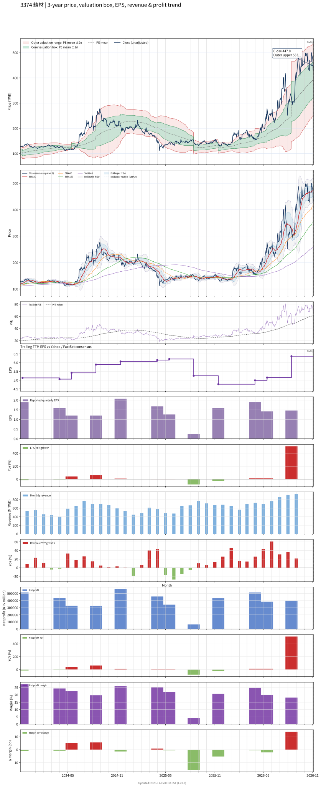

# 3374 - 精材

## 業務簡介
**板塊:** Technology
**產業:** Semiconductors
**市值:** 140,838 百萬台幣
**企業價值:** 138,235 百萬台幣

精材科技 (3374) 是  集團旗下[[晶圓級封裝]] ([[WLCSP]]) 子公司，台積電持股逾 30%。公司專注於 [[CMOS 影像感測器]] (CIS) 封裝，並擴展至各式感測元件、[[MEMS]] 封裝及晶圓測試服務。毛利率達 33.74% 為純封測同業之冠。

## 供應鏈位置
**上游 (晶圓與材料):**
- **母公司:**  (持股 30%+，晶圓供應)
- **彩色濾光片:**  (VisEra，CIS 彩色濾光片/微透鏡)

**中游 (晶圓級封裝):**
- **WLCSP:** **精材** (CIS 晶圓級封裝，台積電集團)

**下游 (影像感測):**
- **CIS 客戶:** [[Sony Semiconductor]]、[[OmniVision]] (影像感測器封裝)
- **指紋辨識:** 指紋感測器封裝客戶

## 主要客戶及供應商
### 主要客戶
- **CIS:** [[Sony Semiconductor]]、[[OmniVision]] (影像感測器封裝)
- **母公司:**  (策略合作)

### 主要供應商
- **母公司:**  (持股 30%+)
- **彩色濾光片:**  (VisEra)

### 競爭同業
- **競爭同業:** [[Amkor]] (WLCSP)

## 財務概況 (單位: 百萬台幣, 只有 Margin 為 %)
### 估值指標 (股價 $519.00 as of 2026-11-13 | TTM 截至 2026-09-30 | Forward 預估至 2026-12-31)
| P/E (TTM) | Forward P/E | P/S (TTM) |   P/B | EV/EBITDA |
|-----------|-------------|-----------|-------|-----------|
|     74.25 |       53.92 |     15.88 | 13.42 |     40.63 |

### 年度關鍵財務數據 (近 3 年)
|                         |   2025-12-31 |   2024-12-31 |   2023-12-31 |
|:------------------------|-------------:|-------------:|-------------:|
| Revenue                 |      7238.55 |      7059.94 |      6386.87 |
| Gross Profit            |      1984.72 |      2492.93 |      2179.21 |
| Gross Margin (%)        |        27.42 |        35.31 |        34.12 |
| Selling & Marketing Exp |        57.02 |        55.74 |        50.59 |
| R&D Exp                 |       323.20 |       411.97 |       369.09 |
| General & Admin Exp     |       127.62 |       129.72 |       122.02 |
| Operating Income        |      1591.07 |      1975.70 |      1705.09 |
| Operating Margin (%)    |        21.98 |        27.98 |        26.70 |
| Net Income              |      1353.53 |      1669.72 |      1375.77 |
| Net Margin (%)          |        18.70 |        23.65 |        21.54 |
| Op Cash Flow            |      1865.58 |      2138.70 |      1887.86 |
| Investing Cash Flow     |     -2829.55 |     -1441.99 |      -821.41 |
| Financing Cash Flow     |       282.36 |       619.03 |      -856.63 |
| CAPEX                   |     -2961.83 |     -1523.37 |      -871.11 |

### 季度關鍵財務數據 (近 4 季)
|                         |   2026-09-30 |   2026-06-30 |   2026-03-31 |   2025-12-31 |
|:------------------------|-------------:|-------------:|-------------:|-------------:|
| Revenue                 |      2702.09 |      2184.68 |      1913.72 |      2065.86 |
| Gross Profit            |       889.59 |       604.21 |       567.55 |       678.05 |
| Gross Margin (%)        |        32.92 |        27.66 |        29.66 |        32.82 |
| Selling & Marketing Exp |        17.00 |        16.43 |        16.15 |        15.68 |
| R&D Exp                 |        88.40 |        80.58 |        80.04 |        80.82 |
| General & Admin Exp     |        42.73 |        35.54 |        33.91 |        32.28 |
| Operating Income        |       756.11 |       486.54 |       452.01 |       564.24 |
| Operating Margin (%)    |        27.98 |        22.27 |        23.62 |        27.31 |
| Net Income              |       609.24 |       396.32 |       384.42 |       514.06 |
| Net Margin (%)          |        22.55 |        18.14 |        20.09 |        24.88 |
| Op Cash Flow            |       557.04 |       689.60 |       960.73 |       939.49 |
| Investing Cash Flow     |      -817.46 |      -712.57 |      -887.42 |      -646.38 |
| Financing Cash Flow     |      -705.59 |       -27.34 |      1747.73 |       181.19 |
| CAPEX                   |      -840.98 |      -736.61 |      -906.87 |      -661.97 |
## Chart

