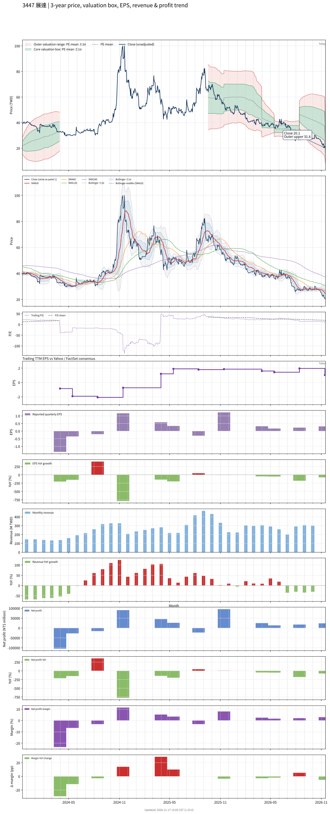

# 3447 - 展達

## 業務簡介
**板塊:** Technology
**產業:** Communication Equipment
**市值:** 1,495 百萬台幣
**企業價值:** 776 百萬台幣

展達通訊 (3447，XAVi Technologies) 隸屬  (Chicony) 集團，為專業寬頻網路終端設備製造商。主要產品涵蓋光纖 [[PON]] 寬頻閘道器、[[G.fast]] 用戶端設備 (CPE)、[[Wi-Fi]] 無線路由器及 [[AIoT]] 智慧家庭裝置 (如網路攝影機、物聯網感測器)。

公司具備完整軟硬體自主研發能力，產品銷售模式包括 OEM/ODM 代工及自有品牌，主攻歐美電信營運商及中小企業網路市場。近年積極開發 AI 網通產品及資安等級網路設備，拓展軍工級高規格通訊市場。生產基地設於中國蘇州及泰國，有效分散地緣政治風險。

## 供應鏈位置
**上游 (網通晶片與模組):**
- **PON 晶片:** 被動光纖網路核心晶片
- **Wi-Fi SoC:** 、、 等網通 SoC
- **光通訊元件:** 光通訊主被動元件

**中游 (寬頻設備製造):**
- **寬頻 CPE:** **展達** (群光集團，PON 閘道器/G.fast/Wi-Fi 路由器/AIoT 製造)

**下游 (電信與企業網):**
- **電信商:** 歐美區域電信營運商 (寬頻 CPE)
- **企業網:** 中小企業及政府 (資安網路設備)
- **母公司:**  集團 (運籌與議價支援)

## 主要客戶及供應商
### 主要客戶
- **電信營運商:** 歐美區域電信商 (光纖閘道器/Wi-Fi 路由器)
- **企業與軍工:** 軍工級資安網路設備客戶
- **母公司集團:**  集團

### 主要供應商
- **網通晶片:** 、、

### 競爭同業
- **競爭同業:** 、、

## 競爭與營運風險
- 公司具備完整軟硬體自主研發能力，產品銷售模式包括 OEM/ODM 代工及自有品牌，主攻歐美電信營運商及中小企業網路市場。近年積極開發 AI 網通產品及資安等級網路設備，拓展軍工級高規格通訊市場。生產基地設於中國蘇州及泰國，有效分散地緣政治風險。

## 財務概況 (單位: 百萬台幣, 只有 Margin 為 %)
### 估值指標 (股價 $19.30 as of 2026-11-25 | TTM 截至 2026-09-30 | Forward 預估至 2026-12-31)
| P/E (TTM) | Forward P/E | P/S (TTM) |  P/B | EV/EBITDA |
|-----------|-------------|-----------|------|-----------|
|     17.39 |         N/A |      0.43 | 1.18 |      7.88 |

### 年度關鍵財務數據 (近 3 年)
|                         |   2025-12-31 |   2024-12-31 |   2023-12-31 |
|:------------------------|-------------:|-------------:|-------------:|
| Revenue                 |      3654.97 |      2558.31 |      2868.68 |
| Gross Profit            |       390.65 |       299.18 |       229.78 |
| Gross Margin (%)        |        10.69 |        11.69 |         8.01 |
| Selling & Marketing Exp |        70.78 |        63.94 |        70.98 |
| R&D Exp                 |       133.23 |       145.63 |       143.29 |
| General & Admin Exp     |        95.95 |        74.33 |       100.04 |
| Operating Income        |        90.70 |        15.28 |       -84.53 |
| Operating Margin (%)    |         2.48 |         0.60 |        -2.95 |
| Net Income              |       123.50 |        92.78 |       -66.06 |
| Net Margin (%)          |         3.38 |         3.63 |        -2.30 |
| Op Cash Flow            |        -2.40 |       440.31 |       876.59 |
| Investing Cash Flow     |       -59.07 |       -39.56 |        12.53 |
| Financing Cash Flow     |       -89.75 |      -280.90 |      -343.05 |
| CAPEX                   |       -53.35 |       -42.84 |       -54.58 |

### 季度關鍵財務數據 (近 4 季)
|                         |   2026-09-30 |   2026-06-30 |   2026-03-31 |   2025-12-31 |
|:------------------------|-------------:|-------------:|-------------:|-------------:|
| Revenue                 |       797.34 |       854.69 |       823.56 |       989.48 |
| Gross Profit            |       108.86 |        78.78 |        77.38 |        65.61 |
| Gross Margin (%)        |        13.65 |         9.22 |         9.40 |         6.63 |
| Selling & Marketing Exp |         8.49 |        14.93 |        18.35 |        17.49 |
| R&D Exp                 |        29.64 |        26.96 |        26.75 |        30.23 |
| General & Admin Exp     |        23.80 |        56.35 |        23.87 |        22.81 |
| Operating Income        |        46.92 |       -19.46 |         8.40 |        -4.92 |
| Operating Margin (%)    |         5.88 |        -2.28 |         1.02 |        -0.50 |
| Net Income              |        23.62 |        17.51 |        13.36 |        24.82 |
| Net Margin (%)          |         2.96 |         2.05 |         1.62 |         2.51 |
| Op Cash Flow            |       -45.08 |       204.00 |        94.89 |       -45.29 |
| Investing Cash Flow     |       -11.39 |        16.62 |       -10.98 |       -17.80 |
| Financing Cash Flow     |        17.70 |       -67.25 |       -15.24 |       -71.77 |
| CAPEX                   |       -19.12 |        -7.76 |       -12.56 |       -12.28 |
## Chart

