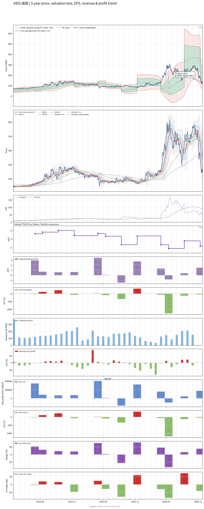

# 3455 - 由田

## 業務簡介
**板塊:** Technology
**產業:** Electronic Components
**市值:** 7,302 百萬台幣
**企業價值:** 7,689 百萬台幣

由田新技 (Utechzone) 為台灣領先之 **自動光學檢測 (AOI)** 設備廠。
早期深耕 **PCB** 與 **LCD 面板** 檢測，市佔率高。
近年積極轉型 **半導體封裝檢測**，尤其在 **IC 載板** ([[ABF]]/BT) 外觀檢查具有高市佔。
並切入 **先進封裝** (, [[FOPLP]]) 檢測設備，已打入封測代工大廠 (OSAT) 供應鏈，[[半導體]]營收比重顯著提升。

## 供應鏈位置
*   **上游**: [[鏡頭]], [[光源]], , [[運動控制元件]].
*   **中游**: **由田 (3455)** - AOI 設備研發與組裝.
*   **下游**:
    *   **IC 載板廠**: , , .
    *   **封測廠**: , [[矽品]] (/[[FOPLP]] 應用).
    *   **PCB/面板廠**: , , .

## 主要客戶及供應商
### 主要客戶
-  (ASE).
-  (Unimicron).
-  (Nan Ya [[PCB]]).

## 財務概況 (單位: 百萬台幣, 只有 Margin 為 %)
### 估值指標 (股價 $122.00 as of 2026-11-22 | TTM 截至 2026-09-30 | Forward 預估至 2026-12-31)
| P/E (TTM) | Forward P/E | P/S (TTM) |  P/B | EV/EBITDA |
|-----------|-------------|-----------|------|-----------|
|     52.36 |         N/A |      4.87 | 2.93 |    123.56 |

### 年度關鍵財務數據 (近 3 年)
|                         |   2025-12-31 |   2024-12-31 |   2023-12-31 |
|:------------------------|-------------:|-------------:|-------------:|
| Revenue                 |      1675.34 |      1851.97 |      2009.81 |
| Gross Profit            |       901.07 |      1001.33 |      1170.76 |
| Gross Margin (%)        |        53.78 |        54.07 |        58.25 |
| Selling & Marketing Exp |       364.32 |       421.77 |       427.09 |
| R&D Exp                 |       266.68 |       233.31 |       240.10 |
| General & Admin Exp     |       183.80 |       155.81 |       164.41 |
| Operating Income        |        86.26 |       190.44 |       339.17 |
| Operating Margin (%)    |         5.15 |        10.28 |        16.88 |
| Net Income              |       159.91 |       316.56 |       314.23 |
| Net Margin (%)          |         9.55 |        17.09 |        15.63 |
| Op Cash Flow            |       389.31 |       345.61 |       497.64 |
| Investing Cash Flow     |        41.92 |       -60.16 |        14.54 |
| Financing Cash Flow     |      -225.64 |      -382.81 |      -567.19 |
| CAPEX                   |       -90.99 |       -85.40 |        -6.08 |

### 季度關鍵財務數據 (近 4 季)
|                         |   2026-09-30 |   2026-06-30 |   2026-03-31 |   2025-12-31 |
|:------------------------|-------------:|-------------:|-------------:|-------------:|
| Revenue                 |       567.71 |       355.54 |       147.17 |       430.24 |
| Gross Profit            |       334.93 |       205.76 |        80.27 |       228.55 |
| Gross Margin (%)        |        59.00 |        57.87 |        54.54 |        53.12 |
| Selling & Marketing Exp |       115.89 |       101.78 |        73.91 |        86.43 |
| R&D Exp                 |        64.80 |        62.84 |        55.44 |        75.77 |
| General & Admin Exp     |        50.38 |        49.03 |        40.71 |        52.90 |
| Operating Income        |       103.85 |        -7.88 |       -89.79 |        13.45 |
| Operating Margin (%)    |        18.29 |        -2.22 |       -61.01 |         3.13 |
| Net Income              |        87.50 |        22.58 |       -48.72 |        78.67 |
| Net Margin (%)          |        15.41 |         6.35 |       -33.11 |        18.29 |
| Op Cash Flow            |      -133.83 |       -11.83 |      -106.11 |       105.01 |
| Investing Cash Flow     |        47.95 |       -41.54 |        -2.94 |       -20.03 |
| Financing Cash Flow     |       370.54 |       115.42 |       -56.29 |       -16.23 |
| CAPEX                   |       -10.02 |       -11.27 |       -13.91 |       -18.12 |
## Chart

