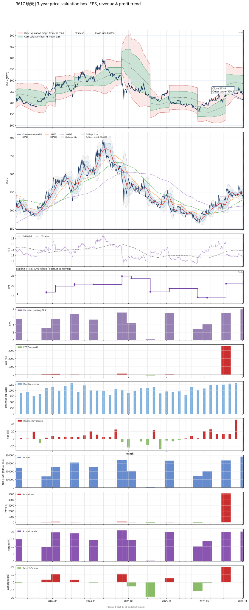

# 3617 - 碩天

## 業務簡介
**板塊:** Industrials
**產業:** Electrical Equipment & Parts
**市值:** 25,349 百萬台幣
**企業價值:** 17,103 百萬台幣

碩天科技 (3617，CyberPower) 全球領先[[UPS]]品牌，北美20kVA以下市佔約15% (第二，僅次[[APC]]/[[Schneider Electric]])。零售含[[Best Buy]]、[[Walmart]]、[[Costco]]、[[Home Depot]]。經銷含[[Ingram Micro]]、[[TD Synnex]]。電信含[[AT&T]]、[[Verizon]]。

## 供應鏈位置
**上游:** 電池/[[PCB]]/機殼
**中游:** **碩天** (CyberPower [[UPS]]/PDU)
**下游:** [[Best Buy]]、[[Walmart]]、[[Costco]]、[[AT&T]]、[[Verizon]]

## 主要客戶及供應商
### 主要客戶
- [[Best Buy]]、[[Walmart]]、[[Costco]]、[[Home Depot]]
- [[Ingram Micro]]、[[TD Synnex]]
- [[AT&T]]、[[Verizon]]

### 主要供應商
- 電池/[[PCB]]/機殼

## 財務概況 (單位: 百萬台幣, 只有 Margin 為 %)
### 估值指標 (股價 $267.50 as of 2026-11-12 | TTM 截至 2026-06-30 | Forward 預估至 2026-12-31)
| P/E (TTM) | Forward P/E | P/S (TTM) |  P/B | EV/EBITDA |
|-----------|-------------|-----------|------|-----------|
|     12.21 |       12.74 |      2.05 | 2.63 |      6.77 |

### 年度關鍵財務數據 (近 3 年)
|                         |   2025-12-31 |   2024-12-31 |   2023-12-31 |
|:------------------------|-------------:|-------------:|-------------:|
| Revenue                 |     11869.88 |     12492.00 |     11731.17 |
| Gross Profit            |      6366.49 |      6364.75 |      5592.85 |
| Gross Margin (%)        |        53.64 |        50.95 |        47.68 |
| Selling & Marketing Exp |      2467.90 |      2102.32 |      2098.64 |
| R&D Exp                 |       471.56 |       473.77 |       443.92 |
| General & Admin Exp     |      1487.34 |      1338.25 |      1229.49 |
| Operating Income        |      1939.68 |      2450.41 |      1820.79 |
| Operating Margin (%)    |        16.34 |        19.62 |        15.52 |
| Net Income              |      1362.74 |      2283.86 |      1468.53 |
| Net Margin (%)          |        11.48 |        18.28 |        12.52 |
| Op Cash Flow            |      1879.47 |      2618.95 |      2132.64 |
| Investing Cash Flow     |       366.96 |      -803.55 |      -279.51 |
| Financing Cash Flow     |     -2469.61 |      -484.12 |      -790.29 |
| CAPEX                   |      -303.81 |      -178.52 |      -102.95 |

### 季度關鍵財務數據 (近 4 季)
|                         |   2026-09-30 |   2026-06-30 |   2026-03-31 |   2025-12-31 |
|:------------------------|-------------:|-------------:|-------------:|-------------:|
| Revenue                 |      3802.39 |      3338.85 |      2931.93 |      2763.32 |
| Gross Profit            |      2248.15 |      2099.87 |      1579.25 |      1426.37 |
| Gross Margin (%)        |        59.12 |        62.89 |        53.86 |        51.62 |
| Selling & Marketing Exp |       727.21 |       651.11 |       618.07 |       650.06 |
| R&D Exp                 |       128.68 |       120.01 |       116.59 |       109.43 |
| General & Admin Exp     |       425.13 |       402.55 |       370.84 |       398.18 |
| Operating Income        |       967.12 |       926.21 |       473.74 |       268.70 |
| Operating Margin (%)    |        25.43 |        27.74 |        16.16 |         9.72 |
| Net Income              |       758.63 |       658.19 |       388.95 |       269.96 |
| Net Margin (%)          |        19.95 |        19.71 |        13.27 |         9.77 |
| Op Cash Flow            |       777.14 |       732.54 |       177.19 |       895.34 |
| Investing Cash Flow     |      -549.74 |      -304.44 |      -133.37 |       478.49 |
| Financing Cash Flow     |      -980.38 |       -38.87 |       -40.02 |       -38.74 |
| CAPEX                   |       -12.00 |      -275.73 |       -80.07 |       -24.19 |
## Chart

