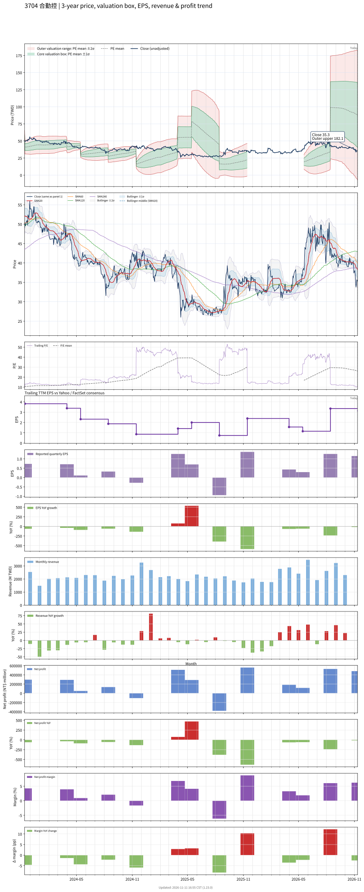

# 3704 - 合勤控

## 業務簡介
**板塊:** Technology
**產業:** Communication Equipment
**市值:** 13,855 百萬台幣
**企業價值:** 18,912 百萬台幣

合勤投資控股 (3704，Zyxel Group) 為台灣歷史最悠久之通訊網路設備集團，旗下三大事業群：合勤科技 (Zyxel Communications，專攻電信營運商標案)、兆勤科技 ([[Zyxel Networks]]，主攻企業 SMB 網路資安自有品牌) 及盟創科技 ([[MitraStar]]，主攻硬體 OEM/ODM 代工)。

產品涵蓋光纖寬頻 ([[PON]])、 固定無線接取 ([[FWA]])、[[Wi-Fi 7]] 路由器、網安防火牆及 Nebula 雲端網管平台。兆勤科技 Nebula 雲端生態系已部署超過百萬台裝置至全球 150 國以上中小企業。公司 2026 年獲選入 S&P Global 永續年鑑，在全球電信設備製造商中排名第一。

## 供應鏈位置
**上游 (網通晶片與元件):**
- **網通 SoC:** 、、 等網通晶片
- **射頻元件:** 通訊射頻晶片
- **PCB:** 工業級 PCB 載板

**中游 (多角化網通設備集團):**
- **品牌事業:** 合勤科技 (電信營運商標案)
- **通路事業:** [[Zyxel Networks]] 兆勤 (企業 SMB 資安品牌/Nebula 雲管理)
- **代工事業:** [[MitraStar]] 盟創 (高彈性 OEM/ODM)

**下游 (全球電信與企業):**
- **歐美電信:** [[Telenor]]、歐美亞一線電信營運商
- **中小企業:** 全球 150 國 SMB 及 MSP 通路
- **資安合作:** 全球端點防護合作夥伴

## 主要客戶及供應商
### 主要客戶
- **電信營運商:** [[Telenor]] (挪威)、歐美亞一線電信商 (5G FWA/光纖標案)
- **企業通路:** 全球 150 國中小企業 (Nebula 雲端網管)
- **資安 MSP:** 管理服務提供商 (企業資安方案)

### 主要供應商
- **網通晶片:** 、、

### 競爭同業
- **競爭同業:** 、、
- **競爭同業:** 

## 財務概況 (單位: 百萬台幣, 只有 Margin 為 %)
### 估值指標 (股價 $34.25 as of 2026-11-12 | TTM 截至 2026-09-30 | Forward 預估至 2026-12-31)
| P/E (TTM) | Forward P/E | P/S (TTM) |  P/B | EV/EBITDA |
|-----------|-------------|-----------|------|-----------|
|     11.23 |       10.44 |      0.49 | 1.11 |     10.38 |

### 年度關鍵財務數據 (近 3 年)
|                         |   2025-12-31 |   2024-12-31 |   2023-12-31 |
|:------------------------|-------------:|-------------:|-------------:|
| Revenue                 |     25295.20 |     25969.44 |     30379.98 |
| Gross Profit            |      6743.32 |      6434.22 |      6679.14 |
| Gross Margin (%)        |        26.66 |        24.78 |        21.99 |
| Selling & Marketing Exp |      2649.80 |      2626.12 |      2414.12 |
| R&D Exp                 |      1854.70 |      1906.80 |      1916.64 |
| General & Admin Exp     |      1047.88 |       979.96 |      1047.73 |
| Operating Income        |      1190.94 |       921.34 |      1300.64 |
| Operating Margin (%)    |         4.71 |         3.55 |         4.28 |
| Net Income              |       634.14 |       569.65 |      1341.16 |
| Net Margin (%)          |         2.51 |         2.19 |         4.41 |
| Op Cash Flow            |       336.14 |     -1385.22 |      3635.55 |
| Investing Cash Flow     |      -515.49 |     -1748.67 |      -327.29 |
| Financing Cash Flow     |       122.43 |      -265.02 |     -2773.59 |
| CAPEX                   |      -545.04 |      -948.71 |      -241.21 |

### 季度關鍵財務數據 (近 4 季)
|                         |   2026-09-30 |   2026-06-30 |   2026-03-31 |   2025-12-31 |
|:------------------------|-------------:|-------------:|-------------:|-------------:|
| Revenue                 |      7753.17 |      8751.28 |      6310.21 |      5655.91 |
| Gross Profit            |      1978.19 |      2073.76 |      1515.16 |      1729.64 |
| Gross Margin (%)        |        25.51 |        23.70 |        24.01 |        30.58 |
| Selling & Marketing Exp |       653.29 |       626.31 |       660.63 |       717.28 |
| R&D Exp                 |       487.18 |       468.94 |       477.17 |       486.19 |
| General & Admin Exp     |       275.45 |       267.34 |       259.81 |       275.60 |
| Operating Income        |       562.26 |       711.17 |       117.55 |       250.58 |
| Operating Margin (%)    |         7.25 |         8.13 |         1.86 |         4.43 |
| Net Income              |       468.54 |       513.46 |       117.07 |       177.87 |
| Net Margin (%)          |         6.04 |         5.87 |         1.86 |         3.14 |
| Op Cash Flow            |     -2144.28 |     -1718.89 |      -484.76 |       950.87 |
| Investing Cash Flow     |       -53.06 |       158.93 |      -115.36 |      -195.90 |
| Financing Cash Flow     |      3373.51 |      1505.59 |       190.81 |      -538.88 |
| CAPEX                   |      -281.98 |       -79.61 |      -139.43 |      -161.63 |
## Chart

