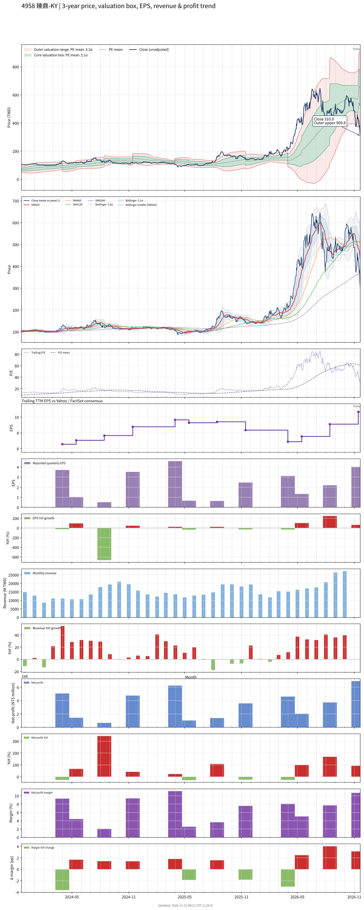

# 4958 - 臻鼎-KY

## 業務簡介
**板塊:** Technology
**產業:** Electronic Components
**市值:** 419,609 百萬台幣
**企業價值:** 471,366 百萬台幣

臻鼎-KY (Zhen Ding Tech) 為全球最大 **印刷電路板 (PCB)** 製造商。
隸屬於 **** 集團 ()，提供「One ZDT」一站式購足服務。
產品線極其完整：
1.  **軟板 ([[FPC]])**: 全球市佔第一，主要應用於手機 (iPhone)、平板。
2.  **類載板 ([[SLP]]) / HDI**: 高階手機主板。
3.  **IC 載板**: [[BT 載板]] (秦皇島廠) 與 **** (深圳/高雄廠)，積極切入  與車載領域。
4.  **硬板 (RPCB)**: 伺服器、車用板。
近年重心轉向 **** 與 **IC 載板** 之高階產能擴充。

## 供應鏈位置
*   **中游 (本體)**: **臻鼎-KY (4958)** - 各式 PCB/載板製造.
*   **上游**: [[銅箔]]基板 ([[CCL]]) - , , ; [[銅箔]], 鑽針 ().
*   **下游**:
    *   **終端品牌**: **** (最大客戶), , .
    *   **EMS 廠**: ****, .
    *   **AI/HPC**: ,  (載板與伺服器板).

## 主要客戶及供應商
### 主要客戶
****: iPhone/iPad/Watch 全系列 PCB 主力供應商.
**AI/Server**: Nvidia, , .

### 主要供應商
**CCL**:  (高階手機/AI板), .
**鑽針**:  (策略合作).

## 財務概況 (單位: 百萬台幣, 只有 Margin 為 %)
### 估值指標 (股價 $370.50 as of 2026-11-18 | TTM 截至 2026-09-30 | Forward 預估至 2026-12-31)
| P/E (TTM) | Forward P/E | P/S (TTM) |  P/B | EV/EBITDA |
|-----------|-------------|-----------|------|-----------|
|     37.46 |       13.61 |      1.99 | 2.51 |     11.64 |

### 年度關鍵財務數據 (近 3 年)
|                         |   2025-12-31 |   2024-12-31 |   2023-12-31 |
|:------------------------|-------------:|-------------:|-------------:|
| Revenue                 |    182521.62 |    171663.85 |    151398.04 |
| Gross Profit            |     36136.40 |     32460.76 |     27459.49 |
| Gross Margin (%)        |        19.80 |        18.91 |        18.14 |
| Selling & Marketing Exp |      2351.91 |      2154.91 |      1899.65 |
| R&D Exp                 |     11807.10 |     11715.28 |      9665.48 |
| General & Admin Exp     |      8041.02 |      7025.11 |      6724.67 |
| Operating Income        |     13936.38 |     11565.46 |      9169.68 |
| Operating Margin (%)    |         7.64 |         6.74 |         6.06 |
| Net Income              |      6790.51 |      9179.69 |      6188.73 |
| Net Margin (%)          |         3.72 |         5.35 |         4.09 |
| Op Cash Flow            |     27616.51 |     30384.82 |     33598.64 |
| Investing Cash Flow     |    -31960.00 |     -8146.90 |    -25730.35 |
| Financing Cash Flow     |     -1865.31 |     -7150.61 |      -495.10 |
| CAPEX                   |    -33528.63 |    -16258.18 |    -26107.14 |

### 季度關鍵財務數據 (近 4 季)
|                         |   2026-09-30 |   2026-06-30 |   2026-03-31 |   2025-12-31 |
|:------------------------|-------------:|-------------:|-------------:|-------------:|
| Revenue                 |     64624.44 |     48430.66 |     40728.19 |     56870.10 |
| Gross Profit            |     17913.25 |     11186.10 |      8811.69 |     12830.08 |
| Gross Margin (%)        |        27.72 |        23.10 |        21.64 |        22.56 |
| Selling & Marketing Exp |       916.72 |       667.39 |       615.89 |       743.93 |
| R&D Exp                 |      5134.22 |      4218.34 |      3575.93 |      3653.26 |
| General & Admin Exp     |      3094.36 |      2518.25 |      2147.04 |      2511.32 |
| Operating Income        |      8767.96 |      3782.12 |      2472.83 |      5921.56 |
| Operating Margin (%)    |        13.57 |         7.81 |         6.07 |        10.41 |
| Net Income              |      4496.11 |      2391.55 |      1425.63 |      3161.28 |
| Net Margin (%)          |         6.96 |         4.94 |         3.50 |         5.56 |
| Op Cash Flow            |     -1411.93 |      1063.09 |     10949.34 |     12209.80 |
| Investing Cash Flow     |    -25861.15 |    -18261.66 |    -12126.34 |     -9269.75 |
| Financing Cash Flow     |     30725.31 |     32039.01 |     10576.93 |    -10751.35 |
| CAPEX                   |    -28520.77 |    -16519.88 |    -12999.34 |     -9030.23 |
## Chart

