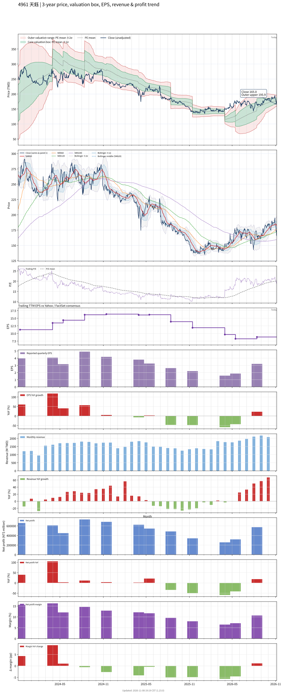

# 4961 - 天鈺

## 業務簡介
**板塊:** Technology
**產業:** Semiconductors
**市值:** 22,214 百萬台幣
**企業價值:** 16,384 百萬台幣

天鈺科技 (4961，Fitipower) 為顯示驅動及[[電源管理 IC]]設計公司，產品涵蓋 TFT-LCD/[[AMOLED]] 顯示驅動 IC、[[TDDI]] 觸控顯示整合晶片及面板電源管理 IC。應用於手機、平板、筆電及車用顯示面板。

## 供應鏈位置
**上游 (晶圓代工):**
- **晶圓製造:** 台灣晶圓代工廠

**中游 (IC 設計):**
- **驅動/PMIC:** **天鈺** (LCD/[[AMOLED]] 驅動 IC、TDDI、面板 PMIC)

**下游 (面板廠):**
- **面板:** 、、中國面板廠

## 主要客戶及供應商
### 主要客戶
- **面板廠:** 、、中國面板廠

### 主要供應商
- **晶圓代工:** 台灣晶圓代工廠

### 競爭同業
- **競爭同業:** 、、[[奇景光電]]

## 財務概況 (單位: 百萬台幣, 只有 Margin 為 %)
### 估值指標 (股價 $185.50 as of 2026-11-13 | TTM 截至 2026-09-30 | Forward 預估至 2026-12-31)
| P/E (TTM) | Forward P/E | P/S (TTM) |  P/B | EV/EBITDA |
|-----------|-------------|-----------|------|-----------|
|     16.83 |       13.33 |      1.10 | 1.26 |      7.67 |

### 年度關鍵財務數據 (近 3 年)
|                         |   2025-12-31 |   2024-12-31 |   2023-12-31 |
|:------------------------|-------------:|-------------:|-------------:|
| Revenue                 |     17993.04 |     19199.74 |     16286.52 |
| Gross Profit            |      5127.43 |      5492.63 |      5282.48 |
| Gross Margin (%)        |        28.50 |        28.61 |        32.43 |
| Selling & Marketing Exp |       596.05 |       420.33 |       353.23 |
| R&D Exp                 |      2808.78 |      2494.33 |      2245.26 |
| General & Admin Exp     |       387.66 |       374.39 |       338.25 |
| Operating Income        |      1334.94 |      2203.57 |      2345.74 |
| Operating Margin (%)    |         7.42 |        11.48 |        14.40 |
| Net Income              |      1169.20 |      1946.07 |      2150.21 |
| Net Margin (%)          |         6.50 |        10.14 |        13.20 |
| Op Cash Flow            |      2559.42 |      1231.42 |      2995.82 |
| Investing Cash Flow     |      -374.81 |      -279.25 |     -5377.41 |
| Financing Cash Flow     |     -1611.41 |     -1403.52 |     -2280.68 |
| CAPEX                   |      -567.74 |      -733.94 |      -465.49 |

### 季度關鍵財務數據 (近 4 季)
|                         |   2026-09-30 |   2026-06-30 |   2026-03-31 |   2025-12-31 |
|:------------------------|-------------:|-------------:|-------------:|-------------:|
| Revenue                 |      6252.59 |      5385.87 |      4501.22 |      3984.05 |
| Gross Profit            |      1845.07 |      1447.31 |      1251.28 |      1106.07 |
| Gross Margin (%)        |        29.51 |        26.87 |        27.80 |        27.76 |
| Selling & Marketing Exp |       143.24 |       139.61 |       136.39 |       166.29 |
| R&D Exp                 |       768.17 |       713.69 |       716.08 |       743.39 |
| General & Admin Exp     |       127.67 |       100.45 |       104.22 |       107.20 |
| Operating Income        |       805.99 |       493.55 |       294.59 |        89.18 |
| Operating Margin (%)    |        12.89 |         9.16 |         6.54 |         2.24 |
| Net Income              |       488.67 |       384.06 |       224.26 |       189.94 |
| Net Margin (%)          |         7.82 |         7.13 |         4.98 |         4.77 |
| Op Cash Flow            |      -279.40 |      1273.87 |       838.79 |        81.32 |
| Investing Cash Flow     |      2726.08 |     -1532.81 |      -849.34 |       -49.57 |
| Financing Cash Flow     |     -1407.00 |        -8.65 |      -394.24 |        26.17 |
| CAPEX                   |      -166.31 |      -550.98 |      -102.39 |      -233.31 |
## Chart

