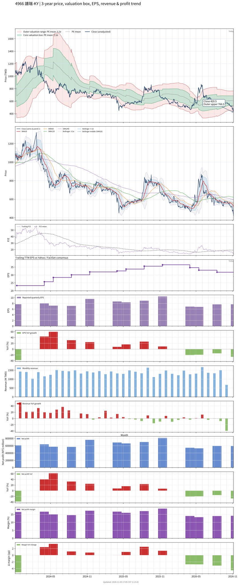

# 4966 - 譜瑞-KY

## 業務簡介
**板塊:** Technology
**產業:** Semiconductors
**市值:** 32,328 百萬台幣
**企業價值:** 22,854 百萬台幣

譜瑞-KY (Parade Technologies) 成立於 2005 年，總部位於美國加州 (註冊於開曼群島)。公司為全球領先的 **高速傳輸介面 IC** (High-speed Interface) 及 **顯示驅動 IC** (Display & Touch) 供應商。譜瑞是 **DisplayPort (DP)** 標準的重要制定者與領導者，專注於 **eDP T-CON (嵌入式時序控制器)**、**High-speed Redriver/Retimer** (USB4, [[PCIe]] Gen4/5, HDMI)。譜瑞在  供應鏈中地位穩固，為 iPad/MacBook T-CON 獨家/主要供應商。

## 供應鏈位置
**角色:** 高速傳輸與顯示介面 IC 設計領導廠。
**上游:** 晶圓代工 (、)、封測廠 (南茂等)。
**下游:** 品牌大廠 (, , , , )。

## 主要客戶及供應商
### 主要客戶
- **:** 最大客戶 (貢獻營收約 40-50%)，供應 eDP T-CON, High-speed Interface IC, Touch IC。
- **非蘋陣營:** , ,  (商用筆電高速傳輸晶片)、 (平板/筆電)。

### 競爭同業
- **高速傳輸:** 祥碩 (ASMedia)、TI (德儀)、Retimer 領域對手 (Astera Labs, Montage)。
- **T-CON/Driver:**  (Novatek)、奇景 (Himax)。
- ### 競爭對手

## 財務概況 (單位: 百萬台幣, 只有 Margin 為 %)
### 估值指標 (股價 $420.50 as of 2026-11-05 | TTM 截至 2026-09-30 | Forward 預估至 2026-12-31)
| P/E (TTM) | Forward P/E | P/S (TTM) |  P/B | EV/EBITDA |
|-----------|-------------|-----------|------|-----------|
|     14.65 |       11.91 |      1.98 | 1.42 |      8.03 |

### 年度關鍵財務數據 (近 3 年)
|                         |   2025-12-31 |   2024-12-31 |   2023-12-31 |
|:------------------------|-------------:|-------------:|-------------:|
| Revenue                 |     16531.05 |     16245.65 |     13769.07 |
| Gross Profit            |      7034.74 |      6903.22 |      6019.41 |
| Gross Margin (%)        |        42.55 |        42.49 |        43.72 |
| Selling & Marketing Exp |       846.75 |       913.99 |       885.74 |
| R&D Exp                 |      2909.87 |      2913.47 |      2586.87 |
| General & Admin Exp     |       568.97 |       623.67 |       580.27 |
| Operating Income        |      2709.15 |      2452.08 |      1966.53 |
| Operating Margin (%)    |        16.39 |        15.09 |        14.28 |
| Net Income              |      2726.71 |      2592.12 |      2033.13 |
| Net Margin (%)          |        16.49 |        15.96 |        14.77 |
| Op Cash Flow            |      3419.07 |      3317.86 |      3704.49 |
| Investing Cash Flow     |      -613.51 |      -605.86 |      -362.66 |
| Financing Cash Flow     |     -2163.12 |     -1261.03 |     -1781.49 |
| CAPEX                   |      -143.65 |      -152.16 |      -143.39 |

### 季度關鍵財務數據 (近 4 季)
|                         |   2026-09-30 |   2026-06-30 |   2026-03-31 |   2025-12-31 |
|:------------------------|-------------:|-------------:|-------------:|-------------:|
| Revenue                 |      4185.17 |      4249.42 |      3989.73 |      3887.99 |
| Gross Profit            |      1686.17 |      1708.31 |      1607.77 |      1634.04 |
| Gross Margin (%)        |        40.29 |        40.20 |        40.30 |        42.03 |
| Selling & Marketing Exp |       228.31 |       217.81 |       203.40 |       224.87 |
| R&D Exp                 |       748.26 |       748.99 |       728.16 |       742.13 |
| General & Admin Exp     |       142.81 |       145.53 |       136.32 |       136.08 |
| Operating Income        |       566.79 |       595.98 |       539.88 |       530.96 |
| Operating Margin (%)    |        13.54 |        14.02 |        13.53 |        13.66 |
| Net Income              |       591.48 |       593.37 |       529.16 |       544.38 |
| Net Margin (%)          |        14.13 |        13.96 |        13.26 |        14.00 |
| Op Cash Flow            |       141.99 |       245.75 |       538.70 |       871.87 |
| Investing Cash Flow     |       -70.55 |      -110.15 |       -45.91 |       -93.70 |
| Financing Cash Flow     |      -715.01 |      -624.81 |      -540.87 |       -37.26 |
| CAPEX                   |       -73.61 |       -70.81 |       -66.55 |       -36.23 |
## Chart

