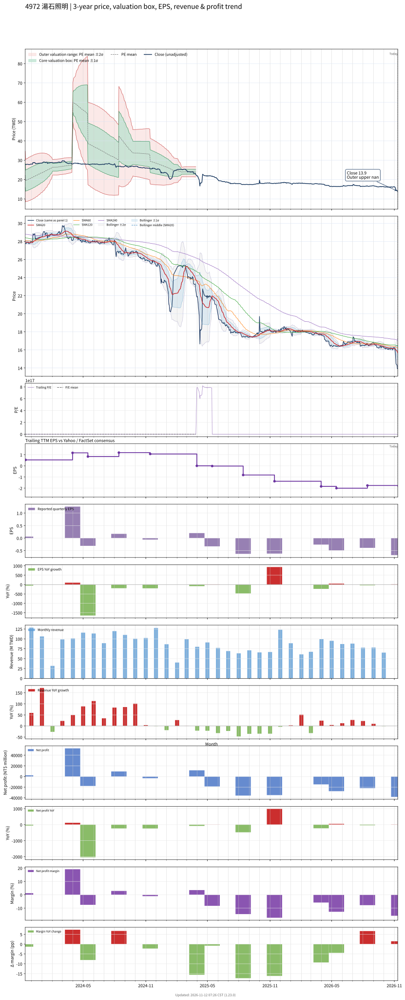

# 4972 - 湯石照明

## 業務簡介
**板塊:** Consumer Cyclical
**產業:** Furnishings, Fixtures & Appliances
**市值:** 785 百萬台幣
**企業價值:** 148 百萬台幣

湯石照明 (4972，Tons Lightology) 總部位於新北，專注於商業照明燈具之設計與製造。自有品牌「Tons」深耕亞太及歐洲專業市場 (博物館、美術館、五星飯店)，以「見光不見燈」之高品質光學設計著稱，屢獲 [[Red Dot]]、[[iF]] 等國際設計大獎。亦提供國際燈具大廠 [[ODM]]/[[OEM]] 代工服務。2023 年併購大峽谷-KY ([[StrongLED]])，跨足戶外建築景觀照明與控制系統，強化專案整合能力。LED 光源主要向 [[Cree]]、[[日亞化學]] (Nichia)、[[Osram]] 等國際大廠採購。

## 供應鏈位置
**上游 (LED 光源與元件):**
- **LED 晶粒:** [[Cree]]、[[日亞化學]] (Nichia)、[[Osram]]、[[Citizen]] — 高品質 LED 封裝
- **驅動 IC:** 電源驅動模組
- **機構件:** 鋁壓鑄散熱機構

**中游 (設計與製造):**
- **湯石照明** — 商業照明燈具設計製造、品牌「Tons」
- **[[StrongLED]]** (大峽谷) — 戶外建築景觀照明與控制系統

**下游 (專案與代工):**
- **專案市場:** 博物館、美術館、五星飯店、商業空間
- **代工客戶:** 歐洲一線照明品牌 — [[ODM]]/[[OEM]]

## 主要客戶及供應商
### 主要客戶
- **博物館:** 故宮博物院、奇美博物館 — 專業照明
- **商業空間:** 台北 101、誠品書店
- **代工客戶:** 歐洲一線照明品牌 — [[ODM]]/[[OEM]]
- **景觀照明:** 中國市政工程 — [[StrongLED]] (大峽谷) 承接

### 主要供應商
- **LED 光源:** [[Cree]]、[[日亞化學]] (Nichia)、[[Osram]]、[[Citizen]]
- **機構件:** 鋁壓鑄散熱模組供應商

## 財務概況 (單位: 百萬台幣, 只有 Margin 為 %)
### 估值指標 (股價 $14.05 as of 2026-11-12 | TTM 截至 2026-09-30 | Forward 預估至 2026-12-31)
| P/E (TTM) | Forward P/E | P/S (TTM) |  P/B | EV/EBITDA |
|-----------|-------------|-----------|------|-----------|
|       N/A |         N/A |      0.79 | 0.56 |     -2.00 |

### 年度關鍵財務數據 (近 3 年)
|                         |   2025-12-31 |   2024-12-31 |   2023-12-31 |
|:------------------------|-------------:|-------------:|-------------:|
| Revenue                 |       932.89 |      1216.40 |       811.93 |
| Gross Profit            |       245.18 |       348.05 |       258.10 |
| Gross Margin (%)        |        26.28 |        28.61 |        31.79 |
| Selling & Marketing Exp |       141.64 |       167.51 |       103.53 |
| R&D Exp                 |        74.94 |        89.13 |        48.01 |
| General & Admin Exp     |       151.29 |       158.36 |       110.31 |
| Operating Income        |      -122.69 |       -66.94 |        -3.75 |
| Operating Margin (%)    |       -13.15 |        -5.50 |        -0.46 |
| Net Income              |      -104.21 |         0.22 |        49.07 |
| Net Margin (%)          |       -11.17 |         0.02 |         6.04 |
| Op Cash Flow            |        62.63 |         0.28 |       134.47 |
| Investing Cash Flow     |         8.57 |        91.15 |        20.92 |
| Financing Cash Flow     |      -156.87 |       -58.09 |       -94.50 |
| CAPEX                   |       -88.15 |       -39.59 |       -23.07 |

### 季度關鍵財務數據 (近 4 季)
|                         |   2026-09-30 |   2026-06-30 |   2026-03-31 |   2025-12-31 |
|:------------------------|-------------:|-------------:|-------------:|-------------:|
| Revenue                 |       243.73 |       281.34 |       217.03 |       255.57 |
| Gross Profit            |        52.34 |        66.15 |        47.97 |        74.61 |
| Gross Margin (%)        |        21.48 |        23.51 |        22.10 |        29.19 |
| Selling & Marketing Exp |        38.60 |        39.26 |        35.73 |        39.62 |
| R&D Exp                 |        20.05 |        18.15 |        17.98 |        19.29 |
| General & Admin Exp     |        38.18 |        38.18 |        37.62 |        37.79 |
| Operating Income        |       -44.49 |       -29.44 |       -43.35 |       -22.09 |
| Operating Margin (%)    |       -18.26 |       -10.47 |       -19.98 |        -8.64 |
| Net Income              |       -38.22 |       -21.85 |       -27.55 |       -14.78 |
| Net Margin (%)          |       -15.68 |        -7.77 |       -12.70 |        -5.78 |
| Op Cash Flow            |       -21.14 |       -31.74 |       -17.32 |         2.31 |
| Investing Cash Flow     |      -136.78 |       152.18 |         8.59 |        55.14 |
| Financing Cash Flow     |        34.91 |        -4.68 |        26.52 |       -10.56 |
| CAPEX                   |        -8.94 |       -14.96 |        -3.41 |        -6.51 |
## Chart

