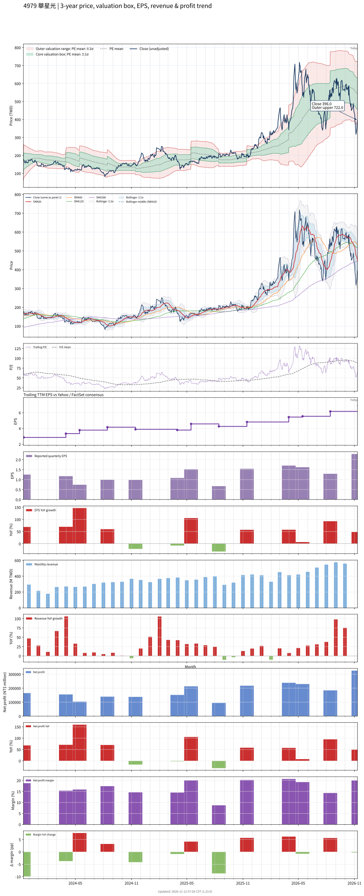

# 4979 - 華星光

## 業務簡介
**板塊:** Technology
**產業:** Semiconductors
**市值:** 54,122 百萬台幣
**企業價值:** 51,157 百萬台幣

華星光通 (LuxNet) 成立於 1999 年，總部位於台灣[[桃園]]。公司主要業務為[[光通訊]] **主動元件 (Active Components)** 之封裝與模組製造，產品包含 **光收發模組 (Transceiver)**、**TOSA/ROSA** (光傳送/接收次模組) 及 **雷射二極體 (LD)**、**檢光二極體 (PD)**。近年成功轉型，切入 **** 供應鏈，成為其 **光收發模組代工夥伴**，主要應用於 [[AI]]  及  基礎建設。

## 供應鏈位置
**角色:** [[光通訊]]元件與模組製造/代工。
**上游:** [[磊晶]]片 (聯亞、IQE)、IC ( 驅動晶片)。
**下游:** [[網通]]設備商、 ()、電信營運商。

## 主要客戶及供應商
### 主要客戶
- **:** 關鍵策略客戶 (代工光收發模組，終端供貨給美系  )。
- **其他:** 中國與台灣[[網通]]設備廠。

### 競爭同業
- **光模組/元件:** 眾達 (PCL)、光聖 (Eks)、聯鈞 (Elite)。
- ### 競爭對手

## 財務概況 (單位: 百萬台幣, 只有 Margin 為 %)
### 估值指標 (股價 $379.00 as of 2026-11-13 | TTM 截至 2026-09-30 | Forward 預估至 2026-12-31)
| P/E (TTM) | Forward P/E | P/S (TTM) |   P/B | EV/EBITDA |
|-----------|-------------|-----------|-------|-----------|
|     55.82 |       27.27 |     10.28 | 11.30 |     43.64 |

### 年度關鍵財務數據 (近 3 年)
|                         |   2025-12-31 |   2024-12-31 |   2023-12-31 |
|:------------------------|-------------:|-------------:|-------------:|
| Revenue                 |      4384.85 |      3451.04 |      2956.49 |
| Gross Profit            |       920.64 |       631.79 |       573.75 |
| Gross Margin (%)        |        21.00 |        18.31 |        19.41 |
| Selling & Marketing Exp |         9.58 |         7.51 |         8.60 |
| R&D Exp                 |        64.02 |        48.19 |        53.94 |
| General & Admin Exp     |       109.91 |        91.19 |        68.24 |
| Operating Income        |       737.13 |       484.89 |       442.98 |
| Operating Margin (%)    |        16.81 |        14.05 |        14.98 |
| Net Income              |       764.25 |       533.25 |       442.39 |
| Net Margin (%)          |        17.43 |        15.45 |        14.96 |
| Op Cash Flow            |       681.29 |       766.50 |       502.40 |
| Investing Cash Flow     |     -1047.77 |       -93.80 |       -55.04 |
| Financing Cash Flow     |      -217.53 |       622.77 |       901.07 |
| CAPEX                   |      -446.73 |       -91.20 |       -51.95 |

### 季度關鍵財務數據 (近 4 季)
|                         |   2026-09-30 |   2026-06-30 |   2026-03-31 |   2025-12-31 |
|:------------------------|-------------:|-------------:|-------------:|-------------:|
| Revenue                 |      1629.42 |      1289.11 |      1193.48 |      1154.36 |
| Gross Profit            |       443.59 |       289.33 |       303.35 |       265.77 |
| Gross Margin (%)        |        27.22 |        22.44 |        25.42 |        23.02 |
| Selling & Marketing Exp |         2.92 |         2.72 |         3.14 |         2.47 |
| R&D Exp                 |        18.11 |        17.77 |        15.02 |        14.86 |
| General & Admin Exp     |        40.23 |        31.93 |        34.76 |        33.55 |
| Operating Income        |       382.32 |       236.90 |       250.44 |       214.90 |
| Operating Margin (%)    |        23.46 |        18.38 |        20.98 |        18.62 |
| Net Income              |       325.43 |       184.25 |       229.65 |       238.47 |
| Net Margin (%)          |        19.97 |        14.29 |        19.24 |        20.66 |
| Op Cash Flow            |       448.06 |       231.91 |       295.96 |        55.88 |
| Investing Cash Flow     |      -347.52 |       415.04 |      -498.98 |      -613.76 |
| Financing Cash Flow     |      -310.20 |        -0.04 |        -0.04 |        -0.01 |
| CAPEX                   |      -239.69 |      -183.59 |       -55.02 |      -112.86 |
## Chart

