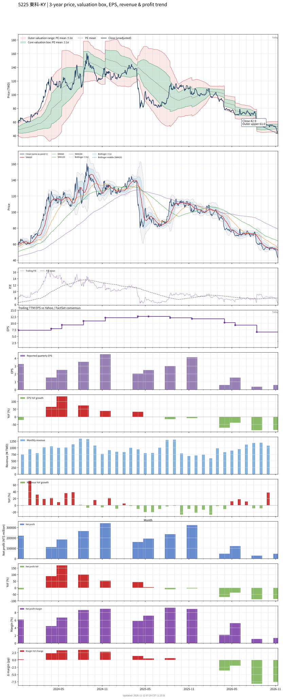

# 5225 - 東科-KY

## 業務簡介
**板塊:** Technology
**產業:** Consumer Electronics
**市值:** 3,376 百萬台幣
**企業價值:** 3,115 百萬台幣

東科-KY (Eastech) 為全球最大 **影音揚聲器 (Audio/Speaker)** [[OEM]]/[[ODM]] 代工廠。
專注於聲學產品之設計與製造，生產基地主要位於越南 (海防) 與中國 (惠州)。
主要產品：
1.  **Sound Bar (聲霸)**: 全球市佔率極高，為主要營收成長動能。
2.  **家用音響**: 家庭劇院系統、藍牙喇叭。
3.  **耳機**: 積極拓展輔聽器及高階耳機代工。
4.  **會議系統**: 視訊會議音訊設備。
客戶涵蓋韓系、日系與歐美一線家電與音響品牌。

## 供應鏈位置
*   **中游 (本體)**: **東科 (5225)** - 音響系統組裝代工 ([[OEM]]/[[ODM]]).
*   **上游**:
    *   **零件**: 喇叭單體 (自製/外購), 塑膠機殼, 木箱, 電子零組件 (IC, [[PCB]]).
*   **下游**:
    *   **品牌**: , [[LG]], .

## 主要客戶及供應商
### 主要客戶
**韓系**:  (最大客戶), [[LG]].
**日系**: , [[Panasonic]].
**歐美**: [[Philips]], 以及各類新創音響品牌.

### 主要供應商
**零件**: 被動元件, 機構件供應商. (關鍵喇叭單體具備自製能力).

## 財務概況 (單位: 百萬台幣, 只有 Margin 為 %)
### 估值指標 (股價 $42.90 as of 2026-11-12 | TTM 截至 2026-06-30 | Forward 預估至 2026-12-31)
| P/E (TTM) | Forward P/E | P/S (TTM) |  P/B | EV/EBITDA |
|-----------|-------------|-----------|------|-----------|
|      6.59 |        5.86 |      0.31 | 0.96 |      4.88 |

### 年度關鍵財務數據 (近 3 年)
|                         |   2025-12-31 |   2024-12-31 |   2023-12-31 |
|:------------------------|-------------:|-------------:|-------------:|
| Revenue                 |     11039.42 |     12405.47 |     10640.52 |
| Gross Profit            |      1813.97 |      2136.04 |      1653.25 |
| Gross Margin (%)        |        16.43 |        17.22 |        15.54 |
| Selling & Marketing Exp |       190.99 |       227.39 |       191.12 |
| R&D Exp                 |       -    |       -    |       -    |
| General & Admin Exp     |       878.89 |      1028.84 |       890.56 |
| Operating Income        |       744.09 |       879.81 |       571.57 |
| Operating Margin (%)    |         6.74 |         7.09 |         5.37 |
| Net Income              |       799.81 |       952.62 |       533.31 |
| Net Margin (%)          |         7.24 |         7.68 |         5.01 |
| Op Cash Flow            |       382.24 |       974.88 |      1174.67 |
| Investing Cash Flow     |      -252.16 |      -171.48 |       -38.16 |
| Financing Cash Flow     |      -829.12 |      -533.85 |      -169.16 |
| CAPEX                   |      -273.44 |      -188.92 |       -66.24 |

### 季度關鍵財務數據 (近 4 季)
|                         |   2026-09-30 |   2026-06-30 |   2026-03-31 |   2025-12-31 |
|:------------------------|-------------:|-------------:|-------------:|-------------:|
| Revenue                 |      3496.02 |      2676.17 |      2323.13 |      2185.73 |
| Gross Profit            |       367.46 |       311.12 |       345.92 |       270.34 |
| Gross Margin (%)        |        10.51 |        11.63 |        14.89 |        12.37 |
| Selling & Marketing Exp |        62.44 |        58.10 |        46.82 |        65.53 |
| R&D Exp                 |       -    |       -    |       -    |       -    |
| General & Admin Exp     |       253.31 |       237.05 |       184.67 |       201.71 |
| Operating Income        |        51.72 |        15.97 |       114.43 |         3.10 |
| Operating Margin (%)    |         1.48 |         0.60 |         4.93 |         0.14 |
| Net Income              |        47.41 |        29.63 |       121.49 |        47.88 |
| Net Margin (%)          |         1.36 |         1.11 |         5.23 |         2.19 |
| Op Cash Flow            |       220.35 |      -424.72 |       181.09 |      -180.22 |
| Investing Cash Flow     |       -38.11 |       -50.91 |       -39.27 |       -79.64 |
| Financing Cash Flow     |       249.41 |      -576.03 |       -40.57 |        13.93 |
| CAPEX                   |       -38.41 |       -51.01 |       -39.44 |       -93.98 |
## Chart

