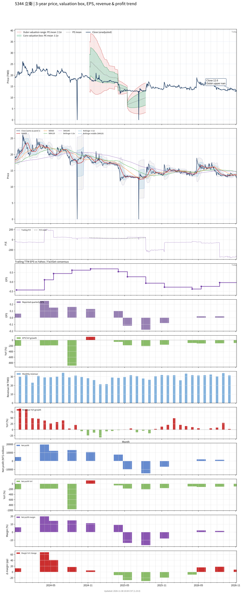

# 5344 - 立衛

## 業務簡介
**板塊:** Technology
**產業:** Semiconductors
**市值:** 1,013 百萬台幣
**企業價值:** 985 百萬台幣

立衛科技 (5344) 為電子零組件通路商，主要從事半導體及電子零件之代理銷售。產品涵蓋 [[IC]]、[[被動元件]]及[[連接器]]等電子零組件，服務台灣及亞太地區[[電子製造]]客戶。產品涵蓋[[功率元件]]及[[感測器]]等。

## 供應鏈位置
**上游 (原廠):**
- **IC 原廠:** 國際半導體品牌
- **被動元件:** 被動元件原廠

**中游 (通路代理):**
- **電子通路:** **立衛** (IC 及電子零組件代理銷售)

**下游 (電子製造):**
- **電子 OEM:** 台灣及亞太電子製造商

## 主要客戶及供應商
### 主要客戶
- **電子 OEM:** 台灣及亞太電子製造商

### 主要供應商
- **IC 原廠:** 國際半導體品牌

### 競爭同業
- **競爭同業:** 、、

## 財務概況 (單位: 百萬台幣, 只有 Margin 為 %)
### 估值指標 (股價 $12.75 as of 2026-11-12 | TTM 截至 2026-09-30 | Forward 預估至 2026-12-31)
| P/E (TTM) | Forward P/E | P/S (TTM) |  P/B | EV/EBITDA |
|-----------|-------------|-----------|------|-----------|
|    318.75 |         N/A |      2.69 | 2.19 |     33.09 |

### 年度關鍵財務數據 (近 3 年)
|                         |   2025-12-31 |   2024-12-31 |   2023-12-31 |
|:------------------------|-------------:|-------------:|-------------:|
| Revenue                 |       340.23 |       352.67 |       297.69 |
| Gross Profit            |        19.45 |        76.16 |        45.35 |
| Gross Margin (%)        |         5.72 |        21.60 |        15.23 |
| Selling & Marketing Exp |         7.02 |         5.53 |         6.08 |
| R&D Exp                 |         4.51 |         3.38 |         2.47 |
| General & Admin Exp     |        46.55 |        40.16 |        37.42 |
| Operating Income        |       -38.62 |        27.08 |        -0.63 |
| Operating Margin (%)    |       -11.35 |         7.68 |        -0.21 |
| Net Income              |       -31.12 |        43.55 |         8.40 |
| Net Margin (%)          |        -9.15 |        12.35 |         2.82 |
| Op Cash Flow            |        -3.73 |       126.36 |         9.56 |
| Investing Cash Flow     |       -36.20 |       -73.15 |       -29.76 |
| Financing Cash Flow     |       -10.58 |        -8.28 |        -9.95 |
| CAPEX                   |       -36.16 |       -76.75 |       -19.63 |

### 季度關鍵財務數據 (近 4 季)
|                         |   2026-09-30 |   2026-06-30 |   2026-03-31 |   2025-12-31 |
|:------------------------|-------------:|-------------:|-------------:|-------------:|
| Revenue                 |        96.79 |        94.68 |        90.91 |        93.81 |
| Gross Profit            |        12.71 |        12.55 |        11.35 |         9.14 |
| Gross Margin (%)        |        13.13 |        13.26 |        12.49 |         9.75 |
| Selling & Marketing Exp |         1.13 |         1.03 |         1.04 |         1.76 |
| R&D Exp                 |         1.04 |         1.15 |         1.00 |         1.05 |
| General & Admin Exp     |        12.92 |        12.39 |        12.55 |        12.15 |
| Operating Income        |        -2.38 |        -2.02 |        -3.25 |        -5.81 |
| Operating Margin (%)    |        -2.46 |        -2.13 |        -3.57 |        -6.19 |
| Net Income              |         0.06 |         1.44 |         1.98 |         0.01 |
| Net Margin (%)          |         0.06 |         1.52 |         2.18 |         0.02 |
| Op Cash Flow            |        12.82 |        11.28 |        -6.61 |         0.63 |
| Investing Cash Flow     |        -8.38 |        -7.57 |        -7.94 |        -2.31 |
| Financing Cash Flow     |        -1.48 |        -2.41 |        -2.68 |        -2.66 |
| CAPEX                   |        -9.13 |        -7.57 |        -7.94 |        -2.29 |
## Chart

