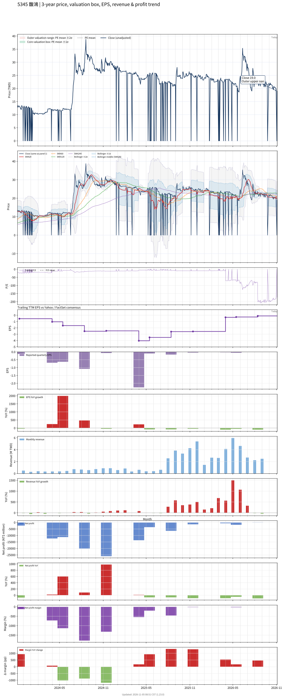

# 5345 - 馥鴻

## 業務簡介
**板塊:** Technology
**產業:** Electronic Components
**市值:** 728 百萬台幣
**企業價值:** 575 百萬台幣

馥鴻 (5345) 前身為天揚精密，原經營精密陶瓷 ([[MLCC]] 等) 與被動元件，現轉型為 **科技產品方案** 與 **營建開發** 雙軌並進之公司。

主要業務：(1) **科技事業** — 自有品牌 EzCon 智慧電源控制系統、電池管理系統 ([[BMS]])，內含 [[MCU]] 微控制器與 [[MOSFET]] 功率元件，應用於智慧家庭與工業電源管理，可整合 [[物聯網]] 物聯網遠端監控；(2) **營建事業** — 住宅及大樓開發租售、室內裝修工程。近年營運規模較小 (年營收僅約數百萬)，處於轉型與業務調整期，科技事業尚在推廣階段，營建事業為主要收入來源。公司持續投入研發智慧電源控制技術，期望科技事業成為未來成長引擎。

## 供應鏈位置
**上游 (電子零件與營建材料):**
- **IC 元件:** [[MCU]] 微控制器、[[MOSFET]] 功率元件、電源管理 IC
- **被動元件:** [[MLCC]] 電容、電阻、電感
- **電池芯:** [[鋰電池]]芯 — BMS 管理對象
- **營建材料:** [[營造]]廠合作、建材供應商

**中游 (產品開發與建案):**
- **智慧電源:** **馥鴻** (EzCon 電源控制系統與 [[BMS]]，整合 [[物聯網]] 遠端監控)
- **營建開發:** **馥鴻** (住宅大樓開發租售)

**下游 (終端應用):**
- **智慧家庭:** 智慧家庭用戶 — EzCon 電源控制
- **工業應用:** 工廠電源管理專案客戶
- **營建:** 購屋大眾 — 住宅建案
- **裝修:** 室內裝修客戶

## 主要客戶及供應商
### 主要客戶
- **智慧電源:** 智慧家庭與工業電源管理專案客戶 — EzCon 系統
- **營建:** 購屋大眾 — 住宅大樓建案
- **裝修:** 室內裝修工程客戶

### 主要供應商
- **IC 元件:** [[MCU]] 微控制器供應商、[[MOSFET]] 功率元件供應商
- **被動元件:** [[MLCC]] 電容、電阻、電感供應商
- **電池芯:** [[鋰電池]]芯供應商 — BMS 系統核心
- **營建:** 合作[[營造]]廠與建材供應商

## 財務概況 (單位: 百萬台幣, 只有 Margin 為 %)
### 估值指標 (股價 $19.25 as of 2026-11-13 | TTM 截至 2026-06-30 | Forward 預估至 2026-12-31)
| P/E (TTM) | Forward P/E | P/S (TTM) |  P/B | EV/EBITDA |
|-----------|-------------|-----------|------|-----------|
|       N/A |         N/A |     17.54 | 3.39 |   -124.00 |

### 年度關鍵財務數據 (近 3 年)
|                         |   2025-12-31 |   2024-12-31 |   2023-12-31 |
|:------------------------|-------------:|-------------:|-------------:|
| Revenue                 |        23.18 |         6.61 |         6.28 |
| Gross Profit            |         5.87 |       -13.75 |         0.44 |
| Gross Margin (%)        |        25.32 |      -208.13 |         7.05 |
| Selling & Marketing Exp |         2.86 |        16.19 |         9.43 |
| R&D Exp                 |         2.11 |        15.59 |        11.12 |
| General & Admin Exp     |        15.63 |        24.98 |        21.12 |
| Operating Income        |       -14.72 |       -70.52 |       -41.22 |
| Operating Margin (%)    |       -63.50 |     -1067.16 |      -656.37 |
| Net Income              |       -12.04 |       -71.10 |       -27.11 |
| Net Margin (%)          |       -51.93 |     -1076.01 |      -431.74 |
| Op Cash Flow            |       -51.98 |       -55.75 |       -50.91 |
| Investing Cash Flow     |        22.88 |        -7.29 |         4.04 |
| Financing Cash Flow     |        -2.23 |       211.84 |        45.90 |
| CAPEX                   |        -0.25 |         0.00 |        -0.42 |

### 季度關鍵財務數據 (近 4 季)
|                         |   2026-09-30 |   2026-06-30 |   2026-03-31 |   2025-12-31 |
|:------------------------|-------------:|-------------:|-------------:|-------------:|
| Revenue                 |         7.40 |        14.72 |         6.73 |        13.00 |
| Gross Profit            |         4.30 |         3.47 |         2.48 |         3.50 |
| Gross Margin (%)        |        58.08 |        23.57 |        36.77 |        26.97 |
| Selling & Marketing Exp |         1.76 |         0.45 |         0.47 |         0.60 |
| R&D Exp                 |         0.19 |         0.52 |         0.28 |         0.27 |
| General & Admin Exp     |         2.71 |         2.70 |         3.08 |         3.61 |
| Operating Income        |        -0.36 |        -0.21 |        -1.36 |        -0.98 |
| Operating Margin (%)    |        -4.89 |        -1.41 |       -20.17 |        -7.51 |
| Net Income              |        -0.23 |         0.10 |        -1.79 |        -0.60 |
| Net Margin (%)          |        -3.05 |         0.66 |       -26.52 |        -4.59 |
| Op Cash Flow            |         5.50 |         9.79 |         6.29 |         9.95 |
| Investing Cash Flow     |         0.17 |         0.44 |        -0.09 |         0.37 |
| Financing Cash Flow     |        -0.10 |        -0.30 |        -0.40 |        -0.48 |
| CAPEX                   |         0.00 |         0.00 |         0.00 |         0.00 |
## Chart

