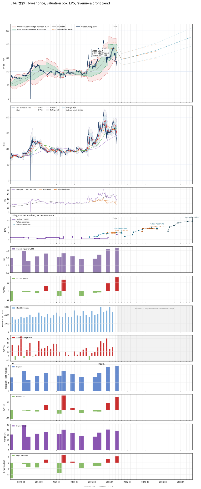

# 5347 - 世界

## 業務簡介
**板塊:** Technology
**產業:** Semiconductors
**市值:** 285,080 百萬台幣
**企業價值:** 260,684 百萬台幣

世界先進 (5347，Vanguard International Semiconductor) 為台灣特殊製程[[晶圓代工]]領導廠商， 持股約 28%。公司擁有五座 8 吋晶圓廠 (台灣及新加坡)，專精高壓、超高壓、[[BCD]]、[[SOI]]、分離式元件、類比、混合訊號及 [[MEMS]] 等特殊製程。近期與 [[NXP]] 合資 VSMC 於新加坡建設 12 吋晶圓廠，預計 2027 年投產。

## 供應鏈位置
**上游 (材料與設備):**
- **:** 8 吋矽晶圓供應
- **股東:**  (持股約 28%)

**中游 (特殊製程晶圓代工):**
- **晶圓代工:** **世界先進** (8 吋特殊製程，高壓/BCD/SOI/MEMS)

**下游 (IC 設計):**
- **電源 IC:** 全球電源管理 IC 設計公司
- **車用 IC:** 車用功率元件 IC 設計
- **合資:** [[NXP]] (VSMC 新加坡 12 吋廠)

## 主要客戶及供應商
### 主要客戶
- **電源 IC:** 全球電源管理 IC 設計公司
- **車用 IC:** 車用功率元件客戶
- **合資:** [[NXP]] (VSMC 新加坡 12 吋廠)

### 主要供應商
- **股東:**  (持股約 28%)
- **矽晶圓:** 8 吋矽晶圓供應
- **競爭同業:** [[聯華電子]]、、[[Tower Semiconductor]]

### 競爭同業
- **成熟製程晶圓代工競爭者:** 、、、、[[華虹半導體]]
- **競爭同業:** 

## 財務概況 (單位: 百萬台幣, 只有 Margin 為 %)
### 估值指標 (股價 $138.50 as of 2026-11-12 | TTM 截至 2026-09-30 | Forward 預估至 2026-12-31)
| P/E (TTM) | Forward P/E | P/S (TTM) |  P/B | EV/EBITDA |
|-----------|-------------|-----------|------|-----------|
|     28.97 |       18.64 |      5.18 | 4.02 |     13.86 |

### 年度關鍵財務數據 (近 3 年)
|                         |   2025-12-31 |   2024-12-31 |   2023-12-31 |
|:------------------------|-------------:|-------------:|-------------:|
| Revenue                 |     48591.25 |     44054.76 |     38272.57 |
| Gross Profit            |     13653.84 |     11932.91 |     10446.01 |
| Gross Margin (%)        |        28.10 |        27.09 |        27.29 |
| Selling & Marketing Exp |       557.42 |       448.96 |       382.14 |
| R&D Exp                 |      2189.95 |      2081.17 |      2150.69 |
| General & Admin Exp     |      3133.10 |      2291.40 |      2138.99 |
| Operating Income        |      7773.37 |      7111.39 |      5774.19 |
| Operating Margin (%)    |        16.00 |        16.14 |        15.09 |
| Net Income              |      7907.50 |      7046.42 |      7370.07 |
| Net Margin (%)          |        16.27 |        15.99 |        19.26 |
| Op Cash Flow            |     25439.23 |     24731.06 |      8631.51 |
| Investing Cash Flow     |    -59710.58 |    -11698.52 |     -8359.84 |
| Financing Cash Flow     |     13459.63 |     17529.72 |     -1358.68 |
| CAPEX                   |    -63978.03 |    -15952.93 |     -6900.09 |

### 季度關鍵財務數據 (近 4 季)
|                         |   2026-09-30 |   2026-06-30 |   2026-03-31 |   2025-12-31 |
|:------------------------|-------------:|-------------:|-------------:|-------------:|
| Revenue                 |     15702.03 |     14244.84 |     12531.63 |     12593.73 |
| Gross Profit            |      5283.22 |      4604.50 |      3671.00 |      3464.53 |
| Gross Margin (%)        |        33.65 |        32.32 |        29.29 |        27.51 |
| Selling & Marketing Exp |       222.36 |       181.62 |       159.35 |       163.45 |
| R&D Exp                 |       672.39 |       680.18 |       610.16 |       582.36 |
| General & Admin Exp     |       918.26 |       841.74 |       814.94 |       912.04 |
| Operating Income        |      3470.21 |      2900.96 |      2086.55 |      1806.67 |
| Operating Margin (%)    |        22.10 |        20.37 |        16.65 |        14.35 |
| Net Income              |      3098.70 |      2974.77 |      2246.08 |      1747.50 |
| Net Margin (%)          |        19.73 |        20.88 |        17.92 |        13.88 |
| Op Cash Flow            |      9906.12 |      5759.13 |     11432.13 |      7691.68 |
| Investing Cash Flow     |    -12913.39 |    -11203.80 |    -24947.42 |    -26746.51 |
| Financing Cash Flow     |     -2475.73 |      1677.71 |     18104.58 |     10354.13 |
| CAPEX                   |    -12546.69 |    -13271.65 |    -25280.42 |    -28023.21 |
## Chart

