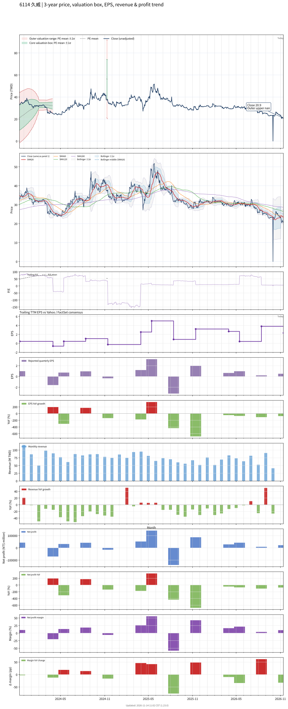

# 6114_久威

## 業務簡介
**板塊:** Technology
**產業:** Electronic Components
**市值:** 916 百萬台幣
**企業價值:** 57 百萬台幣

久威國際 (6114) 原以 [[PCB]] 製造起家，策略轉型專注於消費性電子機構材料、光學材料之代理銷售與精密模切加工。

主要業務：(1) 電子材料代理 — 代理國際大廠特用電子材料與光學膜材 (如 [[3M]]、[[Nitto]])，營收占比達 85%，產品應用於智慧型手機光學驅動模組 (VCM 音圈馬達相關膜材)；(2) 精密模切 — 利用精密模切技術加工光學與機構材料，供應消費性電子產品組裝所需。憑藉精準供應鏈管理，成功打入美國科技品牌大廠 ( 供應鏈) 及中國大型電子製造服務商。

## 供應鏈位置
**上游 (國際材料原廠):**
- **光學膜材:** [[3M]]、[[Nitto]] — 特用光學與機構電子材料
- **膠膜:** 國際化工大廠 — 精密膠膜材料

**中游 (代理加工):**
- **材料代理:** **久威** (光學與機構電子材料代理)
- **精密模切:** **久威** (光學膜材精密模切加工)

**下游 (EMS 與品牌廠):**
- **消費性電子:**  供應鏈 — 光學驅動模組膜材
- **EMS:** 、 等 EMS 大廠 — 組裝用材料
- **中國 EMS:** 中國大型 3C 電子代工廠

## 主要客戶及供應商
### 主要客戶
- **消費性電子:**  供應鏈 — 光學驅動模組 (VCM) 膜材
- **EMS:** 、 等大廠 — 組裝用電子材料
- **中國代工:** 中國大型 3C 電子產品代工廠

### 主要供應商
- **光學膜材:** [[3M]]、[[Nitto]] — 特用光學電子材料
- **膠膜:** 國際化工大廠 — 精密膠膜材料原廠

## 財務概況 (單位: 百萬台幣, 只有 Margin 為 %)
### 估值指標 (股價 $20.85 as of 2026-11-13 | TTM 截至 2026-06-30 | Forward 預估至 2026-12-31)
| P/E (TTM) | Forward P/E | P/S (TTM) |  P/B | EV/EBITDA |
|-----------|-------------|-----------|------|-----------|
|      7.37 |         N/A |      1.15 | 0.58 |      1.85 |

### 年度關鍵財務數據 (近 3 年)
|                         |   2025-12-31 |   2024-12-31 |   2023-12-31 |
|:------------------------|-------------:|-------------:|-------------:|
| Revenue                 |       874.44 |       916.38 |      1190.05 |
| Gross Profit            |       127.29 |       133.81 |       124.16 |
| Gross Margin (%)        |        14.56 |        14.60 |        10.43 |
| Selling & Marketing Exp |        38.88 |        37.62 |        46.98 |
| R&D Exp                 |       -    |       -    |       -    |
| General & Admin Exp     |        42.85 |        43.76 |        35.53 |
| Operating Income        |        45.56 |        52.43 |        41.65 |
| Operating Margin (%)    |         5.21 |         5.72 |         3.50 |
| Net Income              |       139.65 |       110.77 |       -27.81 |
| Net Margin (%)          |        15.97 |        12.09 |        -2.34 |
| Op Cash Flow            |        12.91 |       203.19 |        66.84 |
| Investing Cash Flow     |       192.22 |       173.25 |      -296.45 |
| Financing Cash Flow     |      -202.01 |       -53.15 |       167.91 |
| CAPEX                   |        -0.04 |        -0.34 |        -5.28 |

### 季度關鍵財務數據 (近 4 季)
|                         |   2026-09-30 |   2026-06-30 |   2026-03-31 |   2025-12-31 |
|:------------------------|-------------:|-------------:|-------------:|-------------:|
| Revenue                 |       224.77 |       219.97 |       197.39 |       174.92 |
| Gross Profit            |        36.71 |        27.69 |        32.63 |        24.35 |
| Gross Margin (%)        |        16.33 |        12.59 |        16.53 |        13.92 |
| Selling & Marketing Exp |        19.46 |         8.61 |        11.07 |        17.34 |
| R&D Exp                 |       -    |       -    |       -    |       -    |
| General & Admin Exp     |         8.41 |         9.90 |        12.50 |        12.17 |
| Operating Income        |         8.85 |         9.18 |         9.06 |        -5.16 |
| Operating Margin (%)    |         3.94 |         4.17 |         4.59 |        -2.95 |
| Net Income              |        22.00 |         8.70 |        42.38 |        51.28 |
| Net Margin (%)          |         9.79 |         3.95 |        21.47 |        29.31 |
| Op Cash Flow            |        41.13 |       -15.66 |        51.46 |       110.53 |
| Investing Cash Flow     |      -113.96 |      -393.56 |        13.88 |      -278.15 |
| Financing Cash Flow     |       -75.48 |      -108.45 |        36.68 |       -35.38 |
| CAPEX                   |         0.00 |         0.00 |         0.00 |        -0.04 |
## Chart

