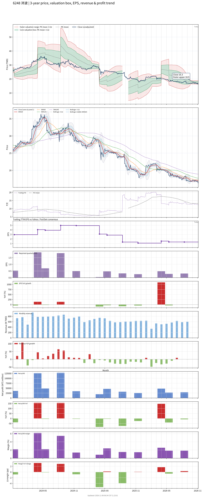

# 6248_沛波

## 業務簡介
**板塊:** Basic Materials
**產業:** Steel
**市值:** 1,577 百萬台幣
**企業價值:** 2,480 百萬台幣

沛波鋼鐵股份有限公司 (6248) 隸屬於[[台灣鋼鐵集團]](台鋼)，是一家專業的鋼筋二次加工裝配與買賣廠。沛波的營運模式有別於傳統煉鋼廠，主要從事鋼筋的成型、裁剪、彎曲等客製化加工服務。透過引進[[自動化]]加工設備，沛波能大幅縮短[[營造]]廠在工地綁紮鋼筋的時間並降低人工成本。受惠於台商回流建廠、國內公共工程推動及商辦廠辦的熱絡需求，沛波的鋼鐵出貨量穩定增長。

## 供應鏈位置
*   **上游**: 大型電爐煉鋼廠、鋼胚製造商及鋼筋一級供應商(如 , )。
*   **中游**: **沛波鋼鐵** (專業鋼筋二次裁切加工、成型裝配及鋼材物流買賣)。
*   **下游**: 國內各大綜合[[營造]]廠、建設公司及公共工程統包商。

## 主要客戶及供應商
### 主要客戶
- 參與全台科技廠房(廠辦)、社會住宅及重大公共工程興建之國內大型[[營造]]商。

### 主要供應商
- [[台灣鋼鐵集團]]旗下之煉鋼廠及國內大型條線鋼廠。

## 財務概況 (單位: 百萬台幣, 只有 Margin 為 %)
### 估值指標 (股價 $16.40 as of 2026-11-13 | TTM 截至 2026-06-30 | Forward 預估至 2026-12-31)
| P/E (TTM) | Forward P/E | P/S (TTM) |  P/B | EV/EBITDA |
|-----------|-------------|-----------|------|-----------|
|     11.08 |         N/A |      0.23 | 0.70 |     10.26 |

### 年度關鍵財務數據 (近 3 年)
|                         |   2025-12-31 |   2024-12-31 |   2023-12-31 |
|:------------------------|-------------:|-------------:|-------------:|
| Revenue                 |      7678.41 |      9313.43 |      7825.66 |
| Gross Profit            |       436.16 |       473.96 |       481.18 |
| Gross Margin (%)        |         5.68 |         5.09 |         6.15 |
| Selling & Marketing Exp |       174.94 |       197.97 |       174.86 |
| R&D Exp                 |       -    |       -    |       -    |
| General & Admin Exp     |        80.92 |        84.37 |        76.90 |
| Operating Income        |       180.29 |       191.62 |       229.43 |
| Operating Margin (%)    |         2.35 |         2.06 |         2.93 |
| Net Income              |       152.46 |       230.84 |       263.23 |
| Net Margin (%)          |         1.99 |         2.48 |         3.36 |
| Op Cash Flow            |       250.89 |      -375.68 |      -146.45 |
| Investing Cash Flow     |      -354.44 |      -504.46 |      -145.93 |
| Financing Cash Flow     |        73.27 |       920.49 |        58.36 |
| CAPEX                   |      -216.95 |      -412.57 |       -71.04 |

### 季度關鍵財務數據 (近 4 季)
|                         |   2026-09-30 |   2026-06-30 |   2026-03-31 |   2025-12-31 |
|:------------------------|-------------:|-------------:|-------------:|-------------:|
| Revenue                 |      1811.27 |      1596.82 |      1513.65 |      1868.69 |
| Gross Profit            |       117.44 |       117.31 |        88.50 |       117.27 |
| Gross Margin (%)        |         6.48 |         7.35 |         5.85 |         6.28 |
| Selling & Marketing Exp |        46.40 |        40.35 |        39.70 |        34.18 |
| R&D Exp                 |       -    |       -    |       -    |       -    |
| General & Admin Exp     |        19.52 |        16.88 |        18.74 |        16.81 |
| Operating Income        |        51.51 |        60.07 |        30.07 |        66.27 |
| Operating Margin (%)    |         2.84 |         3.76 |         1.99 |         3.55 |
| Net Income              |        40.70 |        29.41 |        27.88 |        47.82 |
| Net Margin (%)          |         2.25 |         1.84 |         1.84 |         2.56 |
| Op Cash Flow            |      -172.85 |       -27.78 |       328.27 |       176.09 |
| Investing Cash Flow     |      -130.52 |        -8.40 |        31.83 |       -12.64 |
| Financing Cash Flow     |       444.09 |       -25.82 |      -305.18 |      -101.71 |
| CAPEX                   |       -49.26 |        -2.69 |        -3.79 |       -36.27 |
## Chart

