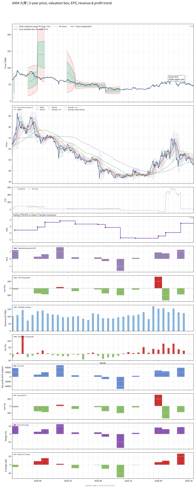

# 6494_九齊

## 業務簡介
**板塊:** Technology
**產業:** Semiconductors
**市值:** 1,362 百萬台幣
**企業價值:** 654 百萬台幣

九齊科技股份有限公司 (6494，Nyquest) 是一家專注於語音控制IC及微控制器([[MCU]])設計的台灣無晶圓廠(Fabless)[[半導體]]公司。九齊的產品線以4位元、8位元及32位元[[MCU]]為主，憑藉極高的性價比與高度客製化的晶片設計，在全球[[消費性電子]]領域(特別是語音及發聲玩具)享有極高的市佔率。除了穩固的玩具市場，九齊近年積極將產品應用拓展至智能小家電、個人電子護理產品以及結合邊緣運算(Edge [[AI]])的智慧高階玩具中，以提升產品的毛利率與應用廣度。

## 供應鏈位置
*   **上游**: (Silicon Wafer)供應商、[[半導體]]晶圓代工廠及光罩服務廠。
*   **中游**: **九齊科技** (消費性語音控制IC、各規格微控制器[[MCU]]之設計與開發)。
*   **下游**: IC封裝測試廠(OSAT)、各式[[消費性電子]]代工廠([[EMS]]/[[ODM]])及玩具代工廠。

## 主要客戶及供應商
### 主要客戶
- Mattel(美泰兒)、Hasbro(孩之寶)、Bandai(萬代)等國際玩具巨頭，及各大中國玩具廠。

### 主要供應商
- 國內外各大8吋/12吋晶圓代工廠(如 、力積電等)及封測廠。

## 財務概況 (單位: 百萬台幣, 只有 Margin 為 %)
### 估值指標 (股價 $43.15 as of 2026-11-12 | TTM 截至 2026-06-30 | Forward 預估至 2026-12-31)
| P/E (TTM) | Forward P/E | P/S (TTM) |  P/B | EV/EBITDA |
|-----------|-------------|-----------|------|-----------|
|     14.53 |     -154.11 |      0.95 | 1.37 |      5.37 |

### 年度關鍵財務數據 (近 3 年)
|                         |   2025-12-31 |   2024-12-31 |   2023-12-31 |
|:------------------------|-------------:|-------------:|-------------:|
| Revenue                 |      1187.33 |      1345.30 |      1333.00 |
| Gross Profit            |       286.05 |       408.48 |       423.71 |
| Gross Margin (%)        |        24.09 |        30.36 |        31.79 |
| Selling & Marketing Exp |        36.69 |        43.47 |        49.99 |
| R&D Exp                 |       206.95 |       247.60 |       260.99 |
| General & Admin Exp     |        71.56 |        74.66 |        66.23 |
| Operating Income        |       -29.15 |        42.76 |        46.49 |
| Operating Margin (%)    |        -2.45 |         3.18 |         3.49 |
| Net Income              |       -29.50 |        82.98 |        56.87 |
| Net Margin (%)          |        -2.48 |         6.17 |         4.27 |
| Op Cash Flow            |       106.48 |       314.84 |        64.59 |
| Investing Cash Flow     |       -25.12 |      -127.06 |       146.32 |
| Financing Cash Flow     |       -85.05 |       -59.86 |      -214.67 |
| CAPEX                   |       -47.43 |       -29.15 |       -41.35 |

### 季度關鍵財務數據 (近 4 季)
|                         |   2026-09-30 |   2026-06-30 |   2026-03-31 |   2025-12-31 |
|:------------------------|-------------:|-------------:|-------------:|-------------:|
| Revenue                 |       408.16 |       442.91 |       384.46 |       330.54 |
| Gross Profit            |       144.97 |       133.81 |       105.71 |        80.32 |
| Gross Margin (%)        |        35.52 |        30.21 |        27.49 |        24.30 |
| Selling & Marketing Exp |        11.75 |        10.94 |         9.62 |         7.79 |
| R&D Exp                 |        64.49 |        58.76 |        55.88 |        44.52 |
| General & Admin Exp     |        22.88 |        21.67 |        18.52 |        15.14 |
| Operating Income        |        45.85 |        42.44 |        21.68 |        12.88 |
| Operating Margin (%)    |        11.23 |         9.58 |         5.64 |         3.90 |
| Net Income              |        41.29 |        38.80 |        23.82 |        27.19 |
| Net Margin (%)          |        10.12 |         8.76 |         6.20 |         8.23 |
| Op Cash Flow            |        72.47 |       112.98 |       134.36 |        89.65 |
| Investing Cash Flow     |       -32.01 |        -8.10 |      -123.58 |        34.85 |
| Financing Cash Flow     |       -33.79 |        -2.55 |         4.85 |        -0.92 |
| CAPEX                   |        -9.51 |        -4.62 |        -3.80 |        -6.75 |
## Chart

