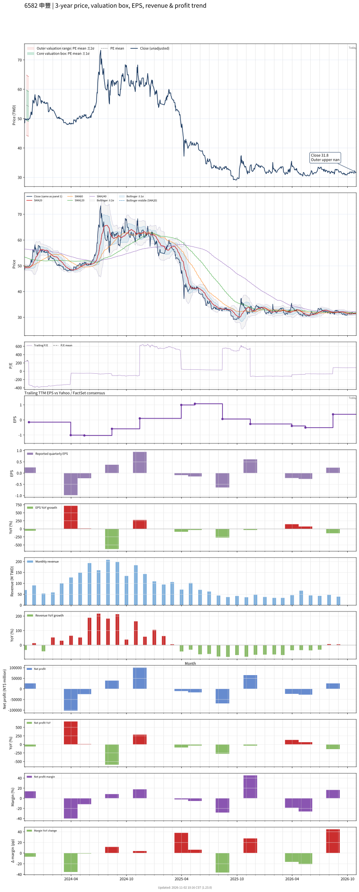

# 6582_申豐

## 業務簡介
**板塊:** Basic Materials
**產業:** Specialty Chemicals
**市值:** 3,398 百萬台幣
**企業價值:** 3,342 百萬台幣

申豐特用化學 (6582，Shin Foong) 隸屬[[永豐餘]]集團，為全球頂尖合成乳膠供應商。核心產品：(1) [[NBR]]乳膠 — 年產能約 8 萬噸，全球市佔約 6%，為醫療級拋棄式手套核心原料，客戶涵蓋馬來西亞手套四巨頭[[Top Glove]]、[[Hartalega]]、[[Kossan]]、[[Supermax]]；(2) [[SBR]]乳膠 — 年產能約 4 萬噸，應用於造紙塗佈及建材接著劑。上游丁二烯/苯乙烯/丙烯腈原料來自[[台灣中油]]及[[台塑石化]]。

## 供應鏈位置
**上游 (原料):**
- **石化:** [[台灣中油]]、[[台塑石化]] — 丁二烯/苯乙烯/丙烯腈

**中游 (製造):**
- **申豐** ([[NBR]]乳膠年產 8 萬噸/[[SBR]]乳膠年產 4 萬噸)

**下游 (終端):**
- **手套廠:** [[Top Glove]]、[[Hartalega]]、[[Kossan]]、[[Supermax]] — 醫療級 NBR 乳膠
- **造紙/建材:** 造紙塗佈/建材接著劑 — SBR 乳膠

## 主要客戶及供應商
### 主要客戶
- **手套 (NBR):** [[Top Glove]]、[[Hartalega]]、[[Kossan]]、[[Supermax]] — 醫療級手套
- **造紙/建材 (SBR):** 造紙塗佈/建材接著劑

### 主要供應商
- **石化:** [[台灣中油]]、[[台塑石化]] — 丁二烯/苯乙烯/丙烯腈
- **母集團:** [[永豐餘]]

## 財務概況 (單位: 百萬台幣, 只有 Margin 為 %)
### 估值指標 (股價 $32.00 as of 2026-11-12 | TTM 截至 2026-06-30 | Forward 預估至 2026-12-31)
| P/E (TTM) | Forward P/E | P/S (TTM) |  P/B | EV/EBITDA |
|-----------|-------------|-----------|------|-----------|
|     45.71 |         N/A |      6.41 | 0.54 |    -91.41 |

### 年度關鍵財務數據 (近 3 年)
|                         |   2025-12-31 |   2024-12-31 |   2023-12-31 |
|:------------------------|-------------:|-------------:|-------------:|
| Revenue                 |       821.39 |      1706.20 |       894.34 |
| Gross Profit            |       -45.16 |       148.75 |        21.36 |
| Gross Margin (%)        |        -5.50 |         8.72 |         2.39 |
| Selling & Marketing Exp |        61.18 |       130.03 |       104.09 |
| R&D Exp                 |        28.41 |        25.12 |        26.23 |
| General & Admin Exp     |        64.03 |        66.39 |       106.64 |
| Operating Income        |      -198.77 |       -72.79 |      -215.60 |
| Operating Margin (%)    |       -24.20 |        -4.27 |       -24.11 |
| Net Income              |       -43.32 |       104.91 |      -107.86 |
| Net Margin (%)          |        -5.27 |         6.15 |       -12.06 |
| Op Cash Flow            |       209.00 |       151.92 |      -177.84 |
| Investing Cash Flow     |      -349.74 |        54.50 |       100.59 |
| Financing Cash Flow     |       -85.78 |        -4.24 |      -163.82 |
| CAPEX                   |      -102.42 |       -72.96 |      -103.10 |

### 季度關鍵財務數據 (近 4 季)
|                         |   2026-09-30 |   2026-06-30 |   2026-03-31 |   2025-12-31 |
|:------------------------|-------------:|-------------:|-------------:|-------------:|
| Revenue                 |       128.40 |       156.64 |       104.10 |       125.60 |
| Gross Profit            |         3.92 |        18.69 |       -13.07 |       -14.31 |
| Gross Margin (%)        |         3.05 |        11.93 |       -12.56 |       -11.39 |
| Selling & Marketing Exp |         8.44 |         7.37 |         7.48 |        12.70 |
| R&D Exp                 |        10.75 |         3.25 |        10.41 |         6.96 |
| General & Admin Exp     |        14.00 |        15.11 |        14.97 |        16.22 |
| Operating Income        |       -29.27 |        -7.03 |       -45.93 |       -50.19 |
| Operating Margin (%)    |       -22.80 |        -4.49 |       -44.12 |       -39.96 |
| Net Income              |        98.77 |        25.91 |       -27.17 |       -23.49 |
| Net Margin (%)          |        76.92 |        16.54 |       -26.10 |       -18.71 |
| Op Cash Flow            |       171.87 |        -7.54 |         1.25 |        -5.01 |
| Investing Cash Flow     |      -196.24 |       -97.28 |         3.88 |       -29.81 |
| Financing Cash Flow     |        10.12 |       129.51 |        -6.94 |         7.89 |
| CAPEX                   |        -7.42 |        -3.56 |       -23.98 |       -21.39 |
## Chart

