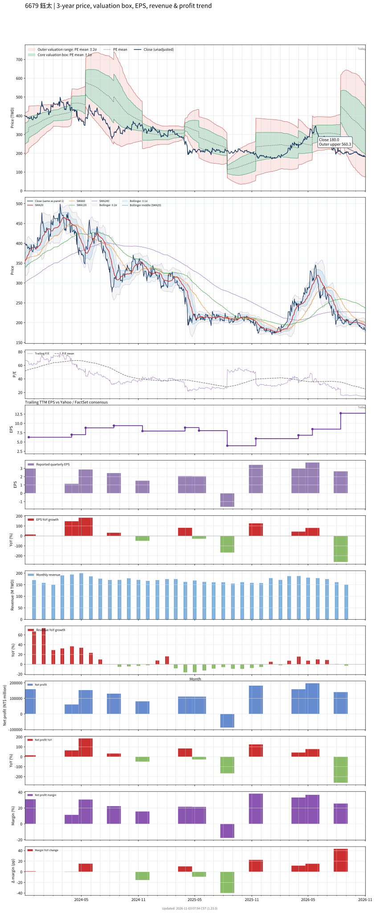

# 6679 - 鈺太

## 業務簡介
**板塊:** Technology
**產業:** Semiconductors
**市值:** 8,046 百萬台幣
**企業價值:** 5,722 百萬台幣

鈺太科技 (6679) 為全球 [[MEMS]] 麥克風 IC 設計龍頭廠商，在筆電 MEMS 麥克風市場市占率高達 55-60%。產品涵蓋類比及數位 MEMS 麥克風、數位氣壓計及溫度感測器、音訊放大器、[[DC/DC]] 轉換器及 [[LDO]] 穩壓器。近期收購 [[Nisshinbo Micro Devices]] (NISD) 資產，強化專利佈局並拓展車用、醫療及穿戴裝置市場。

## 供應鏈位置
**上游 (晶圓代工):**
- **晶圓製造:** 台灣晶圓代工廠
- **MEMS 製程:** MEMS 代工

**中游 (IC 設計):**
- **MEMS 麥克風 IC:** **鈺太** (全球筆電 MEMS 麥克風市占 55-60%)

**下游 (筆電品牌):**
- **筆電:** 、、、

## 主要客戶及供應商
### 主要客戶
- **筆電品牌:** 、、、
- **穿戴/車用:** 穿戴裝置及車用麥克風客戶

### 主要供應商
- **併購:** [[Nisshinbo Micro Devices]] (專利資產)

### 競爭同業
- **競爭同業:** [[Knowles]]、[[Infineon]]、[[STMicroelectronics]]

## 財務概況 (單位: 百萬台幣, 只有 Margin 為 %)
### 估值指標 (股價 $151.00 as of 2026-11-13 | TTM 截至 2026-09-30 | Forward 預估至 2026-12-31)
| P/E (TTM) | Forward P/E | P/S (TTM) |  P/B | EV/EBITDA |
|-----------|-------------|-----------|------|-----------|
|     11.71 |       11.02 |      3.93 | 1.32 |     11.66 |

### 年度關鍵財務數據 (近 3 年)
|                         |   2025-12-31 |   2024-12-31 |   2023-12-31 |
|:------------------------|-------------:|-------------:|-------------:|
| Revenue                 |      1965.69 |      2113.83 |      1839.59 |
| Gross Profit            |       828.74 |       879.97 |       737.50 |
| Gross Margin (%)        |        42.16 |        41.63 |        40.09 |
| Selling & Marketing Exp |        91.25 |       147.87 |       124.53 |
| R&D Exp                 |       238.19 |       225.60 |       158.88 |
| General & Admin Exp     |       112.26 |       125.87 |        95.42 |
| Operating Income        |       387.05 |       380.63 |       358.66 |
| Operating Margin (%)    |        19.69 |        18.01 |        19.50 |
| Net Income              |       365.20 |       476.71 |       372.77 |
| Net Margin (%)          |        18.58 |        22.55 |        20.26 |
| Op Cash Flow            |       674.92 |       365.03 |       276.22 |
| Investing Cash Flow     |         4.21 |      -158.54 |       309.17 |
| Financing Cash Flow     |      -703.19 |      -179.27 |      -493.74 |
| CAPEX                   |       -34.26 |       -39.45 |       -29.59 |

### 季度關鍵財務數據 (近 4 季)
|                         |   2026-09-30 |   2026-06-30 |   2026-03-31 |   2025-12-31 |
|:------------------------|-------------:|-------------:|-------------:|-------------:|
| Revenue                 |       486.61 |       547.17 |       537.14 |       476.75 |
| Gross Profit            |       244.70 |       277.78 |       279.00 |       223.66 |
| Gross Margin (%)        |        50.29 |        50.77 |        51.94 |        46.91 |
| Selling & Marketing Exp |        32.15 |        29.47 |        26.37 |        -5.74 |
| R&D Exp                 |        69.75 |        57.93 |        70.58 |        64.55 |
| General & Admin Exp     |        37.62 |        35.12 |        31.20 |        34.18 |
| Operating Income        |       105.18 |       155.26 |       150.85 |       130.68 |
| Operating Margin (%)    |        21.61 |        28.38 |        28.08 |        27.41 |
| Net Income              |       182.09 |       140.52 |       197.21 |       158.88 |
| Net Margin (%)          |        37.42 |        25.68 |        36.71 |        33.33 |
| Op Cash Flow            |         1.97 |       299.14 |       171.17 |       276.03 |
| Investing Cash Flow     |      -111.38 |      -221.41 |       279.95 |      -263.78 |
| Financing Cash Flow     |       -20.30 |      -331.46 |        -2.58 |        -2.73 |
| CAPEX                   |        19.49 |        -4.32 |       -46.39 |        -0.44 |
## Chart

