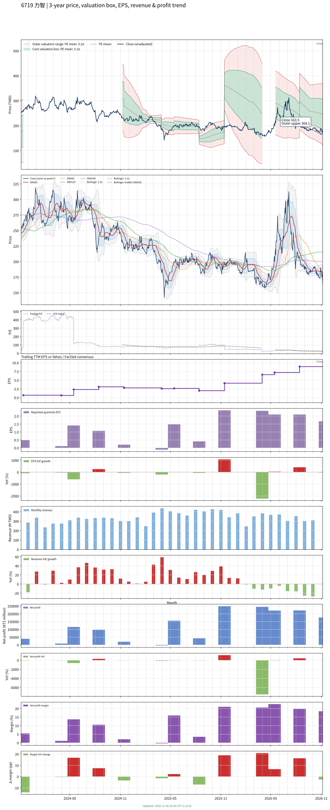

# 6719 - 力智

## 業務簡介
**板塊:** Technology
**產業:** Semiconductors
**市值:** 16,936 百萬台幣
**企業價值:** 5,436 百萬台幣

力智電子 (6719，uPI Semiconductor) 擁有逾 20 年類比電源與分離式元件設計經驗，為高效能[[電源管理 IC]]設計公司。核心產品涵蓋 [[PMIC]]、電源級元件、電池保護 IC、Power [[MOSFET]] 及  驅動解決方案，應用於高效能運算、顯示卡、電競筆電、車用及工業領域。

## 供應鏈位置
**上游 (晶圓代工):**
- **晶圓製造:** 台灣晶圓代工廠

**中游 (IC 設計):**
- **PMIC/[[MOSFET]]:** **力智** (電源管理 IC、[[MOSFET]]、GaN 驅動)

**下游 (HPC 與電競):**
- **顯示卡:** 顯示卡電源方案
- **電競筆電:** 電競筆電電源管理
- **車用/工業:** 車用及工業電源

## 主要客戶及供應商
### 主要客戶
- **顯示卡/電競:** 顯示卡及電競筆電品牌
- **車用/工業:** 車用及工業電源客戶

### 主要供應商
- **晶圓代工:** 台灣晶圓代工廠

### 競爭同業
- **競爭同業:** [[MPS]]、[[Renesas]]、[[Infineon]]

## 財務概況 (單位: 百萬台幣, 只有 Margin 為 %)
### 估值指標 (股價 $160.50 as of 2026-11-12 | TTM 截至 2026-06-30 | Forward 預估至 2026-12-31)
| P/E (TTM) | Forward P/E | P/S (TTM) |  P/B | EV/EBITDA |
|-----------|-------------|-----------|------|-----------|
|     20.98 |       16.63 |      3.78 | 1.20 |      6.57 |

### 年度關鍵財務數據 (近 3 年)
|                         |   2025-12-31 |   2024-12-31 |   2023-12-31 |
|:------------------------|-------------:|-------------:|-------------:|
| Revenue                 |      4581.28 |      3697.96 |      3037.38 |
| Gross Profit            |      1595.62 |      1119.42 |       834.68 |
| Gross Margin (%)        |        34.83 |        30.27 |        27.48 |
| Selling & Marketing Exp |       158.68 |       253.00 |       176.45 |
| R&D Exp                 |       565.90 |       523.27 |       495.22 |
| General & Admin Exp     |       203.24 |       208.73 |       193.70 |
| Operating Income        |       667.80 |       134.42 |       -30.69 |
| Operating Margin (%)    |        14.58 |         3.64 |        -1.01 |
| Net Income              |       692.69 |       229.99 |        50.59 |
| Net Margin (%)          |        15.12 |         6.22 |         1.67 |
| Op Cash Flow            |       971.92 |      1275.07 |        92.72 |
| Investing Cash Flow     |      -718.46 |     -7886.46 |     -1443.69 |
| Financing Cash Flow     |      -167.81 |      6733.05 |      -755.43 |
| CAPEX                   |       -78.91 |       -85.47 |       -77.81 |

### 季度關鍵財務數據 (近 4 季)
|                         |   2026-09-30 |   2026-06-30 |   2026-03-31 |   2025-12-31 |
|:------------------------|-------------:|-------------:|-------------:|-------------:|
| Revenue                 |       960.10 |      1121.64 |       979.14 |      1189.55 |
| Gross Profit            |       385.94 |       435.45 |       408.00 |       416.27 |
| Gross Margin (%)        |        40.20 |        38.82 |        41.67 |        34.99 |
| Selling & Marketing Exp |        38.28 |        39.56 |        37.31 |        41.22 |
| R&D Exp                 |       134.79 |       137.62 |       136.72 |       142.50 |
| General & Admin Exp     |        58.46 |        63.80 |        53.40 |        52.60 |
| Operating Income        |       154.41 |       194.48 |       180.57 |       179.95 |
| Operating Margin (%)    |        16.08 |        17.34 |        18.44 |        15.13 |
| Net Income              |       176.64 |       221.92 |       221.05 |       244.81 |
| Net Margin (%)          |        18.40 |        19.78 |        22.58 |        20.58 |
| Op Cash Flow            |       129.31 |       102.65 |        45.42 |       373.38 |
| Investing Cash Flow     |      1183.69 |      -405.93 |      -226.23 |      -455.80 |
| Financing Cash Flow     |      -487.18 |        -1.75 |        -2.08 |        -2.39 |
| CAPEX                   |       -12.51 |       -12.42 |       -18.84 |       -27.25 |
## Chart

