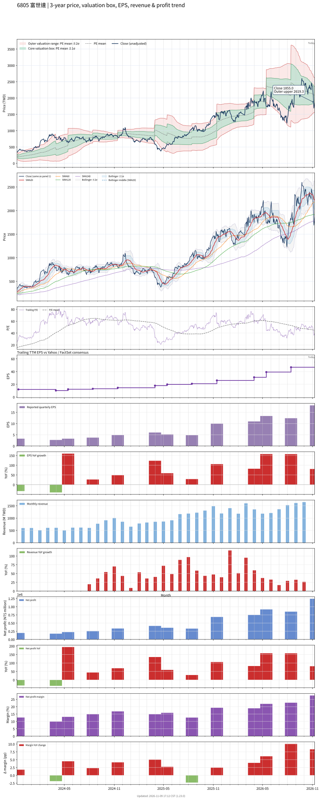

# 6805 - 富世達

## 業務簡介
**板塊:** Technology
**產業:** Computer Hardware
**市值:** 135,737 百萬台幣
**企業價值:** 127,793 百萬台幣

富世達股份有限公司 (6805，Fositek) 為  (3017) 旗下子公司，成立於 2001 年，總部位於新北市新莊區，專精於精密轉軸 (Hinge) 零組件之研發、製造及銷售。公司以筆電轉軸起家，後憑藉「水滴型轉軸」技術成功切入折疊手機市場，成為全球折疊手機轉軸核心供應商。

公司確立「折疊手機」與「」並進的雙引擎成長策略。第一成長曲線為折疊手機轉軸，獨攻[[華為]] Mate XT 全球首款三折機之轉軸，並供應 [[Motorola]] 折疊機。第二成長曲線藉助母公司  在 AI 供應鏈的完善布局，跨足 AI 與通用伺服器滑軌市場。筆電轉軸客戶涵蓋 、、 等國際品牌。

## 供應鏈位置
**上游 (精密金屬材料):**
- **特殊鋼材:** 不鏽鋼板材、碳鋼及特殊合金捲料
- **精密零件:** 精密彈簧、軸承、潤滑劑及表面處理材料
- **CNC 設備:** 精密 CNC 加工設備

**中游 (精密轉軸製造):**
- **折疊手機轉軸:** **富世達** (水滴型轉軸技術，三折/雙折機轉軸)
- **筆電轉軸:** **富世達** (超薄/電競筆電轉軸)
- **伺服器滑軌:** **富世達** (AI/通用伺服器機架滑軌)

**下游 (終端品牌客戶):**
- **折疊手機:** [[華為]] — 全球首款三折機 Mate XT 獨家轉軸供應
- **折疊手機:** [[Motorola]] — 折疊機轉軸供應
- **筆電品牌:** 、、 — 筆電轉軸
- **母集團:**  (3017) — AI 伺服器散熱/滑軌協同

## 主要客戶及供應商
### 主要客戶
- **折疊手機:** [[華為]] — Mate XT 三折機獨家轉軸供應商
- **折疊手機:** [[Motorola]] — 折疊機轉軸供應
- **筆電品牌:** 、、 — 筆電轉軸 OEM
- **伺服器:** AI/通用伺服器機架滑軌客戶

### 主要供應商
- **母集團:**  (3017) — AI 供應鏈策略協同
- **特殊鋼材:** 精密合金鋼材冶煉供應商
- **精密加工:** CNC 精密切削及表面處理廠商

## 財務概況 (單位: 百萬台幣, 只有 Margin 為 %)
### 估值指標 (股價 $1,980.00 as of 2026-11-12 | TTM 截至 2026-09-30 | Forward 預估至 2026-12-31)
| P/E (TTM) | Forward P/E | P/S (TTM) |   P/B | EV/EBITDA |
|-----------|-------------|-----------|-------|-----------|
|     37.41 |       18.23 |      8.28 | 14.03 |     26.64 |

### 年度關鍵財務數據 (近 3 年)
|                         |   2025-12-31 |   2024-12-31 |   2023-12-31 |
|:------------------------|-------------:|-------------:|-------------:|
| Revenue                 |     12413.93 |      8187.69 |      5643.89 |
| Gross Profit            |      3270.37 |      1826.94 |      1317.81 |
| Gross Margin (%)        |        26.34 |        22.31 |        23.35 |
| Selling & Marketing Exp |        23.80 |        32.03 |        39.83 |
| R&D Exp                 |       571.51 |       444.76 |       275.96 |
| General & Admin Exp     |       163.62 |       147.91 |       110.86 |
| Operating Income        |      2511.43 |      1202.23 |       891.16 |
| Operating Margin (%)    |        20.23 |        14.68 |        15.79 |
| Net Income              |      2125.30 |      1227.36 |       627.96 |
| Net Margin (%)          |        17.12 |        14.99 |        11.13 |
| Op Cash Flow            |      1971.35 |      1408.98 |      1218.42 |
| Investing Cash Flow     |      -362.24 |      -663.61 |      -182.44 |
| Financing Cash Flow     |      -603.37 |      -421.61 |      1070.72 |
| CAPEX                   |      -329.73 |      -551.93 |      -198.97 |

### 季度關鍵財務數據 (近 4 季)
|                         |   2026-09-30 |   2026-06-30 |   2026-03-31 |   2025-12-31 |
|:------------------------|-------------:|-------------:|-------------:|-------------:|
| Revenue                 |      4501.65 |      3739.74 |      4183.85 |      3976.15 |
| Gross Profit            |      1711.87 |      1273.20 |      1351.84 |      1154.91 |
| Gross Margin (%)        |        38.03 |        34.05 |        32.31 |        29.05 |
| Selling & Marketing Exp |         5.04 |         5.64 |         6.47 |         7.38 |
| R&D Exp                 |       172.73 |       174.53 |       170.91 |       224.24 |
| General & Admin Exp     |        71.76 |        52.74 |        51.17 |        58.52 |
| Operating Income        |      1462.35 |      1040.30 |      1123.29 |       864.77 |
| Operating Margin (%)    |        32.48 |        27.82 |        26.85 |        21.75 |
| Net Income              |      1242.03 |       849.14 |       917.26 |       751.50 |
| Net Margin (%)          |        27.59 |        22.71 |        21.92 |        18.90 |
| Op Cash Flow            |        79.08 |      1583.66 |       562.76 |      1395.22 |
| Investing Cash Flow     |      -229.64 |      -162.01 |      -157.33 |       -78.96 |
| Financing Cash Flow     |      -298.95 |        -8.71 |       -24.97 |       -13.12 |
| CAPEX                   |       -41.08 |       -21.92 |      -129.66 |       -60.12 |
## Chart

