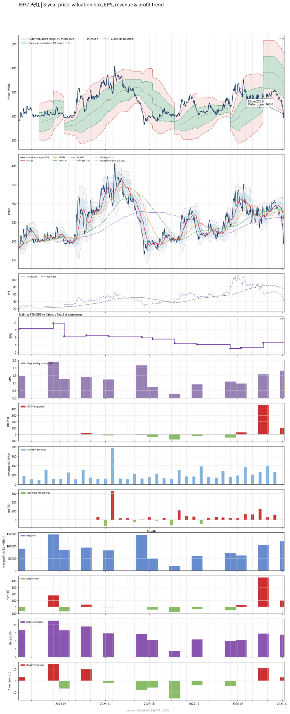

# 6937_天虹

## 業務簡介
**板塊:** Technology
**產業:** Semiconductors
**市值:** 14,777 百萬台幣
**企業價值:** 12,606 百萬台幣

天虹科技 (6937，Skytech) 為台灣本土半導體設備製造商，核心產品為 Nexda 系列 [[PVD]] (物理氣相沉積) 濺鍍設備，另提供 [[ALD]] (原子層沉積) 設備、Bonder/De-bonder 接合設備、Descum/Plasma Polish 設備及客製化零組件。公司從半導體零組件加工轉型為設備製造，並已進入  供應鏈。

## 供應鏈位置
**上游 (零組件):**
- **靶材:** PVD 濺鍍用靶材
- **精密機構:** 真空腔體及機構件

**中游 (設備製造):**
- **PVD/ALD 設備:** **天虹** (Nexda 系列 PVD 濺鍍、ALD 設備)

**下游 (半導體製造):**
- **晶圓廠:** 半導體晶圓廠
- **供應鏈:**  供應鏈

## 主要客戶及供應商
### 主要客戶
- **晶圓廠:** 半導體晶圓廠 (PVD/ALD 設備)
- **供應鏈:**  供應鏈

### 主要供應商
- **靶材:** PVD 濺鍍靶材供應

### 競爭同業
- **競爭同業:** 、[[Lam Research]]、[[Tokyo Electron]]

## 財務概況 (單位: 百萬台幣, 只有 Margin 為 %)
### 估值指標 (股價 $219.00 as of 2026-11-12 | TTM 截至 2026-06-30 | Forward 預估至 2026-12-31)
| P/E (TTM) | Forward P/E | P/S (TTM) |  P/B | EV/EBITDA |
|-----------|-------------|-----------|------|-----------|
|     39.32 |       40.33 |      5.75 | 4.28 |     32.26 |

### 年度關鍵財務數據 (近 3 年)
|                         |   2025-12-31 |   2024-12-31 |   2023-12-31 |
|:------------------------|-------------:|-------------:|-------------:|
| Revenue                 |      2244.65 |      2587.64 |      1992.64 |
| Gross Profit            |       899.94 |      1137.58 |       877.14 |
| Gross Margin (%)        |        40.09 |        43.96 |        44.02 |
| Selling & Marketing Exp |       192.24 |       233.57 |       159.26 |
| R&D Exp                 |       254.53 |       273.32 |       202.40 |
| General & Admin Exp     |       255.17 |       221.54 |       193.61 |
| Operating Income        |       198.01 |       409.14 |       321.88 |
| Operating Margin (%)    |         8.82 |        15.81 |        16.15 |
| Net Income              |       202.79 |       406.80 |       306.66 |
| Net Margin (%)          |         9.03 |        15.72 |        15.39 |
| Op Cash Flow            |        37.64 |       225.44 |        45.49 |
| Investing Cash Flow     |       193.10 |      -341.83 |      -706.43 |
| Financing Cash Flow     |       -53.54 |      -452.46 |      1113.32 |
| CAPEX                   |      -109.33 |       -84.88 |      -500.02 |

### 季度關鍵財務數據 (近 4 季)
|                         |   2026-09-30 |   2026-06-30 |   2026-03-31 |   2025-12-31 |
|:------------------------|-------------:|-------------:|-------------:|-------------:|
| Revenue                 |       862.91 |       718.42 |       582.45 |       721.66 |
| Gross Profit            |       371.20 |       299.24 |       243.29 |       305.22 |
| Gross Margin (%)        |        43.02 |        41.65 |        41.77 |        42.29 |
| Selling & Marketing Exp |        65.43 |        45.49 |        53.40 |        50.93 |
| R&D Exp                 |        83.99 |        72.22 |        55.60 |        78.76 |
| General & Admin Exp     |        74.00 |        65.93 |        58.56 |        67.29 |
| Operating Income        |       147.78 |       115.61 |        75.74 |       108.24 |
| Operating Margin (%)    |        17.13 |        16.09 |        13.00 |        15.00 |
| Net Income              |       121.53 |       106.17 |        64.82 |        73.11 |
| Net Margin (%)          |        14.08 |        14.78 |        11.13 |        10.13 |
| Op Cash Flow            |        76.25 |       223.96 |      -103.00 |        95.01 |
| Investing Cash Flow     |        27.84 |       -53.46 |         4.29 |       -52.98 |
| Financing Cash Flow     |      -339.97 |       477.20 |       -44.66 |        93.53 |
| CAPEX                   |       -16.67 |       -10.17 |        -5.87 |       -24.66 |
## Chart

