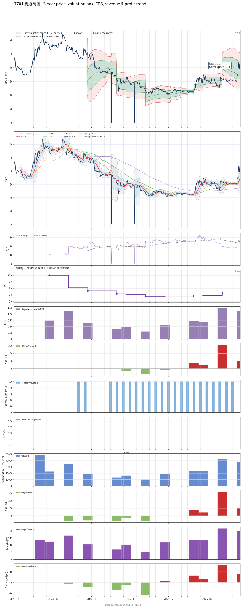

# 7704 - 明遠精密

## 業務簡介
**板塊:** Industrials
**產業:** Electrical Equipment & Parts
**市值:** 2,594 百萬台幣
**企業價值:** 1,985 百萬台幣

明遠精密 (7704) 自主研發半導體RPS電漿源/AOS臭氧系統。與[[京三製作所]]合作ACME射頻電源，被  列為全廠標配。[[日揚科技]]董事長為大股東。

## 供應鏈位置
**上游:** 電源模組/石英陶瓷/RF零組件
**中游:** **明遠** (RPS/AOS/ACME)
**下游:**  — 標配; 、[[Tokyo Electron]]

## 主要客戶及供應商
### 主要客戶
-  — ACME標配
- 、[[Tokyo Electron]]

### 主要供應商
- [[京三製作所]]; [[日揚科技]]

## 財務概況 (單位: 百萬台幣, 只有 Margin 為 %)
### 估值指標 (股價 $76.80 as of 2026-11-12 | TTM 截至 2026-09-30 | Forward 預估至 2026-12-31)
| P/E (TTM) | Forward P/E | P/S (TTM) |  P/B | EV/EBITDA |
|-----------|-------------|-----------|------|-----------|
|     22.07 |         N/A |      3.56 | 2.14 |     13.41 |

### 年度關鍵財務數據 (近 3 年)
|                         |   2025-12-31 |   2024-12-31 |   2023-12-31 |
|:------------------------|-------------:|-------------:|-------------:|
| Revenue                 |       671.07 |       760.26 |       727.75 |
| Gross Profit            |       221.54 |       269.87 |       285.47 |
| Gross Margin (%)        |        33.01 |        35.50 |        39.23 |
| Selling & Marketing Exp |        40.14 |        42.83 |        46.14 |
| R&D Exp                 |        42.53 |        46.57 |        36.58 |
| General & Admin Exp     |        65.19 |        81.72 |        78.71 |
| Operating Income        |        73.68 |        98.76 |       124.11 |
| Operating Margin (%)    |        10.98 |        12.99 |        17.05 |
| Net Income              |        69.51 |        89.55 |       102.92 |
| Net Margin (%)          |        10.36 |        11.78 |        14.14 |
| Op Cash Flow            |        94.64 |       101.29 |       107.92 |
| Investing Cash Flow     |      -170.00 |       -23.29 |       -10.57 |
| Financing Cash Flow     |       -92.01 |       142.88 |       -39.85 |
| CAPEX                   |       -26.73 |       -29.76 |       -20.58 |

### 季度關鍵財務數據 (近 4 季)
|                         |   2026-09-30 |   2026-06-30 |   2026-03-31 |   2025-12-31 |
|:------------------------|-------------:|-------------:|-------------:|-------------:|
| Revenue                 |       189.50 |       194.60 |       174.54 |       169.22 |
| Gross Profit            |        84.38 |        80.31 |        60.67 |        59.91 |
| Gross Margin (%)        |        44.53 |        41.27 |        34.76 |        35.40 |
| Selling & Marketing Exp |        10.87 |        10.37 |         9.09 |        10.23 |
| R&D Exp                 |        11.93 |        10.58 |         9.25 |        10.18 |
| General & Admin Exp     |        18.00 |        17.70 |        15.69 |        16.90 |
| Operating Income        |        43.58 |        41.66 |        26.64 |        22.60 |
| Operating Margin (%)    |        23.00 |        21.41 |        15.26 |        13.35 |
| Net Income              |        37.72 |        41.95 |        23.73 |        24.25 |
| Net Margin (%)          |        19.90 |        21.56 |        13.59 |        14.33 |
| Op Cash Flow            |        47.87 |        57.49 |        39.03 |        55.12 |
| Investing Cash Flow     |       -87.68 |       -13.76 |        66.95 |       -36.79 |
| Financing Cash Flow     |        -2.21 |       -62.94 |        -3.54 |         1.42 |
| CAPEX                   |       -16.16 |        -3.76 |        -3.05 |         6.84 |
## Chart

