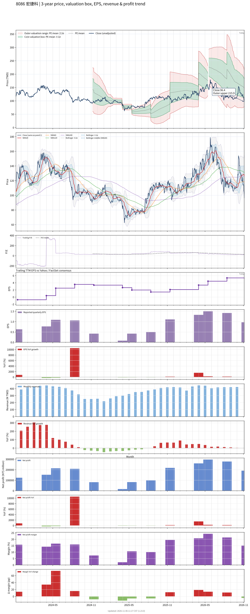

# 8086 - 宏捷科

## 業務簡介
**板塊:** Technology
**產業:** Semiconductors
**市值:** 20,241 百萬台幣
**企業價值:** 20,317 百萬台幣

宏捷科技 (8086，AWSC) 為全球第二大[[砷化鎵]] (GaAs) [[晶圓代工]]廠，市占率約 24%。專注於 6 吋 GaAs [[HBT]]、pHEMT 及 BiHEMT 製程代工，產品應用於 [[Wi-Fi]] 及智慧型手機射頻元件 ([[PA]] 功率放大器、Switch 及 LNA) 及 [[3D 感測]] 。最大客戶 [[Skyworks]] 貢獻約 56% 營收。

## 供應鏈位置
**上游 (磊晶材料):**
- **GaAs 磊晶:** [[全新光電]] (GaAs 磊晶片供應)

**中游 (晶圓代工):**
- **GaAs 代工:** **宏捷科** (全球第二大 GaAs 晶圓代工，市占 24%)

**下游 (RF IC 設計):**
- **RF IC:** [[Skyworks]] (占營收 56%)、、[[紫光展銳]]

## 主要客戶及供應商
### 主要客戶
- **RF IC:** [[Skyworks]] (占營收 56%)
- **台灣 RF:** 
- **中國 RF:** [[紫光展銳]]

### 主要供應商
- **GaAs 磊晶:** [[全新光電]]

### 競爭同業
- **競爭同業:**  (全球最大 GaAs 代工)

## 財務概況 (單位: 百萬台幣, 只有 Margin 為 %)
### 估值指標 (股價 $103.00 as of 2026-11-13 | TTM 截至 2026-09-30 | Forward 預估至 2026-12-31)
| P/E (TTM) | Forward P/E | P/S (TTM) |  P/B | EV/EBITDA |
|-----------|-------------|-----------|------|-----------|
|     19.22 |       18.02 |      4.02 | 2.34 |     11.13 |

### 年度關鍵財務數據 (近 3 年)
|                         |   2025-12-31 |   2024-12-31 |   2023-12-31 |
|:------------------------|-------------:|-------------:|-------------:|
| Revenue                 |      4116.53 |      4455.58 |      2723.10 |
| Gross Profit            |      1089.91 |       885.09 |       414.73 |
| Gross Margin (%)        |        26.48 |        19.86 |        15.23 |
| Selling & Marketing Exp |        27.16 |        26.23 |        19.59 |
| R&D Exp                 |       195.02 |       202.53 |       219.63 |
| General & Admin Exp     |       129.84 |       131.18 |       105.91 |
| Operating Income        |       737.88 |       525.15 |        69.60 |
| Operating Margin (%)    |        17.92 |        11.79 |         2.56 |
| Net Income              |       660.15 |       520.92 |        82.73 |
| Net Margin (%)          |        16.04 |        11.69 |         3.04 |
| Op Cash Flow            |      1307.99 |      1248.67 |       136.59 |
| Investing Cash Flow     |      -707.51 |      -820.70 |      -498.02 |
| Financing Cash Flow     |        23.76 |       419.07 |       427.25 |
| CAPEX                   |      -249.09 |      -877.70 |      -504.59 |

### 季度關鍵財務數據 (近 4 季)
|                         |   2026-09-30 |   2026-06-30 |   2026-03-31 |   2025-12-31 |
|:------------------------|-------------:|-------------:|-------------:|-------------:|
| Revenue                 |      1261.92 |      1298.44 |      1222.32 |      1253.17 |
| Gross Profit            |       306.73 |       389.26 |       423.30 |       381.42 |
| Gross Margin (%)        |        24.31 |        29.98 |        34.63 |        30.44 |
| Selling & Marketing Exp |         6.24 |         7.91 |         9.27 |         8.31 |
| R&D Exp                 |        66.73 |        65.58 |        53.49 |        55.95 |
| General & Admin Exp     |        24.30 |        26.23 |        26.19 |        38.67 |
| Operating Income        |       209.46 |       289.54 |       334.35 |       278.49 |
| Operating Margin (%)    |        16.60 |        22.30 |        27.35 |        22.22 |
| Net Income              |       191.40 |       278.38 |       296.86 |       260.72 |
| Net Margin (%)          |        15.17 |        21.44 |        24.29 |        20.81 |
| Op Cash Flow            |       275.08 |       198.46 |       546.32 |       288.26 |
| Investing Cash Flow     |        11.51 |      -363.35 |     -2207.01 |       634.41 |
| Financing Cash Flow     |      -565.01 |      -333.47 |       -83.89 |        83.22 |
| CAPEX                   |      -101.67 |      -121.26 |      -108.72 |      -103.57 |
## Chart

