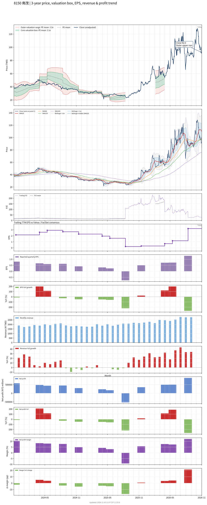

# 8150 - 南茂

## 業務簡介
**板塊:** Technology
**產業:** Semiconductors
**市值:** 58,763 百萬台幣
**企業價值:** 63,228 百萬台幣

南茂科技 (8150，南茂) 為全球前十大獨立半導體封測廠，提供記憶體、[[LCD]] 驅動 IC 及混合訊號 IC 之完整後段[[封裝測試]]服務。記憶體業務占營收約 49%，驅動 IC 封測為另一核心。公司於台灣 (8150) 及 [[NASDAQ]] (IMOS) 雙重掛牌。

## 供應鏈位置
**上游 (封裝材料):**
- **導線架/基板:** 封裝材料供應
- **金線:** 鍵合線材

**中游 (封裝測試):**
- **IC 封測:** **南茂** (全球前十大獨立封測，記憶體/驅動 IC，NASDAQ 雙掛牌)

**下游 (IC 設計):**
- **驅動 IC:**  (占營收約 19%)
- **記憶體:**  (占約 15%)
- **驅動 IC:** [[奇景光電]] (占約 6.6%)

## 主要客戶及供應商
### 主要客戶
- **驅動 IC:**  (營收占比 19%)、[[奇景光電]] (6.6%)
- **記憶體:**  (營收占比 15%)

### 主要供應商
- **封裝材料:** 導線架/基板供應

### 競爭同業
- **競爭同業:** 、、

## 財務概況 (單位: 百萬台幣, 只有 Margin 為 %)
### 估值指標 (股價 $84.50 as of 2026-11-13 | TTM 截至 2026-09-30 | Forward 預估至 2026-12-31)
| P/E (TTM) | Forward P/E | P/S (TTM) |  P/B | EV/EBITDA |
|-----------|-------------|-----------|------|-----------|
|     17.98 |       13.42 |      2.01 | 2.27 |      7.49 |

### 年度關鍵財務數據 (近 3 年)
|                         |   2025-12-31 |   2024-12-31 |   2023-12-31 |
|:------------------------|-------------:|-------------:|-------------:|
| Revenue                 |     23932.90 |     22695.91 |     21356.23 |
| Gross Profit            |      2538.93 |      2887.14 |      3549.43 |
| Gross Margin (%)        |        10.61 |        12.72 |        16.62 |
| Selling & Marketing Exp |       119.80 |       128.73 |       135.66 |
| R&D Exp                 |      1077.02 |      1162.77 |      1093.51 |
| General & Admin Exp     |       491.70 |       478.55 |       497.74 |
| Operating Income        |      1142.69 |      1273.94 |      1908.45 |
| Operating Margin (%)    |         4.77 |         5.61 |         8.94 |
| Net Income              |       550.63 |      1439.54 |      1967.57 |
| Net Margin (%)          |         2.30 |         6.34 |         9.21 |
| Op Cash Flow            |      3996.44 |      5940.58 |      6607.48 |
| Investing Cash Flow     |     -3739.49 |      -615.11 |     -3090.18 |
| Financing Cash Flow     |      -607.19 |     -2475.39 |     -1059.09 |
| CAPEX                   |     -3851.24 |     -5081.15 |     -3073.88 |

### 季度關鍵財務數據 (近 4 季)
|                         |   2026-09-30 |   2026-06-30 |   2026-03-31 |   2025-12-31 |
|:------------------------|-------------:|-------------:|-------------:|-------------:|
| Revenue                 |      8400.76 |      7383.10 |      6935.63 |      6521.08 |
| Gross Profit            |      1820.46 |      1325.60 |       955.47 |       882.00 |
| Gross Margin (%)        |        21.67 |        17.95 |        13.78 |        13.53 |
| Selling & Marketing Exp |        33.77 |       -    |        29.27 |        32.55 |
| R&D Exp                 |       351.37 |       -    |       291.52 |       284.28 |
| General & Admin Exp     |       151.41 |       -    |       130.97 |       125.86 |
| Operating Income        |      1657.35 |       948.00 |       519.68 |       635.56 |
| Operating Margin (%)    |        19.73 |        12.84 |         7.49 |         9.75 |
| Net Income              |      1323.35 |       891.70 |       504.89 |       555.19 |
| Net Margin (%)          |        15.75 |        12.08 |         7.28 |         8.51 |
| Op Cash Flow            |      1186.61 |      1203.99 |       327.71 |      1890.74 |
| Investing Cash Flow     |      -929.56 |      -974.19 |     -2235.41 |      -777.79 |
| Financing Cash Flow     |     -2883.74 |       -63.41 |      -569.29 |       761.31 |
| CAPEX                   |     -4690.08 |      1384.44 |     -1384.44 |     -3851.24 |
## Chart

