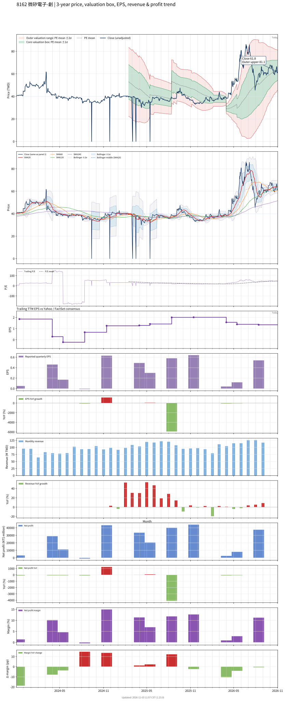

# 8162 - 微矽電子-創

## 業務簡介
**板塊:** Technology
**產業:** Semiconductors
**市值:** 3,641 百萬台幣
**企業價值:** 4,012 百萬台幣

微矽電子 (8162) 深耕半導體後段服務逾 38 年，為國內[[電源管理 IC]]、[[MOSFET]] 及  晶圓測試最大供應商，以「晶圓廠內部實驗室」創新模式與知名晶圓代工廠合作。提供功率半導體晶圓測試、晶圓薄化及封裝一站式整合服務，自行研發高壓高電流[[探針卡]]及測試治具，已通過國際車用大廠認證。

## 供應鏈位置
**上游 (測試設備):**
- **探針卡:** 自行研發高壓高電流探針卡
- **測試機台:** 測試設備

**中游 (晶圓測試):**
- **功率元件測試:** **微矽** (電源 IC/[[MOSFET]]/GaN 晶圓測試最大供應商)

**下游 (晶圓代工):**
- **晶圓代工:** 、 (功率半導體晶圓代工)
- **IC 設計:** 電源管理 IC 設計公司

## 主要客戶及供應商
### 主要客戶
- **晶圓代工:** 、
- **IC 設計:** 電源管理 IC 設計公司

### 主要供應商
- **探針卡:** 自行研發

### 競爭同業
- **競爭同業:** 、

## 財務概況 (單位: 百萬台幣, 只有 Margin 為 %)
### 估值指標 (股價 $53.00 as of 2026-11-12 | TTM 截至 2026-09-30 | Forward 預估至 2026-12-31)
| P/E (TTM) | Forward P/E | P/S (TTM) |  P/B | EV/EBITDA |
|-----------|-------------|-----------|------|-----------|
|     40.77 |         N/A |      2.86 | 2.45 |     10.46 |

### 年度關鍵財務數據 (近 3 年)
|                         |   2025-12-31 |   2024-12-31 |   2023-12-31 |
|:------------------------|-------------:|-------------:|-------------:|
| Revenue                 |      1274.77 |      1064.15 |       904.88 |
| Gross Profit            |       321.19 |       212.37 |       125.13 |
| Gross Margin (%)        |        25.20 |        19.96 |        13.83 |
| Selling & Marketing Exp |        17.85 |        16.96 |        13.43 |
| R&D Exp                 |        68.76 |        67.67 |        64.64 |
| General & Admin Exp     |       104.95 |        94.66 |        87.04 |
| Operating Income        |       129.63 |        33.07 |       -39.98 |
| Operating Margin (%)    |        10.17 |         3.11 |        -4.42 |
| Net Income              |       107.54 |        87.14 |       -26.28 |
| Net Margin (%)          |         8.44 |         8.19 |        -2.90 |
| Op Cash Flow            |       405.94 |       325.56 |       261.83 |
| Investing Cash Flow     |      -523.34 |      -345.09 |      -406.75 |
| Financing Cash Flow     |        83.30 |        84.07 |        74.12 |
| CAPEX                   |      -490.20 |      -375.77 |      -406.65 |

### 季度關鍵財務數據 (近 4 季)
|                         |   2026-09-30 |   2026-06-30 |   2026-03-31 |   2025-12-31 |
|:------------------------|-------------:|-------------:|-------------:|-------------:|
| Revenue                 |       369.28 |       333.51 |       283.36 |       288.12 |
| Gross Profit            |       113.07 |        75.47 |        49.51 |        48.22 |
| Gross Margin (%)        |        30.62 |        22.63 |        17.47 |        16.73 |
| Selling & Marketing Exp |         4.78 |         4.55 |         4.54 |         4.70 |
| R&D Exp                 |        15.81 |        14.93 |        15.69 |        17.04 |
| General & Admin Exp     |        33.88 |        23.01 |        21.18 |        26.39 |
| Operating Income        |        58.60 |        32.99 |         8.09 |         0.09 |
| Operating Margin (%)    |        15.87 |         9.89 |         2.85 |         0.03 |
| Net Income              |        47.78 |        37.44 |         8.00 |         2.63 |
| Net Margin (%)          |        12.94 |        11.23 |         2.82 |         0.91 |
| Op Cash Flow            |        54.71 |        92.32 |        89.19 |       133.82 |
| Investing Cash Flow     |       -96.39 |       -95.32 |       -72.19 |       -82.96 |
| Financing Cash Flow     |         8.83 |         9.28 |       -30.72 |       -30.65 |
| CAPEX                   |       -98.37 |       -99.83 |       -73.83 |       -79.12 |
## Chart

