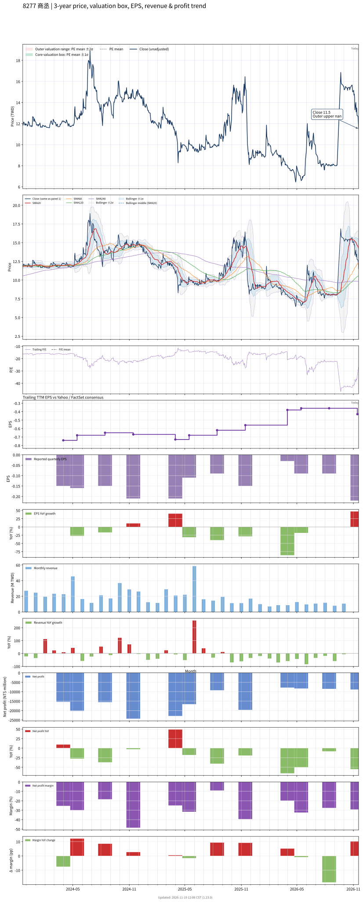

# 8277 - 商丞

## 業務簡介
**板塊:** Technology
**產業:** Semiconductors
**市值:** 179 百萬台幣
**企業價值:** 300 百萬台幣

商丞科技 (8277) 為記憶體模組 [[ODM]] 廠商，主要從事  記憶體模組及儲存產品之設計製造代工服務，服務品牌廠商及系統整合商。

## 供應鏈位置
**上游 (記憶體原廠):**
- **DRAM 顆粒:** 、[[SK Hynix]]、

**中游 (模組代工):**
- **記憶體模組 ODM:** **商丞** (DRAM 模組設計製造代工)

**下游 (品牌與系統):**
- **品牌客戶:** 記憶體品牌廠
- **系統整合:** 系統整合商

## 主要客戶及供應商
### 主要客戶
- **品牌客戶:** 記憶體品牌廠
- **系統整合:** 系統整合商

### 主要供應商
- **DRAM 顆粒:** 、[[SK Hynix]]、

### 競爭同業
- **競爭同業:** 、

## 財務概況 (單位: 百萬台幣, 只有 Margin 為 %)
### 估值指標 (股價 $10.50 as of 2026-11-24 | TTM 截至 2026-09-30 | Forward 預估至 2026-12-31)
| P/E (TTM) | Forward P/E | P/S (TTM) |  P/B | EV/EBITDA |
|-----------|-------------|-----------|------|-----------|
|       N/A |         N/A |      1.42 | 0.92 |     -5.95 |

### 年度關鍵財務數據 (近 3 年)
|                         |   2025-12-31 |   2024-12-31 |   2023-12-31 |
|:------------------------|-------------:|-------------:|-------------:|
| Revenue                 |       243.80 |       293.68 |       267.15 |
| Gross Profit            |        77.97 |        71.96 |        44.13 |
| Gross Margin (%)        |        31.98 |        24.50 |        16.52 |
| Selling & Marketing Exp |        29.68 |        30.78 |        25.06 |
| R&D Exp                 |        46.26 |        43.33 |        46.05 |
| General & Admin Exp     |        72.39 |        62.69 |        59.66 |
| Operating Income        |       -70.36 |       -64.84 |       -86.63 |
| Operating Margin (%)    |       -28.86 |       -22.08 |       -32.43 |
| Net Income              |       -33.74 |       -66.42 |       -67.43 |
| Net Margin (%)          |       -13.84 |       -22.62 |       -25.24 |
| Op Cash Flow            |        16.14 |       -21.97 |       -57.20 |
| Investing Cash Flow     |      -103.65 |        14.23 |       -22.21 |
| Financing Cash Flow     |        -4.42 |        17.18 |        26.67 |
| CAPEX                   |        -4.33 |        -0.10 |        -1.24 |

### 季度關鍵財務數據 (近 4 季)
|                         |   2026-09-30 |   2026-06-30 |   2026-03-31 |   2025-12-31 |
|:------------------------|-------------:|-------------:|-------------:|-------------:|
| Revenue                 |        30.27 |        30.81 |        25.58 |        39.45 |
| Gross Profit            |         8.85 |        10.52 |         8.64 |        17.73 |
| Gross Margin (%)        |        29.23 |        34.14 |        33.77 |        44.94 |
| Selling & Marketing Exp |         2.08 |         2.19 |         2.51 |         7.87 |
| R&D Exp                 |         3.15 |         4.17 |         3.37 |        10.59 |
| General & Admin Exp     |        12.47 |        13.06 |        10.07 |        25.36 |
| Operating Income        |        -8.85 |        -8.90 |        -7.32 |       -26.10 |
| Operating Margin (%)    |       -29.23 |       -28.88 |       -28.61 |       -66.15 |
| Net Income              |        -8.82 |        -8.48 |        -8.29 |        -2.61 |
| Net Margin (%)          |       -29.15 |       -27.53 |       -32.42 |        -6.62 |
| Op Cash Flow            |        -6.23 |        -3.62 |       -11.42 |        29.08 |
| Investing Cash Flow     |       -63.94 |        32.05 |        20.27 |       -69.09 |
| Financing Cash Flow     |        -0.21 |        -0.19 |        -0.19 |        -0.72 |
| CAPEX                   |        -4.87 |        -8.09 |        -0.47 |        -1.77 |
## Chart

