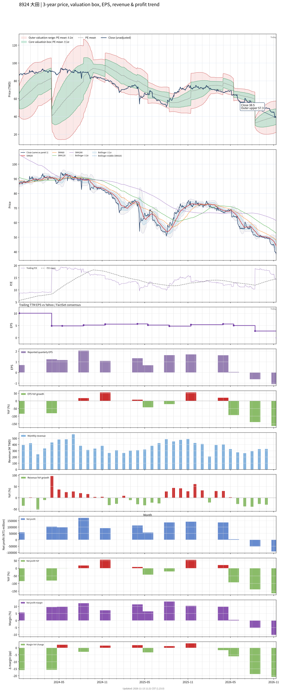

# 8924 - 大田

## 業務簡介
**板塊:** Consumer Cyclical
**產業:** Leisure
**市值:** 3,314 百萬台幣
**企業價值:** 1,963 百萬台幣

大田精密工業股份有限公司 (8924，O-TA Precision) 成立於 1988 年，專精於高爾夫球桿頭之精密鑄造與鍛造製造，為全球主要高爾夫球桿頭代工廠之一。核心技術涵蓋失蠟精密鑄造、鍛造及[[碳纖維]]複合材料加工。主要客戶為全球頂級高爾夫球品牌，包括[[Callaway]]、[[TaylorMade]]、[[Titleist]]等。近年亦將精密鑄造技術延伸至自行車零組件及水暖五金零件領域，並投入碳纖維複合材料產品開發。

## 供應鏈位置
**上游 (金屬材料):**
- **特殊合金:** 鈦合金、不鏽鋼、碳鋼等鑄造用金屬
- **[[碳纖維]]:** 碳纖維複合材料
- **鑄造材料:** 蠟模、陶殼等精密鑄造耗材

**中游 (精密鑄造與鍛造):**
- **大田精密** — 高爾夫球桿頭失蠟精密鑄造、鍛造加工及碳纖維複合材料加工

**下游 (國際高爾夫品牌):**
- **高爾夫:** [[Callaway]]、[[TaylorMade]]、[[Titleist]] — 球桿頭代工
- **自行車:** 碳纖維自行車零組件
- **五金:** 水暖五金零件

## 主要客戶及供應商
### 主要客戶
- **高爾夫球品牌:** [[Callaway]]、[[TaylorMade]]、[[Titleist]] — 球桿頭精密鑄造代工
- **自行車:** 碳纖維自行車零組件客戶
- **五金:** 水暖五金零件客戶

### 主要供應商
- **鈦合金:** 國際鈦合金供應商
- **不鏽鋼:** 特殊合金鋼材供應商
- **[[碳纖維]]:** 碳纖維原料供應商

## 財務概況 (單位: 百萬台幣, 只有 Margin 為 %)
### 估值指標 (股價 $39.55 as of 2026-11-12 | TTM 截至 2026-09-30 | Forward 預估至 2026-12-31)
| P/E (TTM) | Forward P/E | P/S (TTM) |  P/B | EV/EBITDA |
|-----------|-------------|-----------|------|-----------|
|       N/A |        6.14 |      0.77 | 0.86 |      7.66 |

### 年度關鍵財務數據 (近 3 年)
|                         |   2025-12-31 |   2024-12-31 |   2023-12-31 |
|:------------------------|-------------:|-------------:|-------------:|
| Revenue                 |      4632.26 |      4637.47 |      4367.64 |
| Gross Profit            |       855.15 |       738.63 |       724.09 |
| Gross Margin (%)        |        18.46 |        15.93 |        16.58 |
| Selling & Marketing Exp |        83.68 |        77.70 |        76.10 |
| R&D Exp                 |        27.72 |        25.11 |        25.90 |
| General & Admin Exp     |       285.95 |       235.97 |       237.96 |
| Operating Income        |       457.80 |       399.84 |       384.13 |
| Operating Margin (%)    |         9.88 |         8.62 |         8.79 |
| Net Income              |       472.15 |       474.28 |       406.52 |
| Net Margin (%)          |        10.19 |        10.23 |         9.31 |
| Op Cash Flow            |       317.59 |       691.02 |      1097.28 |
| Investing Cash Flow     |      -501.16 |      -257.58 |      -284.52 |
| Financing Cash Flow     |       -72.12 |      -527.37 |     -1116.49 |
| CAPEX                   |      -555.51 |      -257.52 |      -271.45 |

### 季度關鍵財務數據 (近 4 季)
|                         |   2026-09-30 |   2026-06-30 |   2026-03-31 |   2025-12-31 |
|:------------------------|-------------:|-------------:|-------------:|-------------:|
| Revenue                 |       881.40 |      1004.84 |      1011.22 |      1388.33 |
| Gross Profit            |        31.80 |        57.09 |       116.30 |       278.27 |
| Gross Margin (%)        |         3.61 |         5.68 |        11.50 |        20.04 |
| Selling & Marketing Exp |        18.80 |        18.50 |        18.01 |        23.50 |
| R&D Exp                 |         5.13 |         5.43 |         5.34 |         8.43 |
| General & Admin Exp     |        63.88 |        72.74 |        63.68 |        69.83 |
| Operating Income        |       -56.01 |       -39.58 |        29.27 |       176.52 |
| Operating Margin (%)    |        -6.35 |        -3.94 |         2.89 |        12.71 |
| Net Income              |       -91.43 |       -52.77 |         4.36 |       136.35 |
| Net Margin (%)          |       -10.37 |        -5.25 |         0.43 |         9.82 |
| Op Cash Flow            |       -62.95 |       102.30 |       120.63 |       126.53 |
| Investing Cash Flow     |      -112.15 |       -52.32 |       -87.41 |       -65.25 |
| Financing Cash Flow     |       160.56 |      -124.33 |       -11.06 |      -253.87 |
| CAPEX                   |       -80.30 |       -23.93 |       -76.18 |      -153.00 |
## Chart

